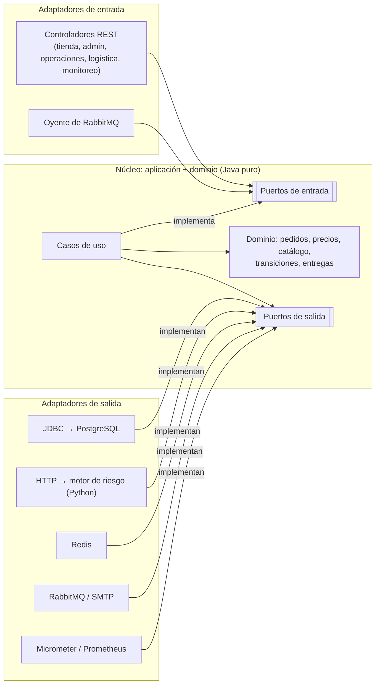

<div align="center">


# POLYMER — Sistema de Gestión de Pedidos de Productos Tecnológicos

**Tecnología que conecta contigo.**

Tienda de tecnología y plataforma de gestión de pedidos con **arquitectura hexagonal** (Java 21 + Python), **PostgreSQL**, **13 contenedores Docker** y observabilidad completa (Prometheus, Grafana, Loki, Tempo y OpenTelemetry).

[Instalación en Windows](#8-instalación-en-windows) · [Ejecución](#10-ejecución) · [Arquitectura](#4-arquitectura-hexagonal) · [Roles](#12-roles) · [Pruebas](#13-pruebas) · [Errores frecuentes](#15-solución-de-errores-frecuentes)


</div>

---

## Índice

1. [Presentación del proyecto](#1-presentación-del-proyecto)
2. [Objetivos](#2-objetivos)
3. [Características](#3-características)
4. [Arquitectura hexagonal](#4-arquitectura-hexagonal)
5. [Tecnologías utilizadas](#5-tecnologías-utilizadas)
6. [Estructura de carpetas](#6-estructura-de-carpetas)
7. [Servicios Docker (13 contenedores)](#7-servicios-docker-13-contenedores)
8. [Instalación en Windows](#8-instalación-en-windows)
9. [Configuración de secretos](#9-configuración-de-secretos)
10. [Ejecución](#10-ejecución)
11. [Acceso a la tienda](#11-acceso-a-la-tienda)
12. [Roles](#12-roles)
13. [Pruebas](#13-pruebas)
14. [Observabilidad](#14-observabilidad)
15. [Solución de errores frecuentes](#15-solución-de-errores-frecuentes)

Anexos: [API](#anexo-a-api) · [Documentación técnica](#anexo-b-documentación-técnica) · [Historial y migración](#anexo-c-historial-y-migración)

---

## 1. Presentación del proyecto

**POLYMER** es una tienda virtual de tecnología con la plataforma interna que la opera. En ella:

- **el cliente** compra en un catálogo de **556 productos** (20 categorías y 170 subcategorías);
- **un motor de riesgo** en Python evalúa cada pedido;
- **operaciones** lo revisa y lo hace avanzar por su ciclo de vida;
- **logística** programa y entrega los pedidos;
- **administración** gestiona productos, promociones, usuarios y reportes;
- **monitoreo** observa la salud técnica con métricas, logs y trazas.

El proyecto está construido para demostrar en una sustentación universitaria que la **arquitectura hexagonal** mantiene las reglas de negocio independientes de la tecnología:

- el dominio no conoce Spring, JDBC, HTTP ni RabbitMQ;
- cambiar un adaptador (base de datos, caché, mensajería) no toca las reglas;
- pruebas automáticas, incluidas pruebas de arquitectura con ArchUnit, lo comprueban en cada cambio.

<p align="center"></p>

## 2. Objetivos

1. **Separar el negocio de la tecnología.** Reglas de precios, promociones, stock, transiciones de pedidos, entregas y riesgo en el dominio, con puertos y adaptadores (Cockburn, 2005).
2. **Ofrecer una tienda realista**: búsqueda con filtros técnicos, carrito persistente, checkout con métodos de entrega y pago, y seguimiento del pedido.
3. **Cubrir el ciclo operativo completo** con roles y permisos: cliente, administración, operaciones, logística (dos operadores) y monitoreo.
4. **Garantizar la consistencia**:
   - transacciones;
   - idempotencia del checkout (`Idempotency-Key`);
   - control de concurrencia;
   - outbox transaccional para los eventos.
5. **Hacerlo observable**: métricas de negocio y técnicas, 9 alertas, 8 dashboards, logs centralizados y trazas distribuidas.
6. **Ejecutarse con un solo comando** en Windows (`.\polymer.cmd start`), sin perder nunca los datos del usuario.

## 3. Características

| Área | Qué incluye |
| --- | --- |
| **Tienda** | Portada, megamenú, buscador por nombre, marca, modelo o SKU; filtros (marca, precio, disponibilidad, ofertas y atributos técnicos); ficha técnica; ofertas; precios en soles con promociones aplicadas en el servidor |
| **Compra** | Carrito guardado en PostgreSQL, que fusiona el del visitante; checkout con entrega estándar, express o recojo, y pago contra entrega, por transferencia o en tienda; número de pedido `HX-…`; seguimiento paso a paso; cancelación |
| **Identidad POLYMER** | Logotipo propio; **intro cinematográfica** con apertura de telón; animación del nombre; sonido de bienvenida opcional (Web Audio); transiciones entre páginas; fondos premium; diseño adaptable a móvil; paneles con identidad común |
| **Pie comercial** | 5 columnas, redes sociales, métodos de pago (disponibles y «próximamente»), páginas de empresa y legales, y **Libro de reclamaciones** funcional |
| **Administración** | Productos con ficha completa, categorías en árbol, inventario con ajustes auditados, promociones con vigencia, usuarios y roles, pedidos, reportes por moneda, auditoría y mensajes |
| **Operaciones** | Bandeja de pedidos, revisión de riesgo, incidencias y cambios de estado validados por el dominio |
| **Logística** | Calendario mensual, semanal y diario; asignaciones por responsable (`logistica`, `logistica2`); programación y reprogramación sin choques; despacho y entrega |
| **Monitoreo** | Salud de dependencias; targets, alertas e indicadores leídos de Prometheus; enlaces a Grafana; documentación técnica interna |
| **Integraciones** | Caché del catálogo en Redis, eventos de negocio en RabbitMQ (outbox, DLQ, consumidor idempotente), correos en Mailpit, trazas OTLP a Tempo y logs a Loki |
| **Seguridad** | Sesión con CSRF, BCrypt, permisos por rol en las páginas y en la API, secretos como archivos de solo lectura, contenedores `read_only`, PostgreSQL, Redis y AMQP no publicados en el equipo |

<p align="center"></p>

## 4. Arquitectura hexagonal

El **interior** (dominio y casos de uso) define **puertos**, que son interfaces. El **exterior** aporta **adaptadores** que los implementan (salida) o los usan (entrada). Las dependencias del código siempre apuntan hacia dentro.

| Capa | Paquete (`com.polymer`) | Ejemplos |
| --- | --- | --- |
| **Dominio** | `domain` | `CommerceOrder`, `TransitionPolicy`, `PriceTag`, `CatalogSearch`, `CheckoutSummary`, `Delivery`, `Promotion` |
| **Aplicación**: casos de uso | `application.service` | `CommerceService`, `CartService`, `PricingService`, `OperationsService`, `LogisticsService`, `AdministrationService` |
| **Puertos de entrada** | `application.port.in` | `CommerceUseCases`, `CatalogUseCases`, `LogisticsUseCases`… |
| **Puertos de salida** | `application.port.out` | `CommerceOrderRepository`, `RiskAssessmentPort`, `CatalogCache`, `EventPublisher`, `MailSender`, `MonitoringPort` |
| **Adaptadores de entrada** | `adapter.in` | Controladores REST, oyente de RabbitMQ, planificador del outbox |
| **Adaptadores de salida** | `adapter.out` | JDBC (PostgreSQL), HTTP al motor de riesgo, Redis, RabbitMQ, SMTP, Micrometer, Prometheus |
| **Composición** | `config` | Ensambla los adaptadores con los casos de uso (único lugar que conoce ambos lados) |



**Flujo de una compra:**

1. `ShopController` recibe el checkout y llama al puerto de entrada `CommerceUseCases`.
2. `CommerceService` precia con `PricingService`, valida stock y entrega (`CheckoutSummary`) y consulta el riesgo por `RiskAssessmentPort`.
3. Guarda el pedido y el evento (outbox) en una sola transacción a través de `CommerceOrderRepository`.
4. Un planificador publica el evento en RabbitMQ, y el oyente envía el correo por `MailSender`.

El motor de riesgo en Python repite el mismo patrón: `domain/risk.py`, el caso de uso `ScoreRisk` y el adaptador FastAPI.

**La arquitectura se verifica automáticamente:**

- `HexagonalArchitectureTest` (ArchUnit) falla si `domain` o `application` importan Spring, JDBC, Jackson, HTTP o Micrometer, o si un adaptador de entrada usa uno de salida;
- `test_architecture.py` hace lo mismo en Python.

Más detalle en [`docs/HEXAGONAL_ARCHITECTURE.md`](docs/HEXAGONAL_ARCHITECTURE.md) y en las [ADR](docs/adr/).

## 5. Tecnologías utilizadas

| Capa | Tecnología |
| --- | --- |
| Servicio principal | Java 21 · Spring Boot 3.5 (Web, JDBC, Security, AMQP, Actuator) · Flyway |
| Motor de riesgo | Python 3.12 · FastAPI · Pydantic · prometheus_client |
| Datos | PostgreSQL 17 (fuente de verdad) · Redis 7 (caché) |
| Mensajería y correo | RabbitMQ 4 (exchange topic, DLQ) · Mailpit |
| Frontend | HTML5, CSS3 y JavaScript nativo (módulos ES), sin frameworks; Web Animations, View Transitions, IntersectionObserver y Web Audio; servido por Nginx |
| Observabilidad | Micrometer · Prometheus · Grafana · Loki · Tempo · OpenTelemetry Collector · Grafana Alloy |
| Contenedores | Docker · Docker Compose (perfiles, healthchecks, secretos, redes internas, `read_only`) · Kubernetes (manifiestos opcionales) |
| Pruebas | JUnit 5 · Mockito · ArchUnit · pytest · Playwright · pruebas de humo en Python |
| Automatización | PowerShell (`polymer.cmd`) · GitHub Actions (Ubuntu con Docker y Windows) |

## 6. Estructura de carpetas

```
.
├── polymer.cmd                 ← lanzador para Windows (hexaorders.cmd es un alias)
├── docker-compose.yml          ← entregable autosuficiente (GENERADO por tools/generate_delivery.py)
├── services/
│   ├── order-api/              ← Java 21 · Spring Boot
│   │   └── src/main/java/com/polymer/
│   │       ├── domain/         ← reglas de negocio puras
│   │       ├── application/    ← casos de uso y puertos (port/in, port/out)
│   │       ├── adapter/        ← adaptadores de entrada y de salida
│   │       └── config/         ← composición de dependencias
│   │   └── src/main/resources/
│   │       ├── db/migration/   ← Flyway V1–V9 (no destructivas)
│   │       └── static/         ← 45 páginas, CSS y módulos JavaScript (identidad POLYMER)
│   └── risk-engine/            ← Python · FastAPI (dominio, caso de uso, adaptador)
├── infra/                      ← compose.base.yml, Nginx, Prometheus, Grafana, Loki, Tempo, OTel, Alloy, RabbitMQ
├── k8s/                        ← manifiestos de Kubernetes (namespace polymer)
├── tools/                      ← polymer.ps1, generadores, validadores, pruebas de humo y e2e
└── docs/                       ← arquitectura, Docker, Windows, ADR, marca, migración e historial
```

## 7. Servicios Docker (13 contenedores)

Proyecto de Compose **`polymer`** (contenedores `polymer-<servicio>-1`, imágenes `polymer/*`).

| # | Servicio | Función | Acceso desde el equipo |
| --- | --- | --- | --- |
| 1 | `frontend` | Gateway Nginx: archivos estáticos y reenvío a Spring | http://localhost:8080 |
| 2 | `order-api` | Núcleo hexagonal (Java 21 / Spring Boot) | (a través de `frontend`) |
| 3 | `risk-engine` | Motor de riesgo (FastAPI) | — (red interna) |
| 4 | `db` | PostgreSQL 17 | — (nunca publicado) |
| 5 | `prometheus` | Métricas y 9 alertas | http://localhost:9091 |
| 6 | `grafana` | 8 dashboards (Prometheus, Loki, Tempo) | http://localhost:3000 |
| 7 | `redis` | Caché del catálogo | — |
| 8 | `rabbitmq` | Eventos de negocio y cola de notificaciones con DLQ | http://localhost:15672 (consola) |
| 9 | `mailpit` | Captura los correos (no envía a Internet) | http://localhost:8025 |
| 10 | `loki` | Logs centralizados | — |
| 11 | `tempo` | Trazas distribuidas | — |
| 12 | `otel-collector` | Recepción OTLP y métricas de Nginx | — |
| 13 | `alloy` | Recolector de logs de Docker hacia Loki | — |

**Volúmenes persistentes:** `polymer_postgres_data`, `polymer_grafana_data`, `polymer_prometheus_data`, `polymer_redis_data`, `polymer_rabbitmq_data`, `polymer_loki_data`, `polymer_tempo_data` y `polymer_alloy_data`.

**Redes internas:** `gateway`, `data`, `compute`, `cache`, `messaging` y `telemetry`.

El modo `-Mode basic` arranca solo los 6 primeros. Detalle en [`docs/DOCKER_ARCHITECTURE.md`](docs/DOCKER_ARCHITECTURE.md) y [`docs/DOCKER_SERVICES.md`](docs/DOCKER_SERVICES.md).

## 8. Instalación en Windows

1. **Docker Desktop:**
   - instálalo con el motor WSL 2 y contenedores Linux;
   - asígnale al menos **6 GB de RAM** para los 13 contenedores. Con WSL 2 se configura en `%UserProfile%\.wslconfig` con `[wsl2]` y `memory=6GB`, y después se ejecuta `wsl --shutdown`;
   - ábrelo y espera a ver **Engine running**.
2. **Python 3** (https://www.python.org/downloads/, marca *Add python.exe to PATH*). Solo lo usan los comandos `check` y `smoke`.
3. **Descomprime el proyecto**, por ejemplo en `C:\Users\TU_USUARIO\Downloads\POLYMER`, y abre PowerShell en esa carpeta.

No necesitas instalar Java, Maven ni Node: las imágenes se construyen dentro de Docker y ejecutan las pruebas al construirse. Guía completa: [`docs/WINDOWS_DOCKER_GUIDE.md`](docs/WINDOWS_DOCKER_GUIDE.md).

> **¿Venías de HexaOrders v6?** Descomprime POLYMER **junto a** la carpeta anterior y ejecuta `.\polymer.cmd start`.
>
> - El script encuentra las contraseñas originales y te pide confirmación para copiarlas.
> - Después copia y verifica tus volúmenes, sin borrar los originales.
>
> Guía: [`docs/MIGRACION_POLYMER.md`](docs/MIGRACION_POLYMER.md).

## 9. Configuración de secretos

Las contraseñas son **archivos** en `secrets\`. Esa carpeta está excluida de Git y del ZIP del proyecto, y Docker la monta como secreto de solo lectura.

| Archivo | Para qué |
| --- | --- |
| `db_password.txt` | PostgreSQL |
| `grafana_password.txt` | Usuario `admin` de Grafana |
| `demo_password.txt` | Las seis cuentas de demostración de la tienda |
| `rabbitmq_password.txt` | Consola y conexión de RabbitMQ |

- **Primera instalación:** `start` genera valores aleatorios de 48 caracteres. Para crearlos sin arrancar: `.\polymer.cmd secrets`.
- **Nunca se sobrescribe** un archivo existente, porque PostgreSQL, Grafana y RabbitMQ guardan la contraseña al inicializar sus volúmenes.
- **Si hay datos pero falta la contraseña**, `start` se detiene antes de tocar nada y explica cómo recuperarla. Busca automáticamente la carpeta `secrets\` de una instalación anterior, o puedes indicarla con `.\polymer.cmd import-secrets -SecretsFrom "C:\ruta"`.
- **Para ver una contraseña**, abre el archivo con el Bloc de notas. No la publiques ni la subas a Git.

## 10. Ejecución

```powershell
.\polymer.cmd start
```

Arranca la **plataforma completa con los 13 contenedores**: genera o recupera los secretos, migra los datos anteriores si los hay, valida el YAML, construye las imágenes (con sus pruebas) y espera a que los 13 servicios estén sanos.

| Comando | Qué hace |
| --- | --- |
| `.\polymer.cmd start` | Arranca la plataforma completa (13 contenedores) |
| `.\polymer.cmd start -Mode basic` | Solo los 6 servicios esenciales (equipos con poca RAM) |
| `.\polymer.cmd status` | Estado de los contenedores |
| `.\polymer.cmd logs` | Últimas 100 líneas de cada servicio |
| `.\polymer.cmd stop` | Detiene todo **conservando los datos** |
| `.\polymer.cmd smoke` | Pruebas HTTP contra tu entorno en marcha |
| `.\polymer.cmd check` | Validación de archivos sin Docker (YAML, páginas, marca, catálogo, observabilidad) |
| `.\polymer.cmd verify` | Prueba integral en un entorno aislado, igual que el CI |
| `.\polymer.cmd import-secrets` / `migrate` | Recuperar contraseñas o migrar volúmenes de una instalación anterior |
| `.\polymer.cmd repair-db-password` | Alinea la contraseña de PostgreSQL con `db_password.txt`, sin borrar datos y con confirmación |
| `.\polymer.cmd help` | Ayuda completa |

`.\polymer.cmd stop -RemoveData` **borra** los datos de POLYMER. Úsalo solo si quieres empezar de cero; nunca toca los volúmenes `hexaorders_*`.

En Linux o macOS: `pwsh ./tools/polymer.ps1 start`.

## 11. Acceso a la tienda

| URL | Qué hay |
| --- | --- |
| http://localhost:8080 | Tienda POLYMER (la intro aparece una vez por sesión; «Ver la intro» en el pie la repite) |
| http://localhost:8080/login.html | Inicio de sesión: cuentas de la sección 12, contraseña en `secrets\demo_password.txt` |
| http://localhost:3000 | Grafana: usuario `admin`, contraseña en `secrets\grafana_password.txt` |
| http://localhost:9091 | Prometheus: targets y alertas |
| http://localhost:8025 | Mailpit: correos de confirmación de pedidos |
| http://localhost:15672 | Consola de RabbitMQ |

## 12. Roles

| Cuenta | Rol | Qué puede hacer |
| --- | --- | --- |
| `cliente` | Cliente | Registrarse, comprar, carrito, checkout, mis pedidos, seguimiento, cancelar, perfil y contraseña |
| `admin` | Administrador | Productos, categorías, inventario, promociones, usuarios y roles, pedidos, reportes, auditoría, mensajes y Libro de reclamaciones; además, acceso a todas las áreas |
| `operador` | Operador de pedidos | Bandeja, revisión de riesgo, incidencias y transiciones de estado |
| `logistica` | Logística 1 (Ana) | Calendario, asignaciones, programación, reprogramación, despacho y entrega |
| `logistica2` | Logística 2 (Bruno) | Lo mismo, con su propia carga asignada |
| `observador` | Monitoreo | Salud técnica, servicios, métricas, alertas, Grafana y documentación técnica (solo lectura) |

Los permisos se comprueban en el servidor, en Spring Security y en el dominio. Ocultar un botón no basta: `SecurityRulesTest` y `pages-e2e.js` recorren las páginas con cada rol.

<p align="center"></p>

## 13. Pruebas

| Tipo | Herramienta | Qué comprueba |
| --- | --- | --- |
| Dominio y casos de uso | JUnit 5 + Mockito (110 pruebas) | Precios y promociones, búsqueda, checkout, transiciones por rol, idempotencia, stock, calendario, notificaciones, seguridad |
| **Arquitectura** | ArchUnit (`HexagonalArchitectureTest`) y `test_architecture.py` | El núcleo no depende de frameworks; los adaptadores de entrada solo usan puertos de entrada |
| Motor de riesgo | pytest (62 pruebas) | Reglas, decimales exactos, validación y métricas |
| API real | `smoke.py`, `platform_smoke.py`, `store_smoke.py`, `integration_smoke.py` | Pedidos, roles, tienda, carrito, checkout, Redis, RabbitMQ, Mailpit, Loki, Tempo y Grafana |
| Interfaz | Playwright: `ui-e2e.js`, `pages-e2e.js` (las 45 páginas con los 6 tipos de usuario) e `intro-e2e.js` (intro, animaciones, sonido opcional, movimiento reducido, móvil y pie) | Navegador real contra el stack real |
| Entregable | `check` | YAML generado al día, Kubernetes, observabilidad conservada, páginas, marca y catálogo |
| Integral | `verify` | Los 13 contenedores sanos, todas las pruebas de humo, degradación sin Redis o RabbitMQ, persistencia tras reiniciar y HTTP 503 sin el motor de riesgo |
| **Migración** | Job del CI `migrate-from-v6` | Parte de HexaOrders v6 con datos y pasa a POLYMER desde otra carpeta sin `secrets\`: contraseñas recuperadas, volúmenes verificados, 13 contenedores y datos intactos |

```powershell
.\polymer.cmd check
```

```powershell
.\polymer.cmd verify
```

El workflow [`verify.yml`](.github/workflows/verify.yml) ejecuta todo en cada cambio, en Ubuntu con Docker y en Windows. Los resultados reales están en [`docs/validacion.md`](docs/validacion.md).

## 14. Observabilidad

- **Métricas** (Prometheus): de negocio (`polymer_*`: pedidos por estado, ventas, transiciones, entregas, incidencias, caché y eventos) y técnicas (JVM, HTTP, motor de riesgo, Nginx, RabbitMQ). Hay **9 alertas**, por ejemplo servicio caído, errores 5xx, latencia, outbox atascado o mensajes en la DLQ.
- **Dashboards** (Grafana, como código):
  - `polymer` (puertos y adaptadores);
  - negocio, riesgo, API, infraestructura, seguridad, logística e integraciones.
- **Logs** (Loki, a través de Alloy) y **trazas** (Tempo, a través de OpenTelemetry), correlacionados por `traceId`. La cabecera `X-Trace-Id` acompaña cada respuesta.
- **Portal de monitoreo** en la propia tienda (rol `observador`), que lee Prometheus a través de `MonitoringPort`.

Más detalle en [`docs/OBSERVABILITY_STACK.md`](docs/OBSERVABILITY_STACK.md) y [`docs/OBSERVABILITY_PRESERVATION.md`](docs/OBSERVABILITY_PRESERVATION.md).

## 15. Solución de errores frecuentes

| Síntoma | Causa | Solución |
| --- | --- | --- |
| «Existe el volumen … pero falta secrets\db_password.txt» | Hay datos de una instalación anterior y en esta carpeta no están sus contraseñas (el ZIP nunca las incluye) | Copia la carpeta `secrets\` anterior, o ejecuta `.\polymer.cmd import-secrets -SecretsFrom "C:\ruta\anterior"` y luego `start`. **No** borres volúmenes. Ver [`MIGRACION_POLYMER.md`](docs/MIGRACION_POLYMER.md) |
| `order-api` no arranca: «password authentication failed» | `db_password.txt` no coincide con la contraseña con que se creó la base | Restaura el archivo original, o `.\polymer.cmd repair-db-password` (no borra datos) |
| «Docker no responde» | Docker Desktop cerrado o iniciándose | Ábrelo y espera a *Engine running* |
| Un contenedor queda *unhealthy* o se reinicia | Poca memoria para los 13 contenedores | Asigna 6 GB o más a Docker (`.wslconfig`, sección 8), o usa `start -Mode basic` |
| «port is already allocated» (8080, 3000…) | Otro programa, o HexaOrders v6 en marcha | `start` detiene HexaOrders automáticamente; para otros programas, ciérralos o cambia su puerto |
| Docker crea una **carpeta** `secrets\db_password.txt` | Se arrancó Docker antes de crear los archivos | `.\polymer.cmd secrets` lo detecta y lo corrige sin borrar contenido |
| No se ve la intro | Ya se vio en esta sesión, o Windows tiene desactivados los *Efectos de animación* | Usa «Ver la intro» en el pie o http://localhost:8080/?intro=1. Con movimiento reducido se omite a propósito |
| No se oye la bienvenida | El sonido es opcional y está apagado por defecto | Pulsa «Entrar con sonido» o el botón de altavoz de la cabecera |
| Cambios que no se ven | Caché del navegador | `Ctrl + F5` |

Diagnóstico: `.\polymer.cmd status` y `.\polymer.cmd logs`. Más casos en [`docs/WINDOWS_DOCKER_GUIDE.md`](docs/WINDOWS_DOCKER_GUIDE.md#8-problemas-frecuentes).

---

## Anexo A. API

Las peticiones que modifican datos usan sesión y cabecera `X-CSRF-TOKEN`, salvo la API pública de pedidos.

| Ruta | Acceso | Uso |
| --- | --- | --- |
| `POST/GET /api/orders`, `/api/orders/{id}`, `/api/orders/statistics` | público | API original de pedidos con evaluación de riesgo (USD) |
| `/api/auth/{csrf,me,login,logout,register}` | público | Sesión y registro |
| `GET /api/catalog/{categories,products,search,promotions}` | público | Catálogo, búsqueda con facetas y promociones vigentes |
| `/api/shop/cart…`, `/api/shop/orders…`, `/checkout-summary`, `/checkout-options` | cliente | Carrito, checkout idempotente, pedidos y cancelación |
| `/api/operations/…` | operador, admin | Bandeja y transiciones |
| `/api/logistics/…` | logística, admin | Entregas, calendario y asignaciones |
| `/api/incidents…` | operador, logística, admin | Incidencias |
| `/api/admin/…` | admin | Panel, productos, categorías, inventario, promociones, usuarios, auditoría, mensajes y reportes |
| `/api/ops/{health,monitoring}` | monitoreo, admin | Salud y Prometheus |
| `POST /api/contact` | público | Contacto y Libro de reclamaciones |

Códigos de respuesta:

- `400` validación;
- `401` sin sesión;
- `403` sin permiso o sin CSRF;
- `404` no existe;
- `409` conflicto de negocio (`OUT_OF_STOCK`, `CONCURRENT_UPDATE`, `SCHEDULE_CONFLICT`…);
- `503` dependencia no disponible.

Colección de Postman: [`docs/demo/POLYMER.postman_collection.json`](docs/demo/POLYMER.postman_collection.json).

## Anexo B. Documentación técnica

| Documento | Contenido |
| --- | --- |
| [`HEXAGONAL_ARCHITECTURE.md`](docs/HEXAGONAL_ARCHITECTURE.md) | Capas, puertos, adaptadores y reglas verificadas |
| [`TECH_STORE.md`](docs/TECH_STORE.md) | Catálogo, búsqueda, precios, carrito y checkout |
| [`DOCKER_ARCHITECTURE.md`](docs/DOCKER_ARCHITECTURE.md) · [`DOCKER_SERVICES.md`](docs/DOCKER_SERVICES.md) | Los 13 servicios, redes, recursos y verificación |
| [`ASYNCHRONOUS_EVENTS.md`](docs/ASYNCHRONOUS_EVENTS.md) · [`REDIS_INTEGRATION.md`](docs/REDIS_INTEGRATION.md) | Outbox, eventos, DLQ, correos y caché |
| [`OBSERVABILITY_STACK.md`](docs/OBSERVABILITY_STACK.md) | Métricas, logs y trazas |
| [`WINDOWS_DOCKER_GUIDE.md`](docs/WINDOWS_DOCKER_GUIDE.md) | Instalación, operación y problemas en Windows |
| [`brand/BRAND_POLYMER.md`](docs/brand/BRAND_POLYMER.md) | Logotipo, paleta, intro, movimiento, audio y pie |
| [`guia-para-explicar.md`](docs/guia-para-explicar.md) · [`presentacion.md`](docs/presentacion.md) | Guion para la sustentación |
| [`adr/`](docs/adr/) | 17 decisiones de arquitectura |
| [`ANTIGRAVITY_HANDOFF.md`](docs/ANTIGRAVITY_HANDOFF.md) | Guía para seguir desarrollando el proyecto |

## Anexo C. Historial y migración

POLYMER es la evolución de un proyecto que comenzó con otro nombre técnico, *HexaOrders*. Esta es la única sección donde se menciona.

- **Migración y nombres heredados:** [`docs/MIGRACION_POLYMER.md`](docs/MIGRACION_POLYMER.md) y la [ADR 0017](docs/adr/0017-polymer-technical-identity-and-safe-volume-migration.md). Explican cómo se migran los datos sin perderlos y qué identificadores heredados se conservan a propósito (usuario y colas de RabbitMQ, migraciones Flyway publicadas, volúmenes de respaldo).
- **Historial de versiones anteriores:** [`docs/historial/`](docs/historial/), con el README y el registro de validaciones originales.
