<div align="center">


# HEXAORDERS

**Order Management & Risk Assessment System**

Gestión de pedidos con evaluación determinista de riesgo, construida con **arquitectura hexagonal** (puertos y adaptadores) en **Java 21** y **Python**, persistida en **PostgreSQL**, orquestada con **Docker Compose** y observada con **Prometheus** y **Grafana**.

[Sitio web v4](#-sitio-web-multipágina-v4) · [Windows](docs/WINDOWS_DOCKER_GUIDE.md) · [Plataforma v3](#-plataforma-comercial-v3) · [Inicio rápido](#-inicio-rápido) · [Arquitectura](#-arquitectura-hexagonal) · [API](#-endpoints) · [Demostración](#-demostración) · [Guía en inglés](docs/english/presentation-guide.md)

</div>

---

## Índice

<details>
<summary>Mostrar el índice completo</summary>

1. [Descripción](#-descripción) · [Problema y objetivos](#-problema-que-resuelve-y-objetivos)
1. [**Plataforma Docker v5 (13 contenedores)**](#-plataforma-docker-v5-13-contenedores): [arquitectura](docs/DOCKER_ARCHITECTURE.md) · [servicios](docs/DOCKER_SERVICES.md) · [eventos](docs/ASYNCHRONOUS_EVENTS.md) · [Redis](docs/REDIS_INTEGRATION.md) · [observabilidad](docs/OBSERVABILITY_STACK.md) · [Windows](docs/WINDOWS_DOCKER_GUIDE.md)
1. [**Sitio web multipágina v4**](#-sitio-web-multipágina-v4): [páginas](docs/FRONTEND_PAGES.md) · [arquitectura](docs/HEXAGONAL_ARCHITECTURE.md) · [Windows y Docker](docs/WINDOWS_DOCKER_GUIDE.md) · [capturas](#capturas-del-sitio-v4-datos-reales)
1. [**Plataforma comercial v3**](#-plataforma-comercial-v3): [roles](#roles-y-permisos) · [funcionalidades](#funcionalidades) · [ciclo de vida](#ciclo-de-vida-del-pedido) · [modelo de datos](#modelo-de-datos) · [seguridad](#seguridad) · [capturas](#capturas-de-la-plataforma-datos-reales) · [ADR](docs/adr/)
2. [Tecnologías](#-tecnologías)
3. [Arquitectura hexagonal](#-arquitectura-hexagonal) · [Diagrama hexagonal](#diagrama-1--estructura-hexagonal-dependencias-vs-ejecución) · [Secuencia](#diagrama-2--secuencia-de-post-apiorders) · [Infraestructura](#diagrama-3--infraestructura-docker-compose)
4. [Estructura de carpetas](#-estructura-de-carpetas) · [Componentes](#-componentes)
5. [Requisitos](#-requisitos-previos) · [Inicio rápido](#-inicio-rápido) · [Docker Compose](#-ejecución-con-docker-compose)
6. [Endpoints](#-endpoints) · [Ejemplos](#-ejemplos-de-solicitudes-y-respuestas)
7. [Integración Java-Python](#-integración-java--python) · [PostgreSQL](#-persistencia-en-postgresql)
8. [Prometheus](#-monitoreo-con-prometheus) · [Grafana](#-dashboard-de-grafana) · [Kubernetes](#-despliegue-en-kubernetes)
9. [Interfaz web](#-interfaz-web) · [Pruebas](#-pruebas) · [Manejo de errores](#-manejo-de-errores)
10. [Demostración](#-demostración) · [Limitaciones](#-limitaciones-conocidas) · [Referencias](#-referencias-técnicas)

</details>

## 🧭 Descripción

HexaOrders registra pedidos de clientes y decide si cada pedido queda **aprobado** o **en revisión**. Para decidir, el servicio Java consulta un **motor de riesgo en Python** que asigna un puntaje de 0 a 100 con reglas deterministas y explicables (no es inteligencia artificial). El pedido y su decisión se guardan en PostgreSQL con un único `INSERT` atómico, y todo el sistema expone métricas que Prometheus recoge y Grafana visualiza.

El proyecto es una práctica universitaria cuyo objetivo es **demostrar de forma verificable** la arquitectura hexagonal: las reglas de negocio no dependen de Spring Boot, FastAPI, PostgreSQL, Docker ni Grafana, y esa independencia se comprueba con pruebas automáticas (ArchUnit en Java, análisis AST en Python).

## 🎯 Problema que resuelve y objetivos

**Problema.** En muchas aplicaciones, las reglas de negocio acaban mezcladas con el framework web, el ORM o el cliente HTTP. Cambiar una integración obliga entonces a tocar reglas, y probar una regla exige arrancar servidores y bases de datos.

**Objetivos.**

| Objetivo | Cómo se cumple |
| --- | --- |
| Núcleo independiente de la tecnología | `domain/` y `application/` en Java puro; `domain/` y `application/` en Python solo con la biblioteca estándar. |
| Dependencias hacia el núcleo | Los adaptadores implementan interfaces del núcleo (`RiskAssessmentPort`, `OrderRepository`, `OrderTelemetry`). |
| Regla verificable, no solo una convención | `HexagonalArchitectureTest` (ArchUnit) y `test_architecture.py` (AST) fallan si alguien rompe la regla. |
| Integración de dos lenguajes | Java orquesta los pedidos; Python calcula el riesgo mediante HTTP con timeouts. |
| Persistencia real | PostgreSQL 17 con migraciones Flyway y restricciones `CHECK`. |
| Entregable en un único YAML | `docker-compose.yml` contiene Dockerfiles, código, tests y configuración de monitoreo. |
| Observabilidad | Métricas técnicas y de negocio en Prometheus, dashboard aprovisionado en Grafana. |

## 🐳 Plataforma Docker v5 (13 contenedores)

La v5 convierte HexaOrders en una plataforma de **13 contenedores**, cada uno con una función real y comprobada por pruebas automáticas: 12 servicios más Alloy como agente de logs. Todo lo anterior se conserva: páginas, APIs, roles, dominio, 7 dashboards, métricas, alertas, scripts y pruebas.

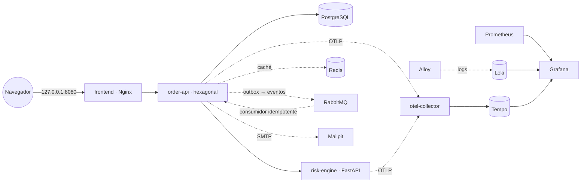

| Servicio | Función | Modo | Host |
| --- | --- | --- | --- |
| `frontend` | Gateway Nginx: estáticos y reenvío a Spring (ADR 0011) | básico | 127.0.0.1:8080 |
| `order-api` | Núcleo hexagonal Java 21 / Spring Boot | básico | — |
| `risk-engine` | Motor de riesgo FastAPI | básico | — |
| `db` | PostgreSQL 17, fuente de verdad y outbox | básico | — |
| `prometheus` | Métricas (9 jobs) y 9 alertas | básico | 127.0.0.1:9091 |
| `grafana` | 8 dashboards; fuentes Prometheus, Loki y Tempo | básico | 127.0.0.1:3000 |
| `redis` | Caché del catálogo (no es fuente de verdad) | full | — |
| `rabbitmq` | Eventos de negocio versionados con DLQ | full | 127.0.0.1:15672 (consola) |
| `mailpit` | Captura de correos de desarrollo (no envía a Internet) | full | 127.0.0.1:8025 |
| `loki` | Logs centralizados (7 días) | full | — |
| `tempo` | Trazas distribuidas (72 h) | full | — |
| `otel-collector` | Recepción OTLP, filtrado, lotes y métricas de Nginx | full | — |
| `alloy` | Recolector de logs de Docker hacia Loki | full | — |

PostgreSQL, Redis y AMQP **nunca** se publican en el host. Las redes internas son `gateway`, `data`, `compute`, `cache`, `messaging` y `telemetry`.

**Comandos (Windows, PowerShell):**

```powershell
.\hexaorders.cmd start               # modo completo (13 contenedores, ~4,5 GB de RAM)
.\hexaorders.cmd start -Mode basic   # modo básico (6 contenedores, ~2,5 GB)
.\hexaorders.cmd status
.\hexaorders.cmd logs
.\hexaorders.cmd smoke
.\hexaorders.cmd check
.\hexaorders.cmd stop                # conserva los datos
```

Documentación:

- [`DOCKER_ARCHITECTURE.md`](docs/DOCKER_ARCHITECTURE.md): redes, modos y recursos;
- [`DOCKER_SERVICES.md`](docs/DOCKER_SERVICES.md): cada servicio y su verificación;
- [`ASYNCHRONOUS_EVENTS.md`](docs/ASYNCHRONOUS_EVENTS.md): outbox, eventos, DLQ y correos;
- [`REDIS_INTEGRATION.md`](docs/REDIS_INTEGRATION.md);
- [`OBSERVABILITY_STACK.md`](docs/OBSERVABILITY_STACK.md): métricas, logs y trazas;
- [`WINDOWS_DOCKER_GUIDE.md`](docs/WINDOWS_DOCKER_GUIDE.md);
- [`validacion.md`](docs/validacion.md): resultados reales.

## 🌐 Sitio web multipágina v4

La versión 4 convierte la interfaz en un **sitio web empresarial con 39 páginas HTML reales** (más el laboratorio original), cada una con su URL, navegación, permisos por rol y datos de la API. Se conserva todo lo anterior: el laboratorio está íntegro en `/laboratorio.html`, las URLs antiguas `#/…` redirigen a su página nueva, y la API, los dashboards, las métricas y los scripts siguen funcionando.

### En Windows, en tres pasos

1. Instala **Docker Desktop** (motor WSL 2, contenedores Linux) y ábrelo hasta ver *Engine running*.
2. Descarga el proyecto y abre **PowerShell** en su carpeta.
3. Ejecuta:

```powershell
.\hexaorders.cmd start
```

Abre <http://127.0.0.1:8080>. Las cuentas `admin`, `operador`, `logistica`, `observador` y `cliente` usan la contraseña de `secrets\demo_password.txt`. No necesitas Linux, Java, Python ni PostgreSQL instalados: todo corre en Docker. Guía completa, solución de problemas y comprobaciones manuales: **[`docs/WINDOWS_DOCKER_GUIDE.md`](docs/WINDOWS_DOCKER_GUIDE.md)**.

### Páginas

| Área | Páginas |
| --- | --- |
| Público | `/` · `/catalogo.html` · `/producto.html?id=` · `/carrito.html` · `/checkout.html` · `/login.html` · `/registro.html` · `/nosotros.html` · `/contacto.html` · `/403.html` · `/404.html` |
| Cliente | `/cliente/dashboard.html` · `pedidos.html` · `pedido-detalle.html?id=` · `seguimiento.html?id=` · `perfil.html` |
| Administración | `/admin/dashboard.html` · `productos` · `categorias` · `inventario` · `pedidos` · `usuarios` · `incidencias` · `reportes` · `auditoria` |
| Operaciones | `/operaciones/dashboard.html` · `pedidos` · `revisiones` · `incidencias` |
| Logística | `/logistica/dashboard.html` · `calendario` · `entregas` · `asignaciones` |
| Monitoreo | `/monitoreo/dashboard.html` · `servicios` · `metricas` · `alertas` |
| Arquitectura | `/arquitectura/overview.html` · `flujo-pedidos.html` · `/laboratorio.html` |

Detalle de cada página, su rol, sus APIs y la matriz de auditoría v3 → v4: **[`docs/FRONTEND_PAGES.md`](docs/FRONTEND_PAGES.md)**.

### Qué se añadió

- **Navegación real**: menú principal, menús por rol, barra lateral en cada portal, breadcrumbs, redirección tras el login (`?next=`), páginas 403 y 404, menú móvil y URLs limpias (`/admin`, `/catalogo`…).
- **Seguridad en el servidor también para las páginas**: sin sesión → 302 al login; otro rol → 403. Ocultar enlaces no es la protección: Spring Security lo comprueba en cada petición.
- **Portal público**: inicio con cifras reales, catálogo con búsqueda, categorías, precio, disponibilidad, orden y paginación (estado en la URL), relacionados en la ficha, carrito con totales del servidor y **checkout con dirección de entrega** (nuevo objeto de valor `ShippingAddress`, migración `V4`).
- **Cliente**: resumen, historial paginado, detalle y **seguimiento** con el estado real y su historial.
- **Administración**: categorías e inventario como páginas propias, búsqueda y paginación en productos, usuarios y auditoría, y bandeja de **mensajes de contacto**.
- **Operaciones**: resumen, bandeja con búsqueda, **revisiones de riesgo** (confirmar/rechazar con nota) e incidencias.
- **Logística**: resumen, calendario (mes/semana/día), **entregas** por periodo y estado, y **asignaciones** con la carga semanal por responsable.
- **Monitoreo**: salud, **targets, alertas e indicadores leídos de Prometheus por el backend** (`MonitoringPort` → `PrometheusMonitoringAdapter`, red interna de Docker) y enlaces a los 7 dashboards de Grafana.
- **Observabilidad**: nuevo dashboard **Logistics Operations**; los 6 anteriores, sin cambios.

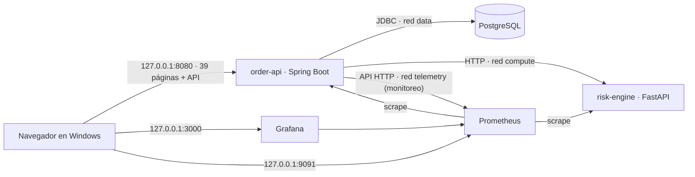

Se evaluó un sexto contenedor Nginx para el frontend y se descartó porque rompía la protección de páginas por rol y el mismo origen de la sesión sin aportar funcionalidad ([ADR 0009](docs/adr/0009-multipage-frontend-served-by-spring.md)). Arquitectura completa con diagramas de componentes, secuencia, integración Java ↔ FastAPI, despliegue y modelo de datos: **[`docs/HEXAGONAL_ARCHITECTURE.md`](docs/HEXAGONAL_ARCHITECTURE.md)**.

### Capturas del sitio v4 (datos reales)

Tomadas por `tools/ui-e2e/pages-e2e.js` y Playwright contra el backend real (Java + Python + PostgreSQL 16 en local, sin Docker). Los pedidos, mensajes y entregas los crearon las propias pruebas. En local no había Prometheus, por eso no se incluye la página de monitoreo; en el CI se comprueba contra un Prometheus real.

| Inicio | Catálogo |
| --- | --- |
| 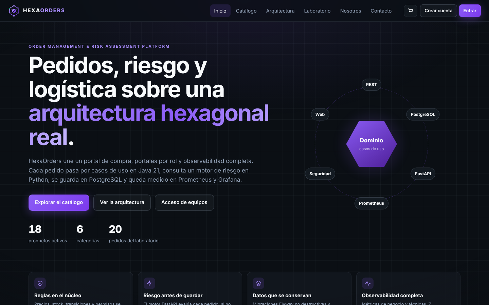 | 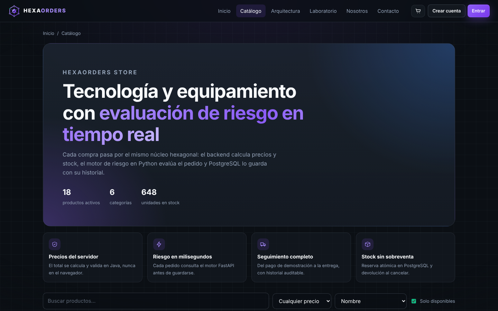 |
| **Checkout con dirección** | **Seguimiento del pedido** |
| 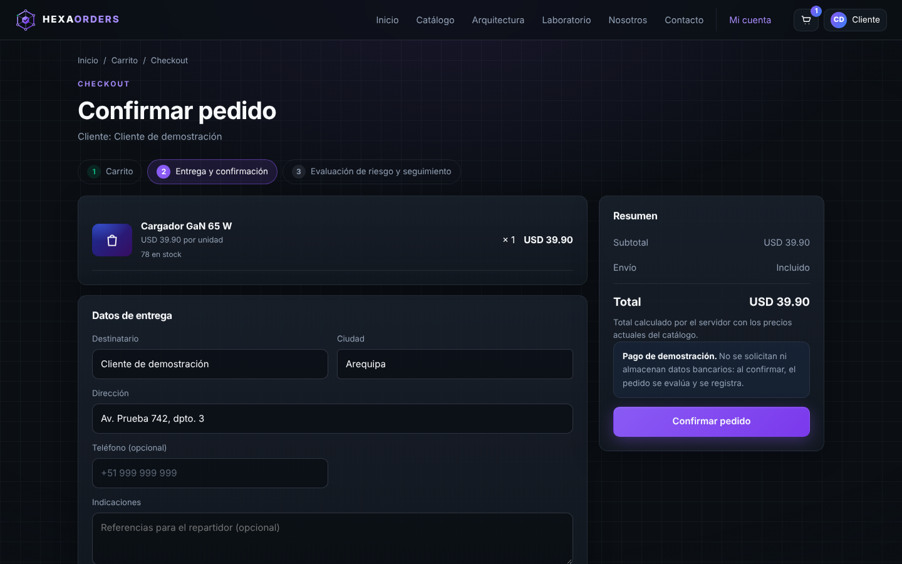 | 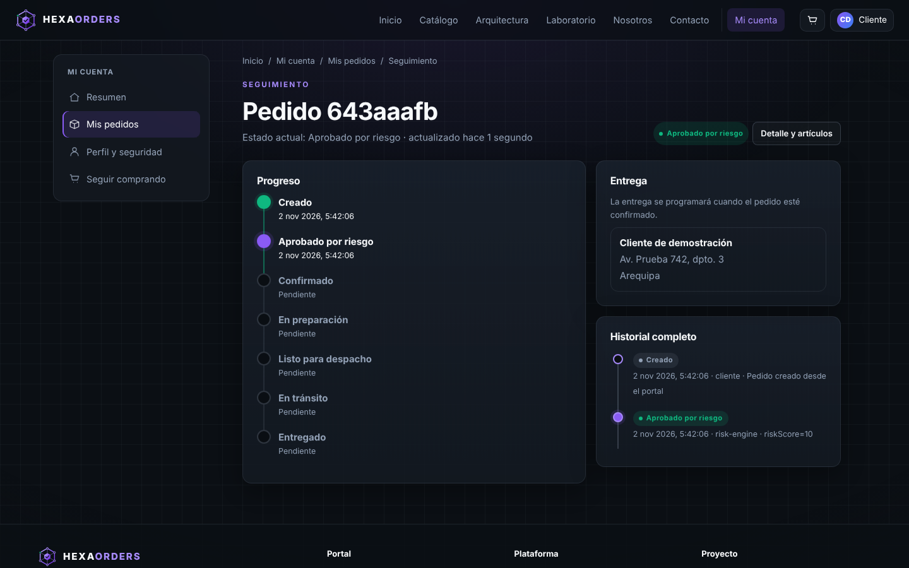 |
| **Resumen del cliente** | **Panel de administración** |
| 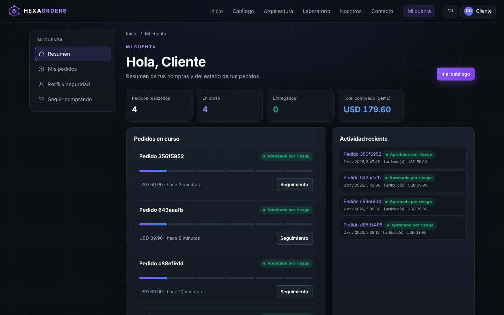 | 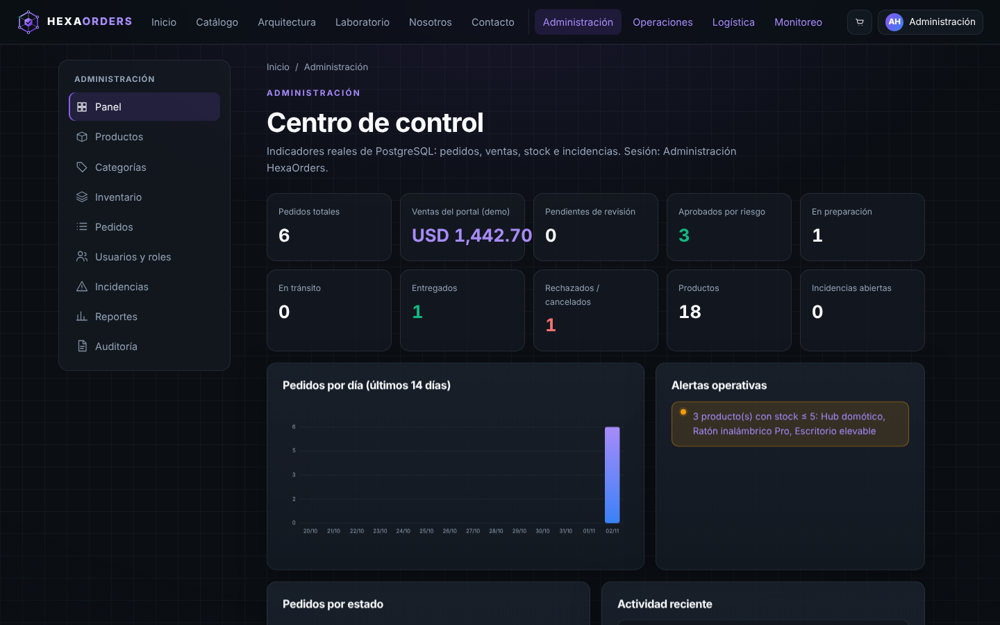 |
| **Inventario** | **Revisiones de riesgo** |
| 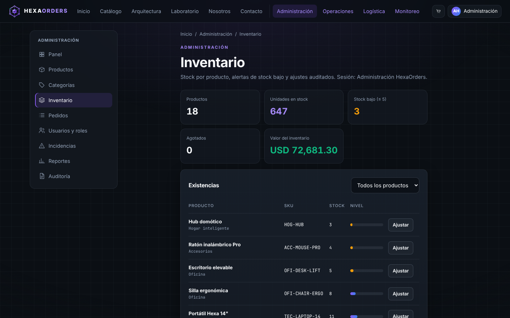 | 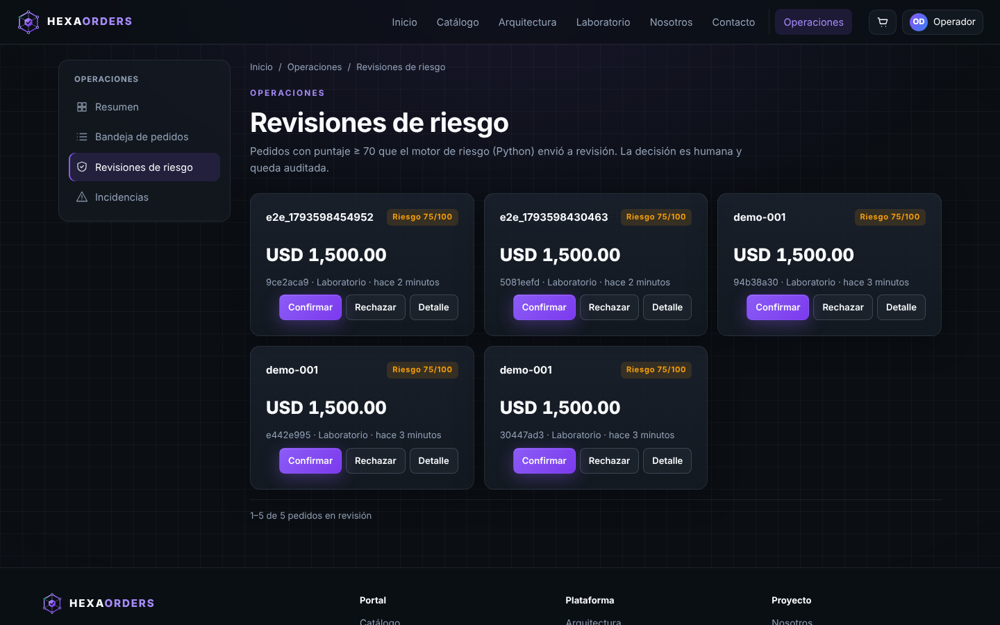 |
| **Resumen logístico** | **Asignaciones** |
| 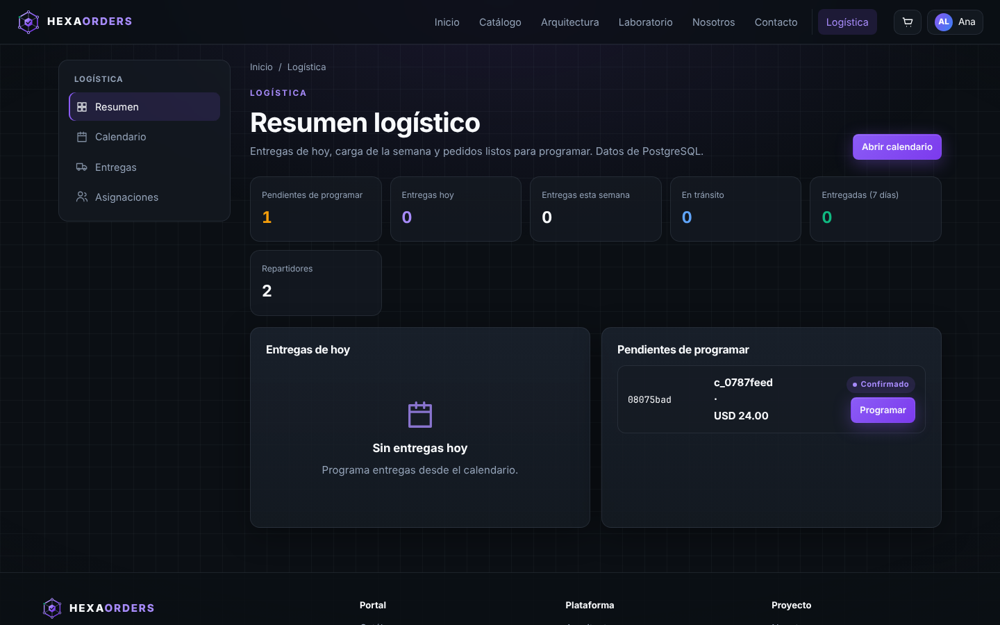 | 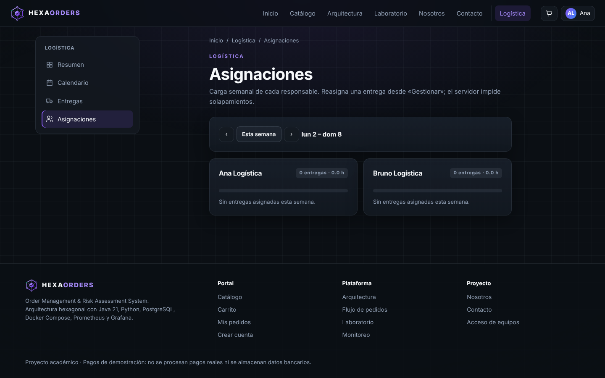 |
| **Flujo de pedidos** | **Contacto** |
| 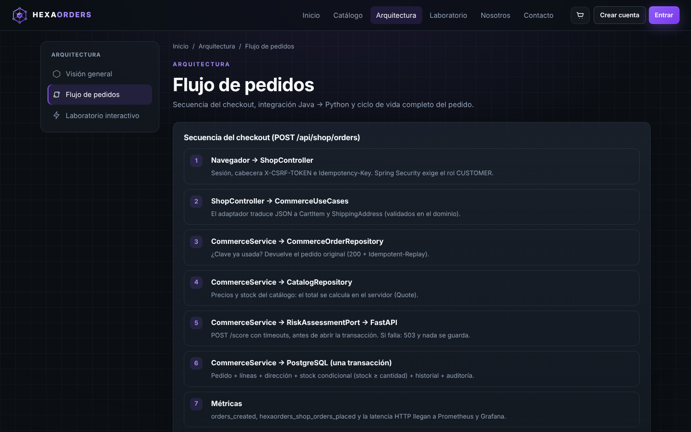 | 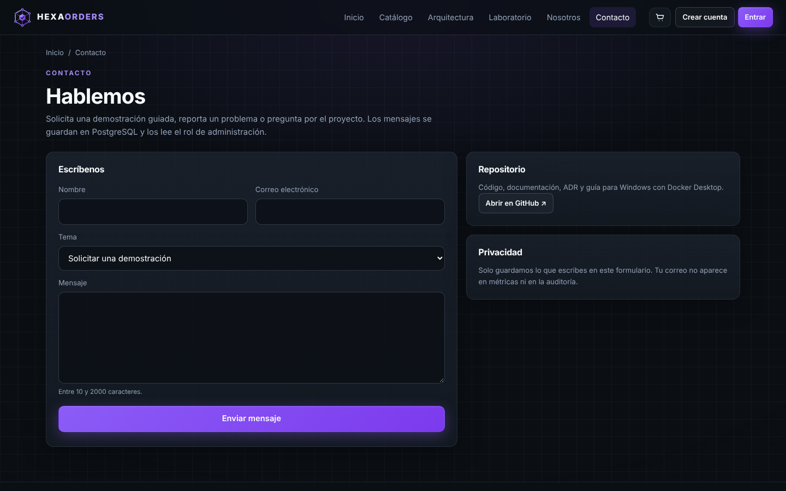 |

<p align="center">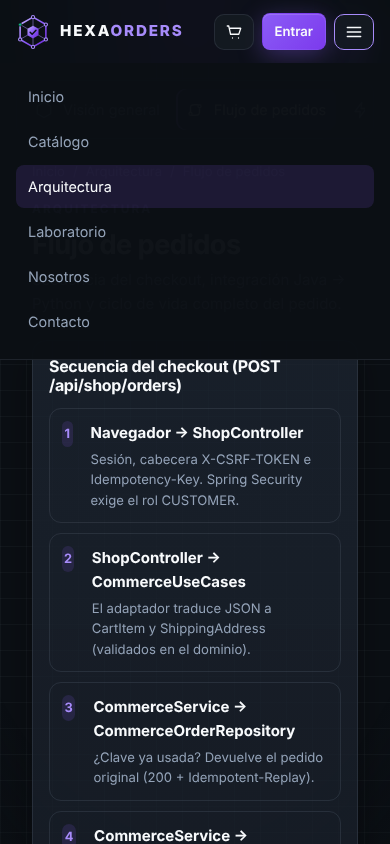</p>

## 🏢 Plataforma comercial v3

La versión 3 convierte el laboratorio en una **plataforma de comercio y operaciones** sin eliminar nada de lo anterior: el formulario de pedidos, el panel, el explorador de arquitectura, `POST /api/orders`, el dashboard original de Grafana, sus métricas y alertas siguen funcionando igual (lo comprueban `tools/smoke.py`, `tools/check_observability.py` y la prueba de interfaz).

| Antes (v2) | Ahora (v3) |
| --- | --- |
| Un formulario de laboratorio y un panel | Portal público (catálogo, búsqueda, filtros, ficha, carrito, checkout de demostración, seguimiento, perfil) **y** el laboratorio original en `#inicio` |
| Sin usuarios | Spring Security con sesión, CSRF, BCrypt y **5 roles** |
| Pedido = aprobado / en revisión | Ciclo de vida de 10 estados con historial, auditoría, idempotencia y control de concurrencia |
| — | Administración, operaciones, calendario logístico, incidencias, informes y auditoría |
| 1 dashboard, 2 alertas | 6 dashboards, 9 alertas + 1 regla de compatibilidad, nuevas métricas de negocio y seguridad |

### Roles y permisos

Las cuentas de demostración se crean al arrancar con la contraseña de `secrets/demo_password.txt` (generada aleatoriamente por `init-env.ps1`, nunca en Git). Cualquiera puede registrarse como cliente desde **Crear cuenta**.

| Usuario demo | Rol | Área | API protegida |
| --- | --- | --- | --- |
| `cliente` | `CUSTOMER` | Tienda, checkout, mis pedidos, perfil | `/api/shop/**`, `/api/account/**` |
| `admin` | `ADMIN` | Centro de control: productos, categorías, inventario, pedidos, usuarios y roles, incidencias, informes, auditoría | todo |
| `operador` | `ORDER_OPERATOR` | Operaciones: revisión de riesgo, confirmación, preparación, incidencias | `/api/operations/**`, `/api/incidents/**` |
| `logistica`, `logistica2` | `LOGISTICS_OPERATOR` | Calendario logístico, asignación, despacho y entrega | `/api/logistics/**`, `/api/incidents/**` |
| `observador` | `OBSERVABILITY_VIEWER` | Salud técnica (PostgreSQL, motor de riesgo) y accesos a Prometheus/Grafana | `/api/ops/**` |

Público sin sesión: `GET /api/catalog/**`, `POST /api/shop/quote`, `/api/auth/**` y la API original `/api/orders/**` (se mantiene pública por compatibilidad). Cualquier otra ruta `/api/**` no declarada se deniega (`denyAll`). Los errores son JSON: `401` sin sesión y `403` sin rol.

### Funcionalidades

- **Portal**: catálogo leído de PostgreSQL (18 productos, 6 categorías), búsqueda, filtro por categoría, orden por nombre o precio, ficha de producto, carrito persistente en el navegador, **precio calculado en el servidor** (el cliente no puede enviar precios), checkout de demostración sin pagos reales con `Idempotency-Key`, seguimiento con línea de tiempo y cancelación cuando la política lo permite.
- **Administración** (`#/admin`): KPIs reales, ventas por categoría, alta y edición de productos y categorías, ajuste de inventario, gestión de usuarios (roles, activar/desactivar, con protección contra autobloqueo), incidencias, informes exportables a CSV y registro de auditoría.
- **Operaciones** (`#/operaciones`): bandeja de pedidos por estado, detalle con historial y solo las transiciones que el rol puede ejecutar.
- **Logística** (`#/logistica`): calendario **mensual, semanal y diario** persistido en PostgreSQL; programar, reasignar y reprogramar entregas (ventana máxima de 8 h, nunca en el pasado), **detección de conflictos** por repartidor (`409 SCHEDULE_CONFLICT`), historial de cambios y paso a `IN_TRANSIT`/`DELIVERED`.
- **Incidencias**: dañado, retraso, dirección, stock u otro; abiertas y resueltas (con texto de resolución) por operación, logística o administración.
- **Salud técnica** (`#/observabilidad-tecnica`): estado real de PostgreSQL y del motor de riesgo, y enlaces a Prometheus y Grafana.

### Ciclo de vida del pedido

```mermaid
stateDiagram-v2
    [*] --> CREATED
    CREATED --> RISK_APPROVED: SYSTEM (riesgo < 70)
    CREATED --> RISK_REVIEW: SYSTEM (riesgo ≥ 70)
    RISK_APPROVED --> CONFIRMED: operador · admin
    RISK_REVIEW --> CONFIRMED: operador · admin
    RISK_REVIEW --> REJECTED: operador · admin
    CONFIRMED --> PREPARING: operador · admin
    PREPARING --> READY_FOR_DISPATCH: operador · admin
    READY_FOR_DISPATCH --> IN_TRANSIT: logística · admin (requiere entrega programada)
    IN_TRANSIT --> DELIVERED: logística · admin
    RISK_APPROVED --> CANCELLED: cliente · operador · admin
    RISK_REVIEW --> CANCELLED: cliente · admin
    CONFIRMED --> CANCELLED: cliente · operador · admin
    PREPARING --> CANCELLED: operador · admin
    DELIVERED --> [*]
    REJECTED --> [*]
    CANCELLED --> [*]
```

La política vive en el dominio (`domain/fulfillment/TransitionPolicy`) y no depende de Spring. Cada transición:

- se valida contra la política y el rol (`403` si el rol no puede, `409` si la transición no existe);
- es **idempotente** (repetir el mismo estado devuelve el pedido sin duplicar historial);
- usa **bloqueo optimista** (`version`): dos operadores a la vez → uno recibe `409 CONCURRENT_UPDATE`;
- escribe historial (`order_status_history`) y auditoría (`audit_events`), y emite `hexaorders_order_transitions_total{from,to}`;
- **devuelve el stock** al cancelar o rechazar un pedido de la tienda.

El checkout evalúa el riesgo con el **mismo** motor Python y el mismo puerto `RiskAssessmentPort` que el laboratorio, **antes** de abrir la transacción; el stock se descuenta con un `UPDATE … WHERE stock >= ?` condicional, así que nunca queda negativo.

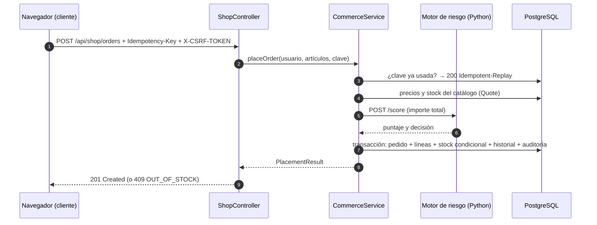

### Modelo de datos

Migraciones Flyway **no destructivas**: `V2__commerce_platform.sql` solo añade tablas y columnas (con valores por defecto y relleno de los pedidos existentes como `channel = 'LAB'`) y `V3__seed_catalog.sql` carga el catálogo. Se probó la actualización real: pedidos creados con la v2 siguen intactos tras migrar.

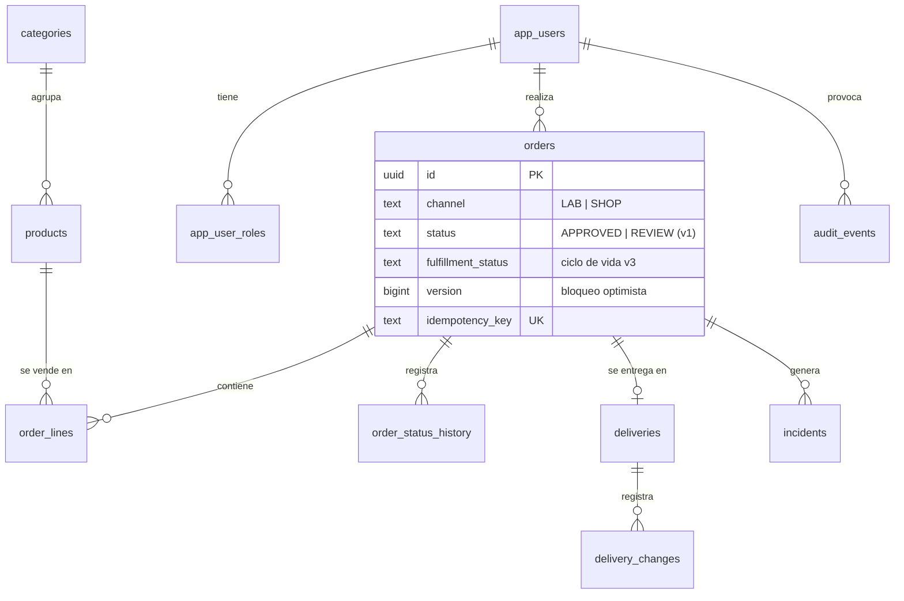

Los pedidos del laboratorio (`LAB`) y de la tienda (`SHOP`) comparten la tabla `orders`, pero `GET /api/orders` y `/api/orders/{id}` siguen mostrando solo los de laboratorio, para no exponer pedidos de clientes en una API pública. `/api/orders/statistics` conserva su significado original.

### Seguridad

- Sesión HTTP con cookie `HttpOnly`, regeneración del identificador al iniciar sesión y **CSRF** (`GET /api/auth/csrf` → cabecera `X-CSRF-TOKEN`).
- Contraseñas con **BCrypt (coste 12)**; validación de usuario, correo y contraseña en el dominio.
- Cabecera **Content-Security-Policy** (sin estilos ni scripts en línea), `X-Content-Type-Options`, `Referrer-Policy`.
- Autorización en dos niveles: reglas de URL en `SecurityConfiguration` **y** comprobaciones de rol en los casos de uso (`Guards`), probadas en `SecurityRulesTest` y en los tests de servicio.
- Un cliente solo ve sus pedidos (`404` para pedidos ajenos, sin revelar su existencia).
- Métricas de seguridad: `hexaorders_auth_logins_total{outcome}`, `hexaorders_access_denied_total{reason}` y alerta `HexaOrdersAuthFailuresSpike`.
- Secretos en archivos (`secrets/*.txt`) excluidos de Git; los del CI son efímeros y solo válidos en el runner.

### Capturas de la plataforma (datos reales)

Tomadas con Playwright contra el backend real (Java + Python + PostgreSQL 16 en local, sin Docker). Los productos proceden de la migración `V3`, y los pedidos, entregas e incidencias los crearon las propias pruebas.

| Tienda | Ficha de producto |
| --- | --- |
| 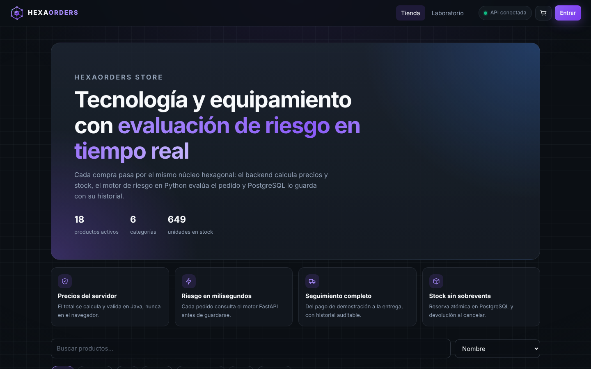 | 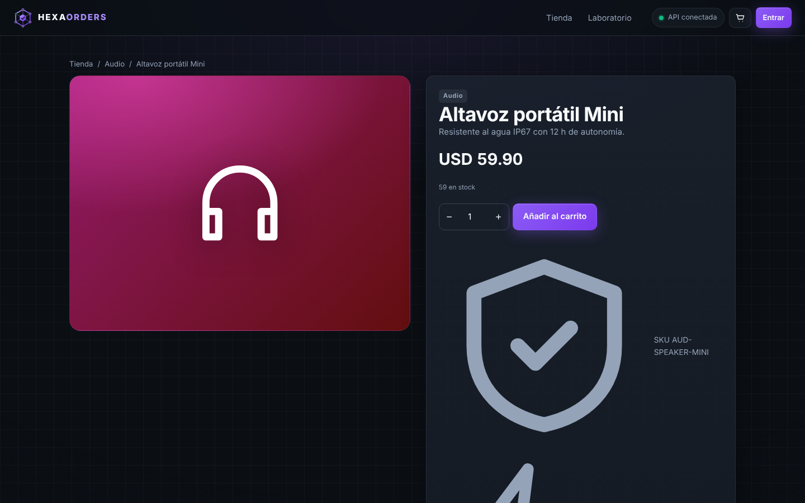 |
| **Checkout de demostración** | **Seguimiento del pedido** |
| 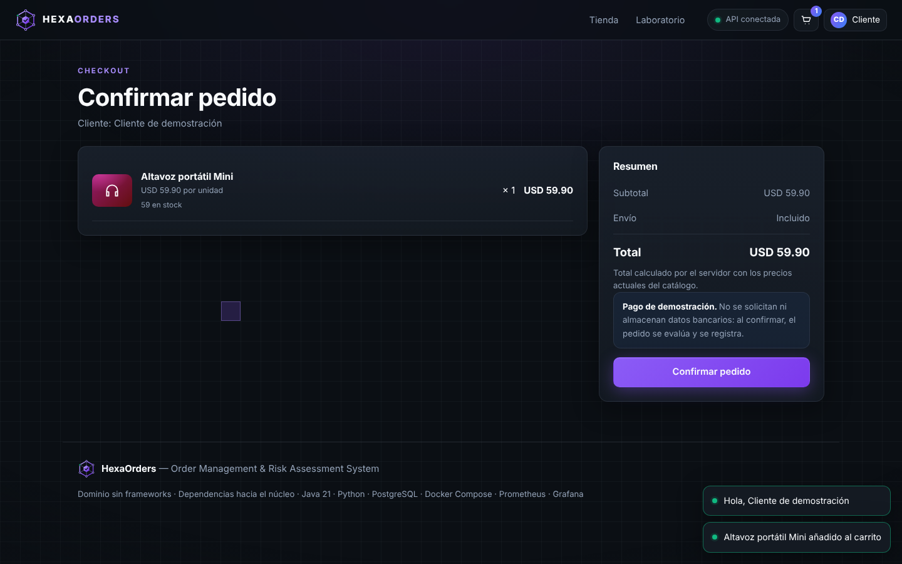 | 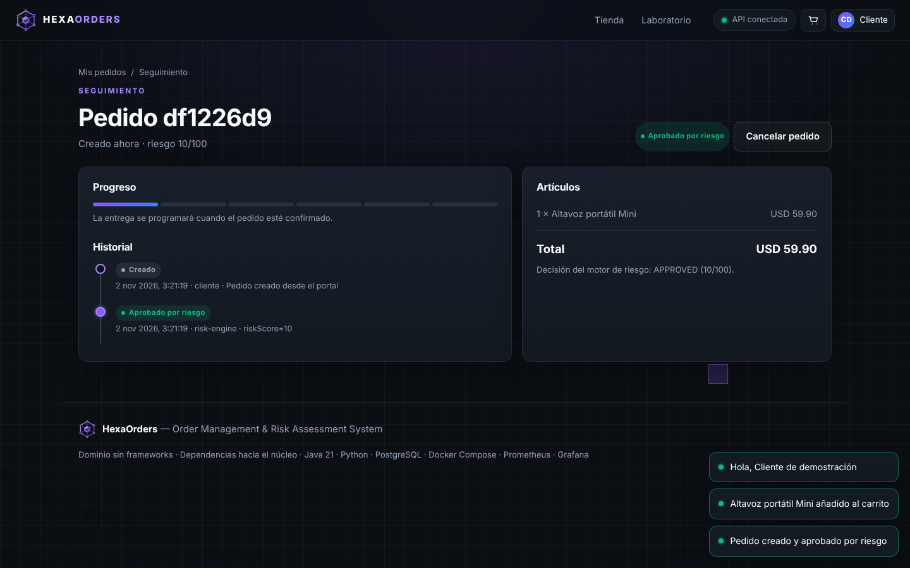 |
| **Centro de control (admin)** | **Usuarios y roles** |
| 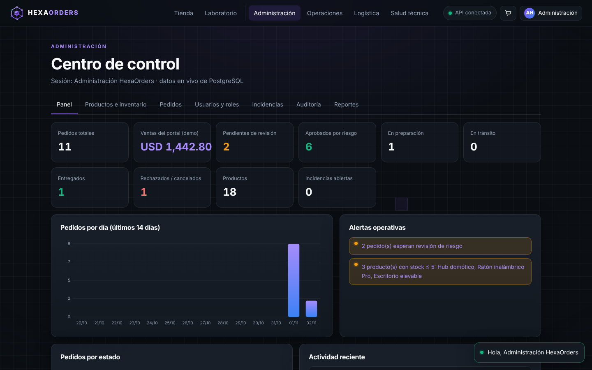 | 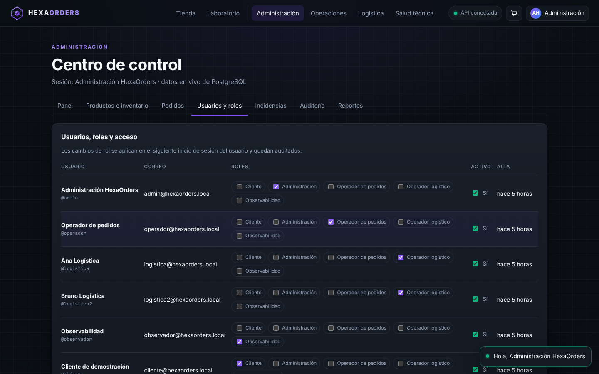 |
| **Detalle con transiciones permitidas** | **Operaciones** |
| 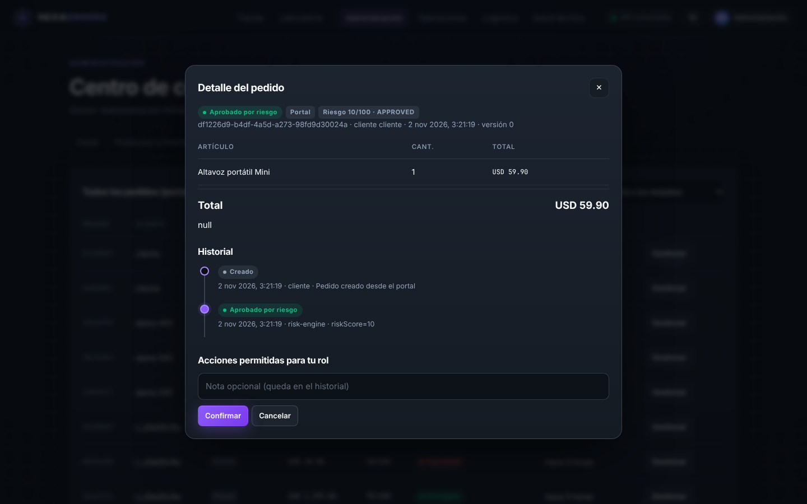 | 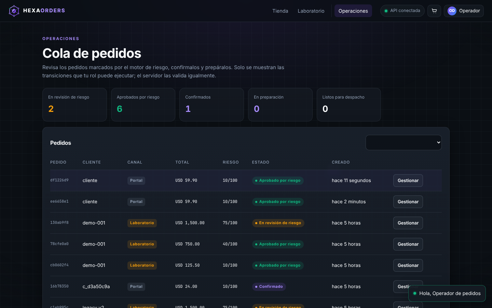 |
| **Calendario logístico (mes)** | **Calendario logístico (semana)** |
| 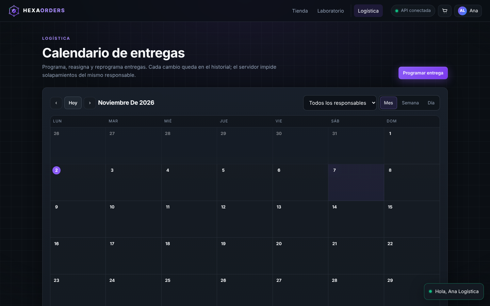 | 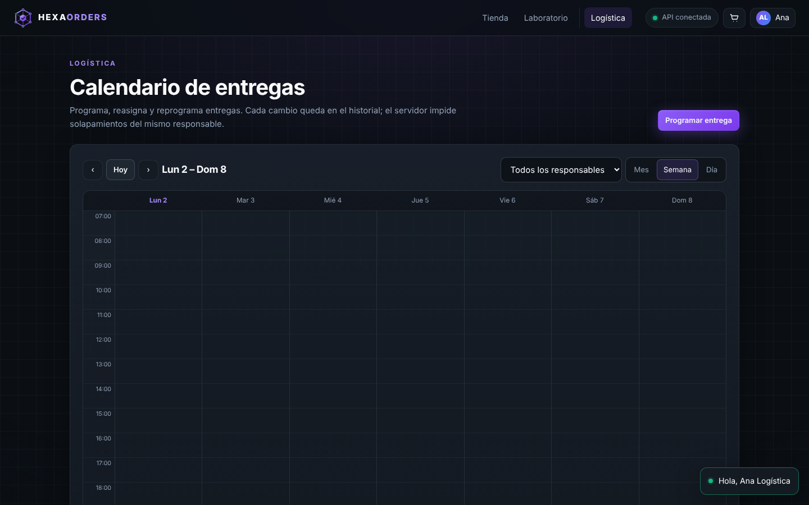 |
| **Informes** | **Salud técnica** |
| 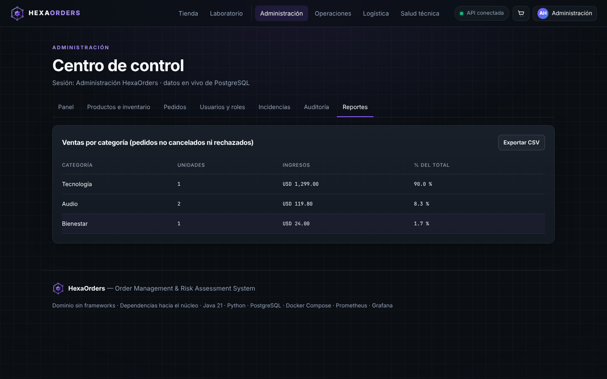 | 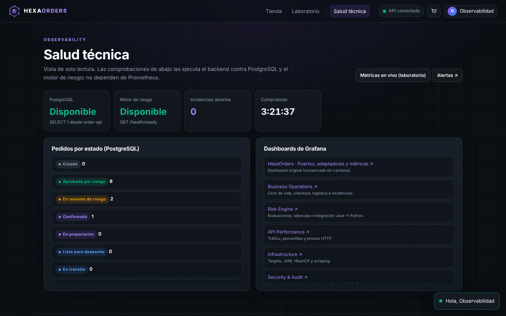 |

<p align="center">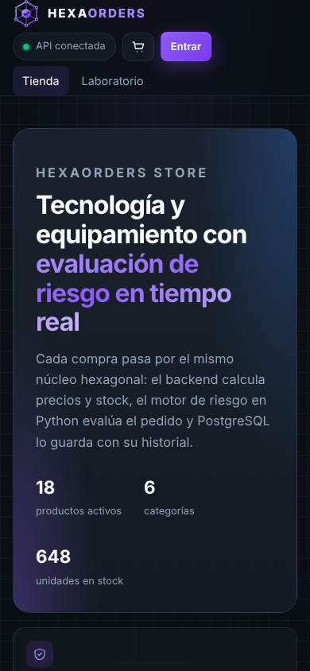</p>

Decisiones de diseño documentadas como ADR en [`docs/adr/`](docs/adr/). Guía para futuras herramientas o equipos: [`docs/ANTIGRAVITY_HANDOFF.md`](docs/ANTIGRAVITY_HANDOFF.md). Inventario de observabilidad conservada: [`docs/OBSERVABILITY_PRESERVATION.md`](docs/OBSERVABILITY_PRESERVATION.md).

## 🧰 Tecnologías

| Capa | Tecnología | Uso en el proyecto |
| --- | --- | --- |
| Servicio principal | Java 21 · Spring Boot 3.5 | API REST, composición de dependencias, JDBC, Actuator. |
| Motor de riesgo | Python 3.12 · FastAPI · Pydantic | `POST /score` con decimales exactos. |
| Base de datos | PostgreSQL 17.11 · Flyway | Tabla `orders`, migración versionada, volumen persistente. |
| Observabilidad | Micrometer · prometheus_client · Prometheus 3.5.1 · Grafana 12.4.1 | Métricas, alertas y dashboard como código. |
| Frontend | HTML5 · CSS3 · JavaScript nativo (módulos ES) | Interfaz servida por Spring Boot; sin frameworks ni librerías. |
| Contenedores | Docker · Docker Compose (BuildKit) | Cinco servicios, redes internas, secretos, healthchecks y límites. |
| Orquestación opcional | Kubernetes | 14 manifiestos validados contra el esquema oficial. |
| Pruebas | JUnit 5 · Mockito · ArchUnit · pytest · Playwright | Unitarias, de arquitectura, de API, de integración y de interfaz. |
| Automatización | GitHub Actions · PowerShell | CI en Ubuntu y Windows; `hexaorders.cmd` para Windows. |

## ⬡ Arquitectura hexagonal

La arquitectura hexagonal (Alistair Cockburn, 2005) separa el **interior** de la aplicación (dominio y casos de uso) de su **exterior** (HTTP, bases de datos, otros servicios). El interior define **puertos**, que son interfaces, y el exterior aporta **adaptadores** que los implementan o los usan. El hexágono es solo una forma de dibujarlo: no exige seis componentes.

| Concepto | En HexaOrders (Java) | En el motor de riesgo (Python) |
| --- | --- | --- |
| Dominio | `Order`, `OrderDraft`, `OrderStatus`, `OrderStatistics` | `domain/risk.py` (`Evaluation`, `assess`) |
| Caso de uso | `OrderService` | `ScoreRisk` |
| Puerto de entrada | `OrderUseCases` | `ScoreRiskPort` |
| Puertos de salida | `RiskAssessmentPort`, `OrderRepository`, `OrderTelemetry` | (no tiene: es un servicio sin estado ni E/S) |
| Adaptadores de entrada | `OrderController`, `ApiExceptionHandler` | `adapters/http.py` (FastAPI) |
| Adaptadores de salida | `HttpRiskAssessmentAdapter`, `JdbcOrderRepository`, `MicrometerOrderTelemetry` | — |
| Composition root | `HexagonalConfiguration` | `bootstrap.py` |

### Diagrama 1 — Estructura hexagonal: dependencias vs. ejecución

Las **flechas continuas** son dependencias del código fuente: apuntan hacia lo que se usa o implementa, y en el núcleo siempre hacia dentro. Las **flechas discontinuas** son comunicaciones en tiempo de ejecución. Fíjate en la inversión de dependencias: en ejecución, `OrderService` llama al adaptador HTTP, pero en el código es el adaptador el que depende del puerto.

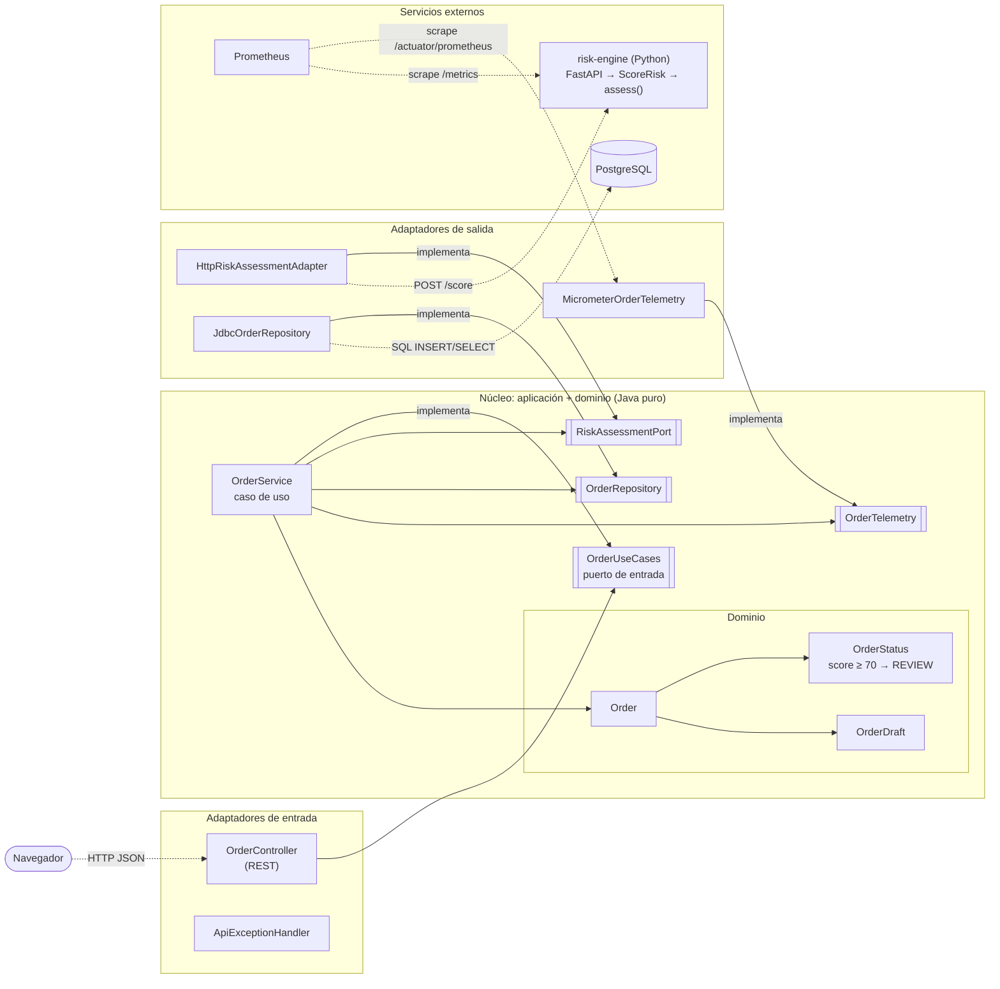

### Diagrama 2 — Secuencia de `POST /api/orders`

Interacción entre usuario, Java, Python y PostgreSQL con los nombres reales del código.

> Nota: las instrucciones mencionaban como referencia el gráfico de la página 6 de un PDF que no estaba disponible al preparar este README. El diagrama se ha construido a partir del código y cubre los siete pasos pedidos: solicitud, validación, petición de riesgo, respuesta de Python, decisión, persistencia y respuesta.

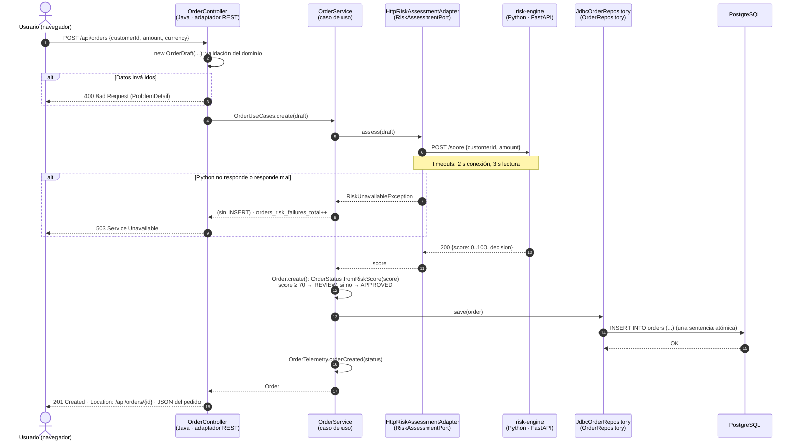

### Diagrama 3 — Infraestructura (Docker Compose)

Cinco servicios y cuatro redes. Solo la red `edge` publica puertos, y lo hace únicamente en `127.0.0.1`. PostgreSQL y el motor de riesgo no son accesibles desde fuera.

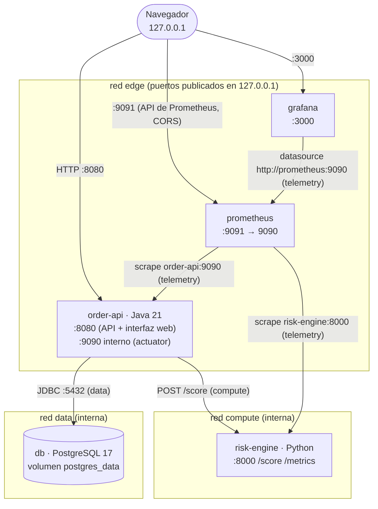

| Servicio | Redes | Puerto publicado | Seguridad |
| --- | --- | --- | --- |
| `db` | data | — | Contraseña desde secreto de archivo, `no-new-privileges`. |
| `risk-engine` | compute, telemetry | — | `read_only`, `cap_drop: ALL`, usuario sin privilegios. |
| `order-api` | edge, data, compute, telemetry | `127.0.0.1:8080` | `read_only`, `cap_drop: ALL`, secreto de archivo. |
| `prometheus` | edge, telemetry | `127.0.0.1:9091` | `read_only`, configuración incorporada en la imagen. |
| `grafana` | edge, telemetry | `127.0.0.1:3000` | `read_only`, contraseña de admin desde secreto de archivo. |

## 📁 Estructura de carpetas

<details>
<summary>Ver el árbol del repositorio</summary>

```text
.
├── docker-compose.yml          ← ENTREGABLE: un único YAML autosuficiente (generado)
├── hexaorders.cmd              ← lanzador para Windows
├── infra/
│   ├── compose.base.yml        ← plantilla fuente del docker-compose.yml
│   ├── prometheus/             ← prometheus.yml, alerts.yml, Dockerfile
│   └── grafana/                ← datasource, proveedor, dashboard JSON, Dockerfile
├── services/
│   ├── order-api/              ← Java 21 / Spring Boot
│   │   └── src/main/java/com/hexaorders/
│   │       ├── domain/         ← Order, OrderDraft, OrderStatus, OrderStatistics
│   │       ├── application/
│   │       │   ├── port/in/    ← OrderUseCases
│   │       │   ├── port/out/   ← RiskAssessmentPort, OrderRepository, OrderTelemetry
│   │       │   ├── service/    ← OrderService
│   │       │   └── exception/
│   │       ├── adapter/in/web/ ← OrderController, ApiExceptionHandler
│   │       ├── adapter/out/    ← http/, persistence/, metrics/
│   │       └── config/         ← HexagonalConfiguration (composition root)
│   │   └── src/main/resources/
│   │       ├── static/         ← interfaz web: index.html, css/, js/, img/
│   │       └── db/migration/   ← V1__create_orders.sql (Flyway)
│   └── risk-engine/            ← Python / FastAPI
│       └── risk_engine/
│           ├── domain/         ← risk.py
│           ├── application/    ← ports.py, score_risk.py
│           ├── adapters/       ← http.py
│           └── bootstrap.py    ← composition root
├── k8s/                        ← 14 objetos Kubernetes (opcional)
├── tools/
│   ├── hexaorders.ps1          ← CLI: start, stop, verify, check, test…
│   ├── generate_delivery.py    ← genera docker-compose.yml y el ConfigMap k8s
│   ├── validate_delivery.py    ← valida el entregable y los manifiestos
│   ├── smoke.py                ← prueba HTTP integral
│   └── ui-e2e/                 ← prueba de la interfaz con Playwright
├── docs/                       ← documentación en español y guía en inglés
└── .github/workflows/verify.yml
```

</details>

## 🧩 Componentes

| Componente | Archivo | Responsabilidad |
| --- | --- | --- |
| `OrderDraft` | `domain/OrderDraft.java` | Valida customerId `[A-Za-z0-9_-]{1,64}`, importe > 0 y ≤ 1 000 000.00 con 2 decimales como máximo (sin redondeo) y moneda USD. |
| `OrderStatus` | `domain/OrderStatus.java` | Regla de decisión: puntaje ≥ 70 → `REVIEW`, < 70 → `APPROVED`. |
| `Order` | `domain/Order.java` | Entidad; garantiza que el estado corresponde al puntaje. |
| `OrderStatistics` | `domain/OrderStatistics.java` | Totales por estado; el total siempre es la suma de ambos. |
| `OrderService` | `application/service/OrderService.java` | Caso de uso: riesgo primero, luego un único `INSERT`; sin riesgo no hay pedido. |
| `HttpRiskAssessmentAdapter` | `adapter/out/http/…` | Cliente HTTP del motor de riesgo; valida la respuesta. |
| `JdbcOrderRepository` | `adapter/out/persistence/…` | SQL con `JdbcTemplate`; errores → `PersistenceUnavailableException`. |
| `MicrometerOrderTelemetry` | `adapter/out/metrics/…` | Contadores `orders_created_total{status}` y `orders_risk_failures_total`. |
| `risk.py` | `risk_engine/domain/risk.py` | Importe < 500 → 10; 500–999.99 → 40; ≥ 1000 → 75. |

## ✅ Requisitos previos

| Uso | Necesitas |
| --- | --- |
| Ejecutar el proyecto | Docker Desktop (Windows/macOS) o Docker Engine (Linux) con **contenedores Linux**, Compose ≥ 2.23.1 y BuildKit. Internet en la primera construcción. Orientativo: 2 vCPU, 8 GB RAM y 30 GB de disco. |
| Comandos de `hexaorders.cmd` | Windows PowerShell 5.1 (incluido en Windows) o PowerShell 7. |
| Editar y regenerar el YAML | Python 3.12 (`py -m pip install -r requirements-tools.txt` para validar). |
| Tests fuera de Docker (opcional) | Java 21 + Maven 3.9 y Python 3.12. |

No necesitas Java ni Python instalados para **ejecutar** el proyecto: los builds Docker compilan y ejecutan las pruebas de ambos servicios.

## 🚀 Inicio rápido

En Windows, con Docker Desktop abierto (*Engine running*), desde **PowerShell o CMD** en la carpeta del proyecto:

```powershell
.\hexaorders.cmd start
```

El comando genera los secretos si faltan (`secrets\db_password.txt`, `secrets\grafana_password.txt` y `secrets\demo_password.txt`, aleatorios y excluidos de Git; nunca sobrescribe uno existente), valida el YAML, construye las imágenes ejecutando los tests de Java y Python y arranca los cinco servicios, esperando a que estén sanos.

| URL | Qué hay |
| --- | --- |
| <http://127.0.0.1:8080> | Sitio web multipágina (inicio, catálogo, portales por rol, monitoreo) y API REST |
| <http://127.0.0.1:8080/login.html> | Acceso con una cuenta demo (contraseña en `secrets\demo_password.txt`) |
| <http://127.0.0.1:8080/laboratorio.html> | Laboratorio original: alta de pedidos, panel y explorador de arquitectura |
| <http://127.0.0.1:3000/d/hexaorders> | Dashboard original de Grafana (usuario `admin`, contraseña en `secrets\grafana_password.txt`) · nuevos: `/d/hexaorders-business`, `/d/hexaorders-risk`, `/d/hexaorders-api`, `/d/hexaorders-infrastructure`, `/d/hexaorders-security`, `/d/hexaorders-logistics` |
| <http://127.0.0.1:9091/targets> | Targets de Prometheus · [alertas](http://127.0.0.1:9091/alerts) |

<details>
<summary>Todos los comandos de <code>hexaorders.cmd</code></summary>

| Comando | Qué hace |
| --- | --- |
| `.\hexaorders.cmd start` | Secretos + validación + build + arranque de los cinco servicios. |
| `.\hexaorders.cmd status` | Estado de los contenedores. |
| `.\hexaorders.cmd logs` | Últimas 100 líneas de log de cada servicio. |
| `.\hexaorders.cmd stop` | Detiene los servicios **conservando** los datos. |
| `.\hexaorders.cmd stop -RemoveData` | Detiene y **elimina** pedidos, métricas y datos de Grafana. |
| `.\hexaorders.cmd verify` | La misma prueba integral que ejecuta GitHub, en un entorno aislado que se elimina al terminar. |
| `.\hexaorders.cmd check` | Entregable al día y válido, observabilidad conservada y sitio multipágina coherente (páginas, rutas, enlaces, CSP, reglas por rol). |
| `.\hexaorders.cmd test` | Tests unitarios locales (Python + Maven). |
| `.\hexaorders.cmd k8s-secrets` | Crea el Secret de Kubernetes desde `secrets\*.txt`. |
| `.\hexaorders.cmd help` | Ayuda completa. |

En Linux o macOS, los mismos comandos con PowerShell 7: `pwsh ./tools/hexaorders.ps1 start`.

</details>

## 🐳 Ejecución con Docker Compose

`docker-compose.yml` es el **entregable principal** y es **autosuficiente**: contiene, mediante `build.dockerfile_inline` y heredocs de BuildKit, los Dockerfiles, el código fuente, los tests, la interfaz web y la configuración de Prometheus y Grafana. Basta con copiar ese archivo a otra máquina y crear allí los cuatro secretos (v5: se añade `rabbitmq_password.txt`).

```powershell
New-Item -ItemType Directory secrets -Force | Out-Null
# Crea secrets\db_password.txt, grafana_password.txt, demo_password.txt y rabbitmq_password.txt (aleatorios; no sobrescribe)
.\tools\init-env.ps1
docker compose config --quiet
$env:COMPOSE_PROFILES = 'full'   # v5: omítelo para el modo básico
docker compose build --pull
docker compose up -d --wait --wait-timeout 240
docker compose ps
```

> **No edites `docker-compose.yml` a mano.** Se genera desde `infra/compose.base.yml`, `services/` e `infra/` con `py tools\generate_delivery.py`. `--check` y el CI detectan cualquier divergencia.

<details>
<summary>Qué incluye el YAML (healthchecks, límites, secretos, volúmenes)</summary>

- **Healthchecks** en los 13 servicios (v5; perfil `full` para los 7 opcionales); `order-api` espera a `db` y `risk-engine` sanos (`depends_on: condition: service_healthy`).
- **Límites** de memoria y CPU (`mem_limit`, `cpus`) y rotación de logs.
- **Secretos** de tipo archivo montados en `/run/secrets` (Compose solo admite este tipo en servicios `read_only`).
- **Volúmenes** `postgres_data`, `prometheus_data` y `grafana_data`: `docker compose down` los conserva y `down -v` los elimina.
- **Endurecimiento**: `read_only`, `cap_drop: ALL`, `no-new-privileges`, `tmpfs` para `/tmp` y usuarios sin privilegios.

</details>

## 🔌 Endpoints

| Método | Ruta | Descripción | Respuestas |
| --- | --- | --- | --- |
| `POST` | `/api/orders` | Evalúa el riesgo y crea un pedido | `201` + `Location`, `400`, `503` |
| `GET` | `/api/orders` | Últimos 50 pedidos (más reciente primero) | `200`, `503` |
| `GET` | `/api/orders/{id}` | Pedido por UUID | `200`, `400` (UUID mal formado), `404` |
| `GET` | `/api/orders/statistics` | Totales de **todos** los pedidos persistidos | `200`, `503` |
| `GET` | `/` | Interfaz web (estáticos servidos por Spring Boot) | `200` |
| `POST` | `risk-engine:8000/score` | Motor de riesgo (solo red interna) | `200`, `415`, `422` |

**API de la plataforma v3** (sesión + cabecera `X-CSRF-TOKEN` en las peticiones que modifican datos):

| Ruta | Acceso | Operaciones |
| --- | --- | --- |
| `/api/auth/{csrf,me,login,logout,register}` | público | Token CSRF, sesión actual, entrar, salir, registro de clientes |
| `GET /api/catalog/{categories,products,products/{id}}` | público | Catálogo con búsqueda (`q`) y filtro por categoría (`category`) |
| `POST /api/shop/quote` | público | Presupuesto calculado en el servidor |
| `/api/shop/orders[/{id}[/cancel]]` | `CUSTOMER` | Checkout (`Idempotency-Key` obligatorio; `201` o `200` + `Idempotent-Replay`; `shipping` opcional desde la v4), mis pedidos, cancelar |
| `/api/account/{me,profile,password}` | con sesión | Perfil y contraseña |
| `/api/operations/orders[/{id}[/transitions]]` | `ORDER_OPERATOR`, `ADMIN` | Bandeja y transiciones |
| `/api/logistics/{deliveries,assignees,schedulable-orders}`, `/deliveries/{id}[/history]`, `/orders/{id}/transitions` | `LOGISTICS_OPERATOR`, `ADMIN` | Calendario, programación, reprogramación, historial, despacho y entrega |
| `/api/incidents[/{id}/resolve]` | `ORDER_OPERATOR`, `LOGISTICS_OPERATOR`, `ADMIN` | Listar, reportar y resolver incidencias |
| `/api/admin/{dashboard,users,audit,products,categories}` | `ADMIN` | Administración completa |
| `GET /api/ops/health` | `OBSERVABILITY_VIEWER`, `ADMIN` | Salud de dependencias |
| `GET /api/ops/monitoring` (v4) | `OBSERVABILITY_VIEWER`, `ADMIN` | Targets, reglas de alerta e indicadores leídos de Prometheus por el backend |
| `POST /api/contact` (v4) | público (con CSRF) | Mensaje de la página de contacto (`201`, sin devolver datos personales) |
| `GET /api/admin/contact-messages` (v4) | `ADMIN` | Mensajes de contacto recibidos |

Códigos: `400` validación, `401` sin sesión, `403` sin rol o CSRF ausente, `404` inexistente o ajeno, `409` (con `code` en los conflictos de negocio: `OUT_OF_STOCK`, `CONCURRENT_UPDATE`, `SCHEDULE_CONFLICT`, `IDEMPOTENCY_KEY_REUSED`, `SELF_LOCKOUT`…), `503` motor de riesgo o PostgreSQL no disponible.

Métricas internas: `order-api:9090/actuator/prometheus`, `order-api:9090/actuator/health/{liveness,readiness}`, `risk-engine:8000/metrics`, `risk-engine:8000/health/{live,ready}`.

## 📨 Ejemplos de solicitudes y respuestas

Colección de Postman y archivo `.http` listos para usar: [`docs/demo/`](docs/demo/).

<details open>
<summary><code>POST /api/orders</code> — pedido aprobado</summary>

```powershell
$body = @{ customerId = 'cliente_demo'; amount = 125.50; currency = 'USD' } | ConvertTo-Json
Invoke-RestMethod http://127.0.0.1:8080/api/orders -Method Post -ContentType 'application/json' -Body $body
```

```http
HTTP/1.1 201 Created
Location: /api/orders/0d0c7e2e-…
Content-Type: application/json

{"id":"0d0c7e2e-…","customerId":"cliente_demo","amount":125.50,"currency":"USD","riskScore":10,"status":"APPROVED","createdAt":"2026-11-01T21:00:00.123Z"}
```

</details>

<details>
<summary><code>POST /api/orders</code> — pedido en revisión (importe ≥ 1000)</summary>

```json
{"customerId": "cliente_demo", "amount": 1500.00, "currency": "USD"}
```

Respuesta `201` con `"riskScore": 75, "status": "REVIEW"`.

</details>

<details>
<summary>Validación (400), no encontrado (404) y motor de riesgo caído (503)</summary>

```json
{"type":"about:blank","title":"Solicitud inválida","status":400,"detail":"amount: debe ser mayor que 0 y menor o igual que 1000000.00"}
```

```json
{"type":"about:blank","title":"Motor de riesgo no disponible","status":503,"detail":"No se creó ningún pedido; vuelva a intentar más tarde"}
```

</details>

<details>
<summary><code>GET /api/orders/statistics</code></summary>

```json
{"total": 3, "approved": 2, "review": 1}
```

</details>

Los valores de los ejemplos son ilustrativos (los `id` y las fechas cambian en cada ejecución). Los campos `title`, `status` y `detail` de los errores son los que fija `ApiExceptionHandler`; Spring puede añadir campos estándar de RFC 9457, como `instance`.

## 🔗 Integración Java ↔ Python

| Aspecto | Implementación |
| --- | --- |
| Contrato | `POST /score` · petición `{"customerId": "…", "amount": 125.50}` · respuesta `{"score": 0..100, "decision": "APPROVED"\|"REVIEW"}` |
| Decimales | Python lee el JSON con `parse_float=Decimal`: no hay pérdida de precisión por `float`. |
| Timeouts | 2 s de conexión y 3 s de lectura (`HexagonalConfiguration`). |
| Validación | Java valida la respuesta (puntaje 0..100, decisión conocida); si no es válida → `RiskUnavailableException`. |
| Autoridad | La decisión final la toma el dominio Java (`OrderStatus.fromRiskScore`), aunque Python devuelva su propia decisión. |
| Fallo | Si Python no responde: **no se guarda nada**, se incrementa `orders_risk_failures_total` y el cliente recibe `503`. |
| Red | Solo por la red interna `compute`: `http://risk-engine:8000`. |

## 🐘 Persistencia en PostgreSQL

- **Migración** Flyway `V1__create_orders.sql`: tabla `orders` con restricciones `CHECK` que repiten las invariantes del dominio (formato de cliente, rango del importe, moneda, puntaje 0..100 y estado coherente con el puntaje). `clean-disabled: true` impide borrar el esquema desde Flyway.
- **Atomicidad**: un único `INSERT`, después de la llamada de riesgo; nunca se mantiene una transacción abierta durante una llamada de red.
- **Consultas**: por id, los últimos 50 (índice `orders_created_at_idx`) y un conteo agregado por estado (`count(*) FILTER (WHERE status = …)`).
- **Persistencia**: volumen `postgres_data`. Los pedidos sobreviven a `stop`/`start` y a `docker compose down`.
- **Credenciales**: contraseña en `secrets/db_password.txt` (fuera de Git), leída desde `/run/secrets/db_password`.

## 📈 Monitoreo con Prometheus

Prometheus recoge métricas cada 10 s (`infra/prometheus/prometheus.yml`).

| Métrica | Origen | Significado |
| --- | --- | --- |
| `orders_created_total{status}` | Java · `MicrometerOrderTelemetry` | Pedidos persistidos por decisión. |
| `orders_risk_failures_total` | Java · `MicrometerOrderTelemetry` | Fallos del motor de riesgo. |
| `http_server_requests_seconds_*{uri,status}` | Java · Spring Boot Actuator | Peticiones, códigos y latencia (con histograma). |
| `risk_evaluations_total{decision}` | Python · prometheus_client | Evaluaciones realizadas. |
| `risk_evaluation_duration_seconds_*` | Python · prometheus_client | Duración del caso de uso de riesgo. |
| `up{job}` | Prometheus | Disponibilidad de cada target. |

Métricas nuevas de la v3 (las anteriores no cambian):

| Métrica | Significado |
| --- | --- |
| `hexaorders_shop_orders_placed_total{risk_decision}` | Pedidos de la tienda por decisión de riesgo. |
| `hexaorders_checkout_failures_total{reason}` | Checkouts fallidos (`invalid`, `out_of_stock`, `risk_unavailable`). |
| `hexaorders_order_transitions_total{from,to}` | Transiciones del ciclo de vida. |
| `hexaorders_orders_by_status{status}` | Pedidos actuales por estado (gauge leído de PostgreSQL con caché de 15 s). |
| `hexaorders_deliveries_total{type}` · `hexaorders_delivery_conflicts_total` | Entregas programadas/reprogramadas y conflictos detectados. |
| `hexaorders_incidents_reported_total{category}` · `hexaorders_incidents_open` | Incidencias reportadas y abiertas. |
| `hexaorders_products_low_stock` | Productos activos con stock bajo. |
| `hexaorders_auth_logins_total{outcome}` · `hexaorders_access_denied_total{reason}` | Inicios de sesión y accesos denegados. |
| `risk_requests_rejected_total{reason}` | Peticiones rechazadas por el motor Python (validación). |

Reglas de alerta (`alerts.yml`): `HexaOrdersServiceDown` (un servicio sin responder durante 30 s) y `RiskRequestsFailing` (fallos de riesgo en los últimos 2 minutos), **sin cambios**; la v3 añade `RiskEngineDown`, `HexaOrdersHighErrorRate`, `HexaOrdersHighLatency`, `HexaOrdersCheckoutFailures`, `HexaOrdersPendingReviewGrowing`, `HexaOrdersAuthFailuresSpike` y `HexaOrdersLowStock`, y la regla de registro `orders_created_total` (ver [defecto corregido](docs/OBSERVABILITY_PRESERVATION.md#10-defectos-encontrados-y-corregidos)). Se ven en <http://127.0.0.1:9091/alerts>; no hay Alertmanager ni envío de correos.

## 📊 Dashboard de Grafana

El datasource y el dashboard se aprovisionan como código: no hay que configurar nada a mano. Dashboard **«HexaOrders · Puertos, adaptadores y métricas»** en <http://127.0.0.1:3000/d/hexaorders>:

| Panel | PromQL principal |
| --- | --- |
| Servicios disponibles | `up{job=~"order-api\|risk-engine"}` |
| Pedidos creados / fallos de riesgo | `sum(orders_created_total)` · `sum(orders_risk_failures_total)` |
| Pedidos por estado / segundo | `sum by(status)(rate(orders_created_total[2m]))` |
| Evaluaciones de riesgo / segundo | `sum by(decision)(rate(risk_evaluations_total[2m]))` |
| Latencia p95 Java y Python | `histogram_quantile(0.95, …_bucket)` |
| Respuestas HTTP por código | `sum by(status)(rate(http_server_requests_seconds_count{uri=~"/api/orders.*"}[2m]))` |
| Errores 5xx | `sum by(uri, status)(rate(http_server_requests_seconds_count{status=~"5.."}[2m]))` |

Las gráficas de tasas necesitan tráfico durante unos 30 segundos y varias muestras.

Dashboards añadidos en la v3 (el original se conserva sin cambios y `check_observability.py` lo vigila):

| Dashboard | URL | Contenido |
| --- | --- | --- |
| Negocio | `/d/hexaorders-business` | Pedidos de la tienda, embudo por estado, transiciones, entregas, incidencias, stock bajo |
| Riesgo | `/d/hexaorders-risk` | Evaluaciones, decisiones, latencia del motor, rechazos y fallos |
| API | `/d/hexaorders-api` | Tráfico por ruta, códigos, p50/p95/p99, errores 4xx/5xx |
| Infraestructura | `/d/hexaorders-infrastructure` | Disponibilidad, JVM (memoria, GC, hilos), HikariCP, proceso Python, Prometheus |
| Seguridad | `/d/hexaorders-security` | Inicios de sesión por resultado, accesos denegados, 401/403 |
| Logística (v4) | `/d/hexaorders-logistics` | Tramo logístico: listos, en tránsito, entregados, programación, conflictos e incidencias |

## ☸️ Despliegue en Kubernetes

Es **opcional y complementario**: el despliegue principal es Docker Compose. Los 14 objetos de `k8s/` (namespace, ConfigMap, Secret externo, StatefulSet de PostgreSQL, Deployments, Services y PVC) mantienen los mismos contratos.

```powershell
.\hexaorders.cmd k8s-secrets
kubectl apply -f k8s/
```

Guía paso a paso (kind, registro, port-forward): [`k8s/README.md`](k8s/README.md). Los manifiestos se han **validado estáticamente** contra el esquema OpenAPI oficial de Kubernetes 1.34.1; **no se han desplegado en un clúster** como parte de este trabajo.

## 🖥️ Interfaz web

Interfaz en español, servida por Spring Boot desde `src/main/resources/static/`. Desde la v4 es un sitio multipágina ([`docs/FRONTEND_PAGES.md`](docs/FRONTEND_PAGES.md)); el **laboratorio original** descrito aquí está íntegro en `laboratorio.html`, con `css/` (base, componentes, efectos) y `js/` (módulos ES nativos). No usa frameworks ni librerías.

| Sección | Datos |
| --- | --- |
| **Bienvenida** | Comprueba de verdad la API y Prometheus; nunca bloquea (Enter, Escape o clic para entrar). |
| **Panel** | Totales de `GET /api/orders/statistics` y últimos pedidos de `GET /api/orders`. |
| **Pedidos** | Alta con validación (el dominio sigue siendo la autoridad), consulta por UUID y listado con filtro y búsqueda. |
| **Arquitectura** | Explorador interactivo con clases y archivos reales, vistas de dependencias y de ejecución, y una solicitud real cuyo resultado (HTTP, latencia, relectura en PostgreSQL) se muestra junto al recorrido conceptual, identificado como tal. |
| **Observabilidad** | Targets y métricas reales de Prometheus; avisa si Prometheus o Grafana no responden sin bloquear el resto. |

<details open>
<summary>Capturas de la interfaz (datos reales)</summary>

Capturas tomadas por la prueba `tools/ui-e2e` con Java, Python y PostgreSQL ejecutándose de verdad (en local, sin Docker); los pedidos que aparecen fueron creados por las propias pruebas.

| Bienvenida | Panel |
| --- | --- |
| 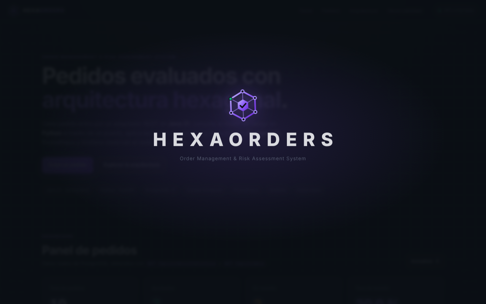 | 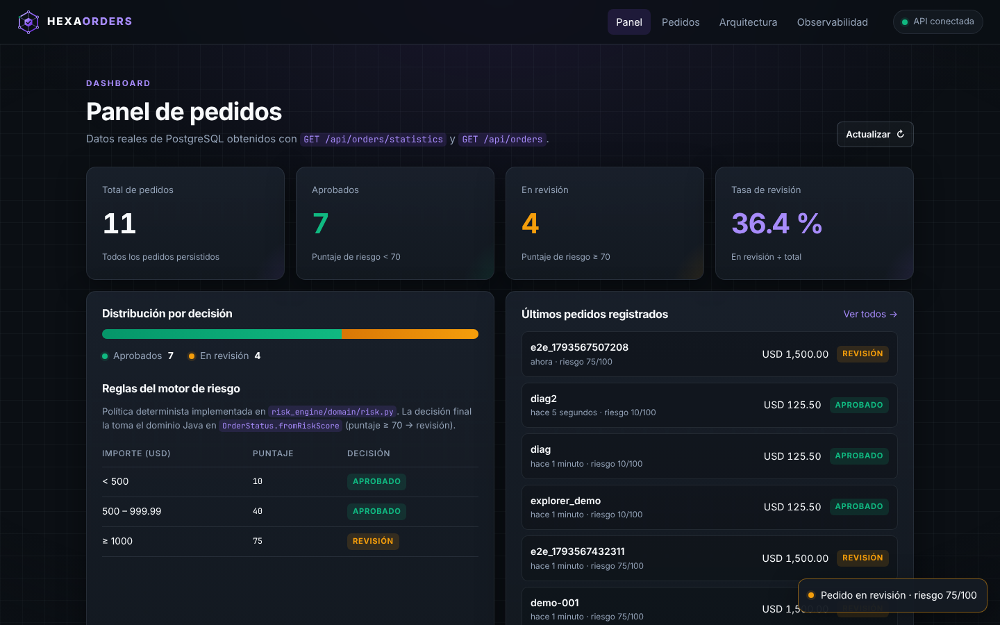 |
| **Gestión de pedidos** | **Explorador de arquitectura** |
| 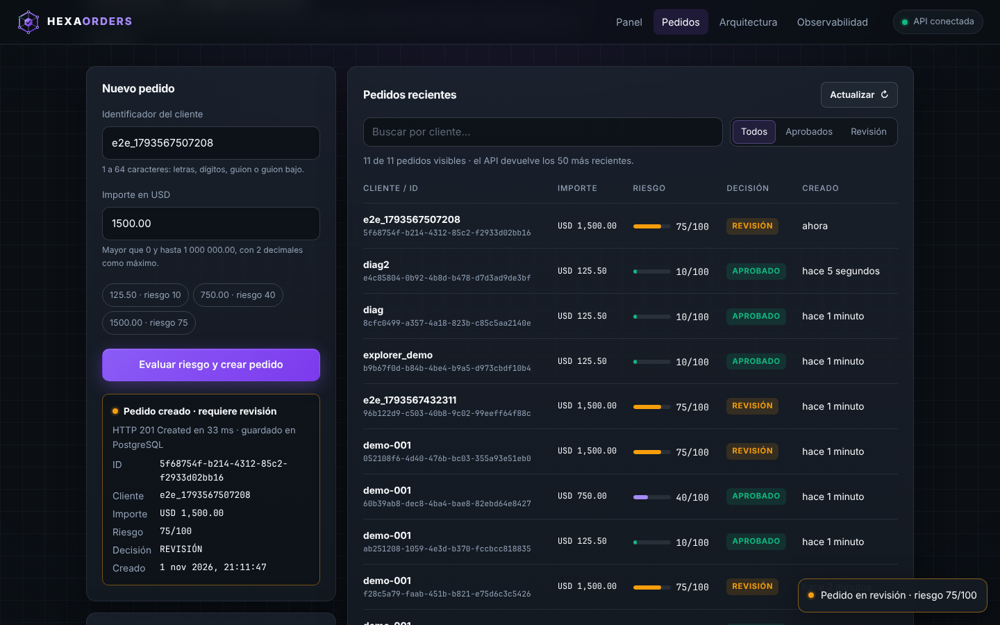 | 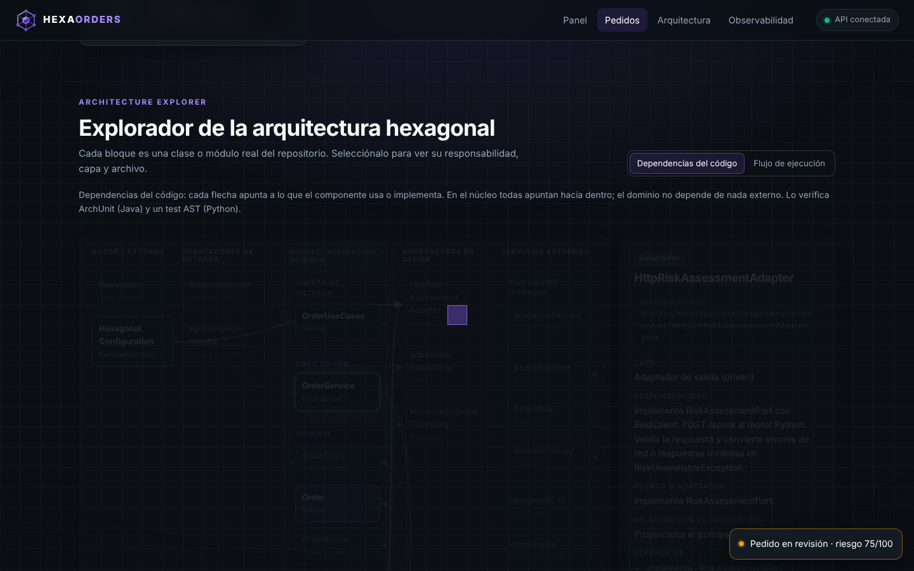 |

</details>

El fondo es una **cuadrícula interactiva** dibujada en un único `<canvas>`: se ilumina en violeta bajo el cursor y se desvanece en unos 1,7 s. Solo anima mientras hay celdas encendidas y respeta `prefers-reduced-motion`. La interfaz se adapta a móviles y se puede usar con el teclado.

## 🧪 Pruebas

| Tipo | Dónde | Qué comprueba |
| --- | --- | --- |
| Dominio (Java) | `OrderDomainTest` | Umbral 70, importes sin redondeo, identificadores, moneda, estadísticas. |
| Caso de uso | `OrderServiceTest` | Riesgo antes de persistir, cero `INSERT` si falla el riesgo, estadísticas. |
| API (Java) | `OrderControllerTest`, `HttpRiskAssessmentAdapterTest` | Códigos 201/400/404/503, `Location`, `/statistics`, respuestas inválidas de Python. |
| Arquitectura | `HexagonalArchitectureTest` (ArchUnit), `test_architecture.py` (AST) | Núcleo sin frameworks; dominio en el centro; adaptadores de entrada sin dependencias de los de salida. |
| Python | `test_domain.py`, `test_api.py` | Reglas, decimales exactos, validación, métricas. |
| Integración | `tools/smoke.py` (dentro de `verify`) | Tres pedidos reales, persistencia, estadísticas, 400, recursos del frontend servidos idénticos, targets y dashboard. |
| Fallo y recuperación | `tools/hexaorders.ps1 verify` | Con `risk-engine` detenido la API responde 503; al volver, todo queda sano. |
| Interfaz | `tools/ui-e2e/ui-e2e.js` (Playwright) | Navegador real contra el stack real: panel, alta, consulta, explorador, observabilidad y móvil. |
| Entregable | `generate_delivery.py --check`, `validate_delivery.py` | YAML al día y autosuficiente, `read_only`, secretos, 14 objetos Kubernetes. |
| Dominio v3 | `LifecycleDomainTest` | Política de transiciones por rol, validación de usuarios, productos, entregas y presupuestos. |
| Casos de uso v3 | `CommerceServiceTest`, `OperationsAndLogisticsTest` | Riesgo antes de la transacción, idempotencia, stock, concurrencia, conflictos de calendario, autobloqueo. |
| Seguridad y roles | `SecurityRulesTest` | 401/403 por rol, CSRF, rutas públicas y API original sin cambios. |
| Arquitectura v3 | `HexagonalArchitectureTest` | Nueva regla: los adaptadores de entrada solo usan puertos de entrada. |
| Plataforma | `tools/platform_smoke.py` (dentro de `verify`) | 35 comprobaciones HTTP reales: catálogo, precios del servidor, registro, checkout idempotente, stock, aislamiento entre clientes, transiciones, 409, calendario, incidencias, auditoría, roles y métricas en Prometheus. |
| Observabilidad | `tools/check_observability.py` (dentro de `check`) | Ningún dashboard, panel, consulta, datasource, job, alerta o métrica previa desaparece o cambia. |
| Interfaz v3 | `tools/ui-e2e/ui-e2e.js` | Checkout de cliente, KPIs de admin, usuarios, detalle de operador, calendario logístico y restricciones del observador. |
| Sitio v4 | `tools/ui-e2e/pages-e2e.js` | Las 39 páginas como visitante y con los 5 roles (200/302/403/404), enlaces sin 404, recarga, contacto, checkout con dirección, monitoreo con Prometheus real, móvil, sin errores de JavaScript ni 5xx. |
| Frontend estático | `tools/check_frontend.py` (en `check`) | Páginas al día con el registro, rutas registradas, recursos y enlaces existentes, CSP sin código en línea, reglas de seguridad por página, transiciones iguales al dominio. |
| v4 (Java) | `WebPlatformDomainTest`, `WebPlatformServicesTest`, `PrometheusMonitoringAdapterTest`, `SecurityRulesTest` | Dirección y contacto en el dominio, servicios de contacto y monitoreo, adaptador de Prometheus, redirecciones y 403 de las páginas. |

```powershell
.\hexaorders.cmd check     # entregable + validación
.\hexaorders.cmd test      # tests unitarios locales
.\hexaorders.cmd verify    # integración completa con Docker
```

El workflow [`verify.yml`](.github/workflows/verify.yml) ejecuta todo lo anterior en cada push. En Ubuntu: `verify` y la prueba de interfaz, con capturas descargables como artefacto. En Windows Server: scripts, generador y tests unitarios. Resultados documentados en [`docs/validacion.md`](docs/validacion.md).

## 🚨 Manejo de errores

| Situación | Excepción | HTTP | ¿Se guarda? |
| --- | --- | --- | --- |
| Datos inválidos (importe, cliente, moneda, JSON, UUID) | `IllegalArgumentException` / errores de lectura | `400` | No |
| Pedido inexistente | `OrderNotFoundException` | `404` | — |
| Motor de riesgo caído, lento o con respuesta inválida | `RiskUnavailableException` | `503` | **No** |
| PostgreSQL no disponible | `PersistenceUnavailableException` | `503` | No |

Las respuestas siguen RFC 9457 (`ProblemDetail`) y nunca incluyen trazas (`include-stacktrace: never`).

## 🎬 Demostración

Guion reproducible con resultados esperados y observados: **[`docs/demo/README.md`](docs/demo/README.md)**. En resumen:

1. `.\hexaorders.cmd start` y abrir <http://127.0.0.1:8080>.
2. Crear pedidos de 125.50 (aprobado, 10), 750.00 (aprobado, 40) y 1500.00 (revisión, 75).
3. Probar un importe inválido (`10.001`) → error de validación.
4. Consultar un pedido por ID y ver los totales en el panel.
5. **Arquitectura → Ejecutar solicitud real**: seguir el recorrido por las capas.
6. `docker compose stop risk-engine` → crear un pedido → **503** y ningún pedido nuevo; `docker compose start risk-engine` → recuperación.
7. Ver métricas en **Observabilidad**, Prometheus y Grafana.
8. `.\hexaorders.cmd stop` + `.\hexaorders.cmd start` → los pedidos siguen ahí.

## ⚠️ Limitaciones conocidas

- La **política de riesgo** es una demostración determinista (tres tramos de importe), no un modelo real.
- `GET /api/orders` devuelve solo los **50 más recientes** y no tiene paginación; los totales completos están en `/statistics`.
- Los **contadores de Prometheus** se reinician al reiniciar cada proceso; los totales persistentes están en PostgreSQL.
- La API original `/api/orders` sigue **pública** por compatibilidad (la v3 añade autenticación al resto); los puertos solo se publican en `127.0.0.1`.
- **Sin límite de intentos** de inicio de sesión (rate limiting); sí hay métrica y alerta de fallos.
- El **checkout es de demostración**: no hay pagos, envío de correos ni facturación.
- **Sin cAdvisor ni node-exporter**: el dashboard de infraestructura muestra métricas de JVM, HikariCP y procesos, no de contenedores.
- **Windows**: los scripts se prueban en un runner Windows de GitHub y el stack completo con el mismo script en Ubuntu; **no se ha probado en un PC con Docker Desktop** ([comprobaciones manuales](docs/WINDOWS_DOCKER_GUIDE.md#9-comprobaciones-manuales-recomendadas-en-docker-desktop)).
- La paginación de las tablas es en el navegador sobre listas que el servidor ya limita (200 pedidos, 200 eventos de auditoría).
- Comunicación Java → Python **síncrona y sin reintentos** ni circuit breaker.
- Una sola réplica de cada servicio; **sin alta disponibilidad** ni copias de seguridad automáticas.
- Los **secretos de Compose** son archivos montados, no una bóveda cifrada.
- **Kubernetes**: validado contra el esquema oficial, no desplegado en un clúster en este trabajo.
- El **recorrido** del explorador de arquitectura es conceptual: no hay trazas distribuidas (por ejemplo, OpenTelemetry).
- **Grafana desde el navegador**: solo se puede comprobar que responde (no envía cabeceras CORS).

**Mejoras futuras**: rate limiting y bloqueo temporal de cuentas, recuperación de contraseña por correo, paginación en todas las listas, OpenTelemetry para trazas reales Java → Python, Alertmanager con notificaciones, cAdvisor, copias de seguridad de PostgreSQL y despliegue real en Kubernetes con Ingress y TLS.

## 📚 Referencias técnicas

- Alistair Cockburn, [*Hexagonal Architecture*](https://alistair.cockburn.us/hexagonal-architecture) (2005).
- Netflix TechBlog, [*Ready for changes with Hexagonal Architecture*](https://netflixtechblog.com/ready-for-changes-with-hexagonal-architecture-b315ec967749) (2020): caso de un equipo concreto (Studio Workflows).
- Allegro Tech Blog, [*Hexagonal Architecture by example*](https://blog.allegro.tech/2020/05/hexagonal-architecture-by-example.html) (2020).
- AWS Prescriptive Guidance, [*Hexagonal architecture pattern*](https://docs.aws.amazon.com/prescriptive-guidance/latest/cloud-design-patterns/hexagonal-architecture.html).
- Docker, [Compose Build `dockerfile_inline`](https://docs.docker.com/reference/compose-file/build/#dockerfile_inline) · [Compose secrets](https://docs.docker.com/reference/compose-file/secrets/).
- Spring Boot, [Actuator metrics](https://docs.spring.io/spring-boot/reference/actuator/metrics.html) · Prometheus, [Querying basics](https://prometheus.io/docs/prometheus/latest/querying/basics/) · Grafana, [Provisioning](https://grafana.com/docs/grafana/latest/administration/provisioning/).
- [ArchUnit](https://www.archunit.org/userguide/html/000_Index.html) · [FastAPI](https://fastapi.tiangolo.com/) · [Flyway](https://documentation.red-gate.com/flyway).

Alcance de cada fuente: [`docs/fuentes.md`](docs/fuentes.md). Más documentación: [arquitectura](docs/arquitectura.md) · [guía para explicar (es)](docs/guia-para-explicar.md) · [**presentation guide (en)**](docs/english/presentation-guide.md) · [**interview explanation v3 (en)**](docs/english/interview-explanation.md) · [**arquitectura hexagonal v4**](docs/HEXAGONAL_ARCHITECTURE.md) · [**páginas**](docs/FRONTEND_PAGES.md) · [**Windows y Docker**](docs/WINDOWS_DOCKER_GUIDE.md) · [ADR](docs/adr/) · [handoff](docs/ANTIGRAVITY_HANDOFF.md) · [observabilidad conservada](docs/OBSERVABILITY_PRESERVATION.md) · [despliegue en VM](docs/despliegue-cloud.md) · [GitHub](docs/github.md).
