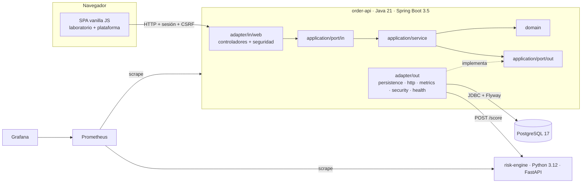

# Handoff técnico — HexaOrders v3

Documento de traspaso para **cualquier herramienta o equipo que continúe el proyecto** (Antigravity, otro asistente de IA, Copilot o personas). Describe el estado real del repositorio, qué se puede tocar y, sobre todo, **qué no se debe romper**.

> ## ⚠️ Instrucciones obligatorias para quien modifique este repositorio
>
> 1. **Conserva todos los dashboards de Grafana, paneles, consultas PromQL, métricas, alertas, jobs de Prometheus y servicios de Docker Compose.** Solo se añade; nunca se borra ni se renombra. `tools/check_observability.py` falla si algo desaparece. Detalle: [`OBSERVABILITY_PRESERVATION.md`](OBSERVABILITY_PRESERVATION.md).
> 2. **Conserva los cinco servicios** (`db`, `risk-engine`, `order-api`, `prometheus`, `grafana`), sus healthchecks, `read_only`, `cap_drop: ALL`, `no-new-privileges`, secretos en archivo y volúmenes.
> 3. **No ejecutes `docker compose down -v`** como solución: borra PostgreSQL, Prometheus y Grafana. Usa `docker compose down` (conserva datos) o `.\hexaorders.cmd stop`.
> 4. **No edites `docker-compose.yml` ni `k8s/10-monitoring-config.yaml` a mano**: se generan con `python tools/generate_delivery.py`. El CI falla si no están al día.
> 5. **No modifiques migraciones Flyway ya publicadas** (`V1`–`V3`). Crea `V4__…sql` y mantenla no destructiva (sin `DROP`, sin cambiar significados).
> 6. **No pongas secretos en Git.** Las contraseñas viven en `secrets/*.txt` (ignorado) y las crea `tools/init-env.ps1` sin sobrescribir nunca.
> 7. **No elimines pruebas, jobs del CI, scripts de Windows ni documentación útil.** Si algo falla, corrige la causa; no desactives la prueba.
> 8. **Mantén la arquitectura hexagonal**: `domain/` y `application/` no importan Spring, JDBC, HTTP ni Micrometer. ArchUnit (`HexagonalArchitectureTest`) y `test_architecture.py` lo comprueban.
> 9. **Mantén la API original** `/api/orders` (pública, mismos códigos y formato) y el laboratorio de la interfaz (`#inicio`, `#panel`, `#pedidos`, `#arquitectura`, `#observabilidad`).
> 10. Trabaja en una rama, abre un Pull Request y espera la aprobación del propietario antes de fusionar con `main`. Sin force push.

## 1. Arquitectura



- **Java (`services/order-api`)**: núcleo en `domain/` (pedidos v1, `identity`, `catalog`, `fulfillment`, `logistics`, `incident`, `audit`) y `application/` (puertos y servicios). Adaptadores en `adapter/in/web` (REST y seguridad) y `adapter/out` (JDBC con `JdbcTemplate` y `TransactionTemplate`, cliente HTTP del motor de riesgo, Micrometer, BCrypt, salud de dependencias). Configuración en `config/`.
- **Python (`services/risk-engine`)**: FastAPI con dominio y casos de uso puros; sin cambios funcionales en v3 salvo la métrica `risk_requests_rejected_total`.
- **Decisiones**: [`docs/adr/`](adr/).

## 2. Estructura relevante

```text
services/order-api/src/main/java/com/hexaorders/
  domain/                 reglas puras (sin frameworks)
  application/port/in     casos de uso que ofrece el núcleo
  application/port/out    lo que el núcleo necesita (repositorios, riesgo, telemetría…)
  application/service     implementación de los casos de uso
  adapter/in/web          controladores REST, DTO, seguridad (principal, telemetría)
  adapter/out/...         persistence, http, metrics, security, health
  config/                 SecurityConfiguration, PlatformConfiguration, cableado
services/order-api/src/main/resources/
  db/migration/           V1 (original), V2 (plataforma), V3 (catálogo)
  static/                 interfaz web (sin build, sin dependencias)
services/risk-engine/     motor de riesgo Python
infra/                    compose.base.yml, Prometheus, Grafana, línea base de observabilidad
tools/                    hexaorders.ps1 (CLI Windows/Linux), generadores, smokes, ui-e2e
k8s/                      manifiestos (validados, no desplegados)
docs/                     documentación, ADR, guías, capturas
```

## 3. Sistema de diseño

Tema oscuro definido con variables en `static/css/base.css` (no introducir colores sueltos):

| Token | Valor | Uso |
| --- | --- | --- |
| `--bg`, `--bg-2`, `--bg-3` | `#0B0F14`, `#151B23`, `#1C2430` | Fondo, tarjetas, elementos elevados |
| `--violet`, `--violet-2`, `--violet-soft` | `#8B5CF6`, `#A78BFA`, 14 % | Acento principal, enlaces, foco |
| `--green` / `--amber` / `--red` (+ `-soft`) | `#10B981` / `#F59E0B` / `#EF4444` | Éxito, revisión/aviso, error |
| `--text`, `--text-2` | `#F8FAFC`, `#94A3B8` | Texto principal y secundario |
| `--radius`, `--radius-sm` | 14 px, 9 px | Bordes |
| `--font`, `--mono` | Inter / system-ui; Cascadia/JetBrains Mono | Tipografía |

Hojas: `base.css` (tokens, layout, topbar), `components.css` (botones, tarjetas, tablas, formularios), `effects.css` (cuadrícula en `<canvas>`, splash, animaciones con `prefers-reduced-motion`), `platform.css` (tienda, admin, calendario, modales, línea de tiempo, modos de navegación).

**Política CSP**: no hay `style=""` ni `<script>` en línea. Cualquier estilo nuevo va en un `.css` y cualquier script en un módulo de `js/`.

## 4. Componentes de interfaz (`static/js/components.js`)

`lifecycleBadge`, `channelBadge`, `progressBar` (ciclo de vida), `icon`, `productArt` (ilustración generada por tono, sin imágenes externas), `stockNote`, `emptyState`, `skeletons`, `errorMessage`, `modal`, `field`, `formError`, `submitting`, `barChart`, `downloadCsv`. Utilidades DOM en `ui.js` (`el`, `formatMoney`…). Sesión en `session.js` (roles, `homeFor`), carrito en `cart.js` (`localStorage` `hexaorders.cart.v1`), router en `router.js`.

## 5. Rutas de la interfaz

El laboratorio usa anclas (`#inicio`, `#panel`, `#pedidos`, `#arquitectura`, `#observabilidad`). La plataforma usa rutas `#/…`; el router pone `body[data-mode="lab"|"app"]` y la CSS muestra la navegación correspondiente.

| Ruta | Roles | Vista |
| --- | --- | --- |
| `#/tienda`, `#/producto/:id`, `#/carrito` | público | `views/shop.js` |
| `#/entrar`, `#/registro` | público | `views/shop.js` |
| `#/checkout`, `#/mis-pedidos`, `#/mis-pedidos/:id` | `CUSTOMER` | `views/shop.js` |
| `#/perfil` | con sesión | `views/shop.js` |
| `#/admin`, `#/admin/:tab` (`productos`, `pedidos`, `usuarios`, `incidencias`, `auditoria`, `reportes`) | `ADMIN` | `views/admin.js` |
| `#/operaciones` | `ORDER_OPERATOR`, `ADMIN` | `views/operations.js` |
| `#/logistica` | `LOGISTICS_OPERATOR`, `ADMIN` | `views/logistics.js` |
| `#/observabilidad-tecnica` | `OBSERVABILITY_VIEWER`, `ADMIN` | `views/ops.js` |

## 6. API

Tabla completa en el [README](../README.md#-endpoints). Resumen: `/api/orders/**` (original, público), `/api/auth/**`, `/api/catalog/**`, `/api/shop/**`, `/api/account/**`, `/api/admin/**`, `/api/operations/**`, `/api/logistics/**`, `/api/incidents/**`, `/api/ops/health`. Las peticiones que modifican datos (salvo `/api/orders` y `/api/auth/*`) necesitan la cabecera `X-CSRF-TOKEN` obtenida de `GET /api/auth/csrf`; el cliente `js/api.js` lo hace solo (`send()`), y reintenta una vez si el token caducó.

## 7. Roles

`CUSTOMER`, `ADMIN`, `ORDER_OPERATOR`, `LOGISTICS_OPERATOR`, `OBSERVABILITY_VIEWER`. Doble control: reglas de URL en `config/SecurityConfiguration.java` y `Guards` en los servicios. La matriz de transiciones del ciclo de vida está en `domain/fulfillment/TransitionPolicy.java`. Cuentas demo: `admin`, `operador`, `logistica`, `logistica2`, `observador`, `cliente`, con la contraseña de `secrets/demo_password.txt` (se crean solo si no existen; nunca se cambia la contraseña de una cuenta existente).

## 8. Estado actual

| Área | Estado |
| --- | --- |
| Backend v3 (roles, portal, ciclo de vida, logística, incidencias, auditoría, métricas) | Implementado; 66 tests Java y 60 Python en verde en local |
| Frontend v3 (tienda, checkout, admin, operaciones, calendario, salud) | Implementado; revisado con capturas reales y Playwright |
| Observabilidad (5 dashboards, 7 alertas, regla de compatibilidad) | Implementada; `check_observability.py` en verde; la carga en Grafana real la comprueba `smoke.py` en el CI |
| Docker Compose | Generado y validado con el esquema oficial; ejecución real en el job `compose` del CI |
| Kubernetes | Manifiestos actualizados y validados estáticamente; **no desplegados** |
| Windows | `hexaorders.cmd`/`hexaorders.ps1` actualizados; se ejecutan en el job `windows` del CI |

## 9. Dependencias

- Java 21, Maven, Spring Boot 3.5.7 (`web`, `jdbc`, `validation`, `actuator`, `security`), Flyway, PostgreSQL JDBC, Micrometer Prometheus; tests con JUnit 5, Mockito, ArchUnit, `spring-security-test`.
- Python 3.12, FastAPI, Uvicorn, `prometheus_client`; tests con pytest.
- Frontend: **ninguna** dependencia (módulos ES nativos).
- Herramientas: Python (`requirements-tools.txt`: PyYAML, jsonschema), Node 22 + Playwright solo para `tools/ui-e2e`.

## 10. Docker

`infra/compose.base.yml` + `services/` + `infra/` → `tools/generate_delivery.py` → `docker-compose.yml` autosuficiente (Dockerfiles en línea). Puertos solo en `127.0.0.1`: 8080 (app), 9091 (Prometheus), 3000 (Grafana). Secretos: `db_password`, `grafana_password`, `demo_password` en `./secrets/`. Comandos: `.\hexaorders.cmd start | stop | status | logs | verify | check | test`.

## 11. Integraciones

- **Java → Python**: `HttpRiskAssessmentAdapter` (`POST risk-engine:8000/score`, timeouts, `503` si falla). Lo usan el laboratorio y el checkout a través del mismo puerto `RiskAssessmentPort`.
- **Java → PostgreSQL**: `JdbcTemplate`; transacciones en los adaptadores; bloqueo optimista (`version`); stock con `UPDATE` condicional; `idempotency_key` única.
- **Salud**: `DependencyHealthAdapter` consulta PostgreSQL y `/health/ready` del motor de riesgo para `/api/ops/health`.

## 12. Grafana y Prometheus

- Prometheus: `infra/prometheus/prometheus.yml` (3 jobs, 10 s) y `alerts.yml` (grupo original + `hexaorders-compat` + `hexaorders-platform`).
- Grafana: datasource `prometheus` y 6 dashboards aprovisionados desde `infra/grafana/` (`hexaorders` original + `business`, `risk`, `api`, `infrastructure`, `security`).
- Línea base protegida: `infra/observability-baseline.json`.

## 13. No modificar sin acuerdo explícito

- `infra/grafana/dashboards/hexaorders.json`, los dos primeros grupos de `alerts.yml`, `prometheus.yml`, `provisioning/`.
- `infra/observability-baseline.json` (solo en un commit propio y justificado).
- Migraciones `V1__…`, `V2__…`, `V3__…`.
- Contrato de `/api/orders` y de `risk-engine /score`.
- `domain/order/*` (pedido original) y la regla de umbral 70 del motor de riesgo.
- Endurecimiento de Compose (`read_only`, `cap_drop`, `no-new-privileges`, secretos en archivo).
- Jobs `compose` y `windows` de `.github/workflows/verify.yml` (se pueden **añadir** pasos).

## 14. Pendientes visuales y funcionales

- Calendario logístico: arrastrar y soltar para reprogramar (hoy se hace con el formulario).
- Imágenes de producto reales (hoy son ilustraciones generadas por tono, para no usar recursos de terceros).
- Paginación en las tablas de administración y en `GET /api/orders` (límite de 50).
- Modo claro (todo el diseño es oscuro).
- Recuperación de contraseña por correo y límite de intentos de inicio de sesión.
- Internacionalización (la interfaz está en español).

## 15. Pruebas

| Comando | Qué ejecuta |
| --- | --- |
| `.\hexaorders.cmd test` | Tests unitarios Python (pytest) y Java (Maven: dominio, servicios, seguridad, ArchUnit) |
| `.\hexaorders.cmd check` | Generador al día, validación de Compose/Kubernetes, `check_observability.py` |
| `.\hexaorders.cmd verify` | Stack real con Docker: build con tests, promtool, `smoke.py`, `platform_smoke.py`, caída y recuperación del motor de riesgo |
| `node tools/ui-e2e/ui-e2e.js` | Playwright contra el stack real (`DEMO_PASSWORD` para los flujos por rol) |

## 16. Problemas conocidos

- El cliente Prometheus 1.x exporta `orders_created` como `orders_total`; se compensa con la regla `orders_created_total` (no la elimines).
- La API original `/api/orders` sigue sin autenticación por compatibilidad.
- Los contadores se reinician con cada proceso; los totales persistentes están en PostgreSQL (`/api/orders/statistics`, gauges `hexaorders_orders_by_status`).
- Sin cAdvisor: no hay métricas de contenedor.
- Grafana no envía CORS: desde el navegador solo se comprueba que responde.
- Kubernetes no se ha desplegado en un clúster real.
