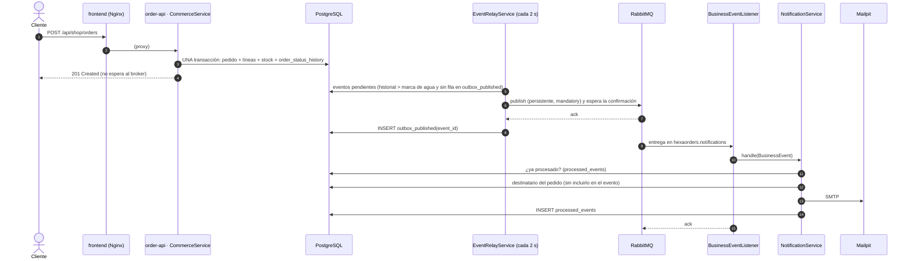
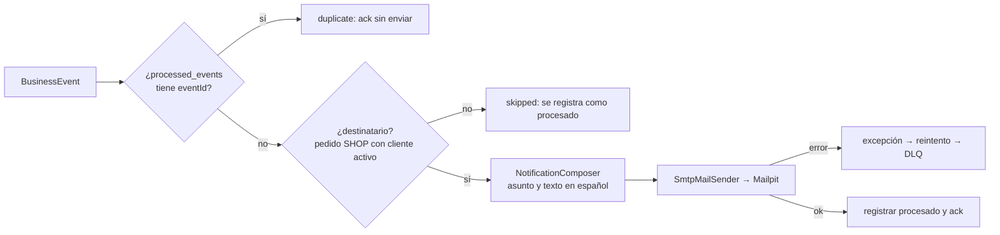

# Eventos asíncronos y notificaciones (v5)

## 1. Qué se resolvió

Cuando un pedido se crea, cambia de estado o se programa su entrega, el cliente recibe un correo. El proceso principal de pedidos **no depende del broker**: si RabbitMQ no está, el pedido se crea igual y el evento espera. Tampoco se pierde ningún evento, porque se escribe en la misma transacción que el cambio de negocio.

## 2. Flujo completo



## 3. Outbox transaccional (ADR 0012)

Cada cambio de un pedido ya escribe una fila en `order_status_history`, y cada programación de entrega una fila en `delivery_changes`, **dentro de la misma transacción** del cambio. POLYMER usa esas tablas como outbox (patrón *polling publisher*):

- Un cambio confirmado siempre tiene su evento y uno deshecho nunca lo tiene.
- No hubo que cambiar los casos de uso ni las transacciones existentes.
- `event_relay_watermark` (migración V5) guarda el último id existente al migrar, así que no se envían correos de pedidos antiguos.
- Un evento está **pendiente** mientras su `eventId` no esté en `outbox_published`. Por eso los huecos de orden entre transacciones concurrentes no pierden eventos.
- Solo se publican eventos de pedidos del portal (`channel = 'SHOP'`); los del laboratorio no tienen cliente.

## 4. Contrato de los eventos (versión 1)

Exchange `hexaorders.events` (topic, durable). Mensajes JSON UTF-8, persistentes, con `message_id = eventId` y cabecera `schemaVersion`.

```json
{
  "eventId": "order-status-1234",
  "type": "ORDER_APPROVED",
  "routingKey": "order.approved",
  "schemaVersion": 1,
  "occurredAt": "2026-11-02T10:00:00Z",
  "orderId": "0189edf8-…",
  "attributes": { "from": "CREATED", "to": "RISK_APPROVED", "approvedBy": "risk-engine" }
}
```

| Tipo | Routing key | Cuándo |
| --- | --- | --- |
| `ORDER_CREATED` | `order.created` | Nuevo pedido del portal (`CREATED`) |
| `ORDER_APPROVED` | `order.approved` | `RISK_APPROVED` (`approvedBy: risk-engine`) o `CONFIRMED` (`approvedBy: operations`) |
| `ORDER_REJECTED` | `order.rejected` | `REJECTED` |
| `ORDER_STATUS_CHANGED` | `order.status_changed` | Cualquier otro estado (`RISK_REVIEW`, `PREPARING`, `IN_TRANSIT`, `DELIVERED`, `CANCELLED`…) |
| `DELIVERY_SCHEDULED` | `delivery.scheduled` | Entrega programada (`action: CREATED`) o reprogramada (`RESCHEDULED`) |

**Sin datos personales.** Los eventos no llevan nombre, correo, dirección ni usuario. El consumidor obtiene el destinatario por `orderId` desde PostgreSQL. Un consumidor rechaza las versiones de esquema desconocidas: van a la DLQ.

## 5. Garantías (y lo que NO se promete)

| Aspecto | Comportamiento |
| --- | --- |
| Publicación | **Al menos una vez.** Se marca como publicado solo tras el *ack* del broker; un fallo entre medias lo vuelve a publicar. |
| Orden | El relay publica en orden de ocurrencia y se detiene en el primer fallo, para que ningún evento se adelante. |
| Duplicados | El consumidor es **idempotente**: `processed_events(event_id, consumer)`. |
| Reintentos | Cuatro intentos con *back-off* exponencial (1 s → 10 s). Después, el mensaje va a `hexaorders.notifications.dlq`. |
| Mensajes inválidos | Directamente a la DLQ, sin reintentos. |
| Broker caído | Los pedidos funcionan; los eventos esperan en el outbox (`polymer_outbox_pending`) y se envían al volver. |
| Reinicios | Colas durables, mensajes persistentes, `hostname: rabbitmq` estable y volumen `rabbitmq_data`. |
| Exactamente una vez | **No se afirma.** Si el proceso cae después de enviar el correo y antes de registrarlo, el correo puede repetirse. |

## 6. Flujo de notificaciones



Ejemplos de asunto:

- «Pedido 0189edf8 recibido»
- «Pedido 0189edf8 aprobado»
- «Pedido 0189edf8: En tránsito»
- «Entrega programada para el pedido 0189edf8»

## 7. Arquitectura hexagonal

| Pieza | Capa | Archivo |
| --- | --- | --- |
| `BusinessEvent`, `EventType` (reglas de mapeo) | dominio | `domain/event/` |
| `EventOutbox`, `EventPublisher`, `ProcessedEvents`, `NotificationRecipients`, `MailSender`, `IntegrationTelemetry` | puertos de salida | `application/port/out/` |
| `EventRelayUseCases`, `NotificationUseCases` | puertos de entrada | `application/port/in/` |
| `EventRelayService`, `NotificationService`, `NotificationComposer` | aplicación | `application/service/` |
| `JdbcEventOutbox`, `JdbcProcessedEvents`, `JdbcNotificationRecipients` | adaptadores de salida | `adapter/out/persistence/` |
| `RabbitMqEventPublisher` | adaptador de salida | `adapter/out/messaging/` |
| `SmtpMailSender` | adaptador de salida | `adapter/out/mail/` |
| `BusinessEventListener` (AMQP), `EventRelayScheduler` (temporizador) | adaptadores de entrada | `adapter/in/messaging/`, `adapter/in/scheduling/` |
| `EventContract` (JSON, nombres de exchange y colas) | contrato compartido | `adapter/messaging/` |

## 8. Métricas

| Métrica | Significado |
| --- | --- |
| `polymer_outbox_pending` | Eventos pendientes de confirmar por el broker |
| `polymer_events_published_total{type}` | Eventos confirmados por RabbitMQ |
| `polymer_events_publish_failures_total` | Intentos fallidos (el evento sigue en el outbox) |
| `polymer_events_consumed_total{type,result}` | `sent`, `duplicate` o `skipped` |
| `polymer_notifications_sent_total{type}` | Correos aceptados por el servidor SMTP |
| `rabbitmq_queue_messages_ready{queue}` / `_unacked` | Profundidad de las colas (plugin `rabbitmq_prometheus`) |

Están en el dashboard **POLYMER — Platform Integrations** (`/d/polymer-integrations`).

## 9. Pruebas

- **Unitarias:** `BusinessEventTest`, `IntegrationServicesTest` (relay, consumidor idempotente, fallo SMTP sin marcar) e `InfrastructureAdaptersTest` (contrato y publicador con confirmación y *nack*).
- **Integración:** `integration_smoke.py check` (correos en Mailpit, cola y DLQ en RabbitMQ, outbox vacío), `degraded` y `recovered` (broker detenido y recuperado).
