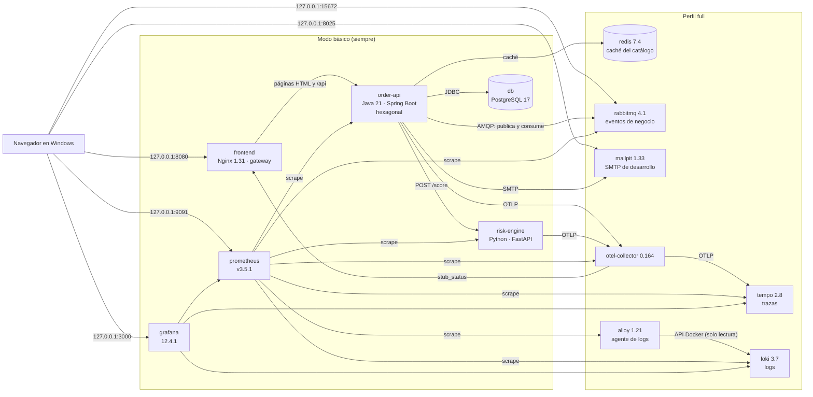
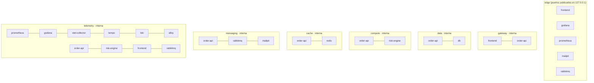

# Arquitectura Docker de POLYMER (v5)

POLYMER se ejecuta íntegramente con Docker Compose en **dos modos**:

- **básico**: 6 contenedores;
- **completo** (perfil `full`): 13 contenedores.

Cada contenedor tiene una responsabilidad comprobable por una prueba automática. Detalle de cada servicio: [`DOCKER_SERVICES.md`](DOCKER_SERVICES.md).

> El enunciado proponía «unos 12 servicios». El modo completo tiene **13**: los 12 pedidos más **Grafana Alloy**. Alloy es el agente que lee los logs de los contenedores en Docker Desktop y los envía a Loki; sin él, Loki no recibiría nada (ADR 0013). No hay contenedores decorativos.

## 1. Contenedores



## 2. Redes

Todas las redes salvo `edge` son **internas** (`internal: true`): no tienen salida a Internet ni son accesibles desde el host. Los contenedores se llaman por su **nombre de servicio** (`db`, `redis`, `rabbitmq`, `otel-collector`…), nunca por `localhost`.



| Red | Miembros | Para qué |
| --- | --- | --- |
| `edge` | frontend, grafana, prometheus, mailpit, rabbitmq | Publicar las interfaces en `127.0.0.1` |
| `gateway` | frontend, order-api | Nginx → Spring Boot |
| `data` | order-api, db | Solo order-api conoce PostgreSQL |
| `compute` | order-api, risk-engine | Llamada al motor de riesgo |
| `cache` | order-api, redis | Caché del catálogo |
| `messaging` | order-api, rabbitmq, mailpit | AMQP y SMTP |
| `telemetry` | prometheus, grafana, otel-collector, tempo, loki, alloy, order-api, risk-engine, frontend, rabbitmq | Métricas, trazas y logs |

La tienda entra por el gateway, en el mismo `127.0.0.1:8080` de siempre. **v8 · Enlaces de verificación:** cada contenedor con interfaz web publica además un enlace **solo en 127.0.0.1** (clicable en Docker Desktop): `order-api` 8081 (núcleo sin gateway), `risk-engine` 8000 (`/docs`), Grafana 3000, Prometheus 9091, RabbitMQ 15672, Mailpit 8025, OpenTelemetry Collector 13133 y Alloy 12345. PostgreSQL, Redis, el AMQP de RabbitMQ, Loki y Tempo **no** se publican; se verifican desde Grafana, `polymer.cmd demo` o la pestaña *Exec* de Docker Desktop. La lista cerrada la comprueba `tools/validate_delivery.py`. Mapa por slice: `ENLACES.html` (`polymer.cmd enlaces`).

## 3. Modos y perfiles

| | Básico | Completo (`full`) |
| --- | --- | --- |
| Contenedores | db, risk-engine, order-api, prometheus, grafana, frontend | + redis, rabbitmq, mailpit, loki, tempo, otel-collector, alloy |
| PowerShell | `.\polymer.cmd start -Mode basic` | `.\polymer.cmd start` (por defecto) |
| Docker directo | `docker compose up --build -d` | `$env:COMPOSE_PROFILES='full'; docker compose up --build -d` |
| Pedidos, portales, seguridad, métricas, dashboards | ✅ | ✅ |
| Caché Redis | catálogo desde PostgreSQL | ✅ |
| Eventos y correos | eventos guardados en el outbox, sin envío | ✅ RabbitMQ → Mailpit |
| Trazas y logs centralizados | — | ✅ Tempo y Loki |

**Cómo sabe order-api qué hay desplegado.** Al arrancar, `IntegrationEnvironment` comprueba si los nombres `redis`, `rabbitmq` y `otel-collector` resuelven en el DNS de Docker (`POLYMER_INTEGRATIONS=auto`). Con eso activa o desactiva cada integración, sin interruptores manuales. Las dependencias de arranque del perfil completo se declaran con `required: false`, así que en el modo básico no bloquean.

**Degradación en tiempo de ejecución.** Si Redis o RabbitMQ se detienen con el sistema en marcha, la aplicación sigue funcionando:

- el catálogo se lee de PostgreSQL;
- los eventos esperan en el outbox y se envían cuando el broker vuelve.

Lo prueba `verify`, en los pasos 7b, `degraded` y `recovered`.

## 4. Puertos en el host (solo `127.0.0.1`)

| URL | Servicio | Modo |
| --- | --- | --- |
| <http://127.0.0.1:8080> | frontend → sitio web y API | ambos |
| <http://127.0.0.1:3000> | Grafana (usuario `admin`, `secrets\grafana_password.txt`) | ambos |
| <http://127.0.0.1:9091> | Prometheus | ambos |
| <http://127.0.0.1:8025> | Mailpit (correos capturados) | full |
| <http://127.0.0.1:15672> | Consola de RabbitMQ (usuario `polymer`, `secrets\rabbitmq_password.txt`) | full |

## 5. Volúmenes persistentes

| Volumen | Servicio | Contenido |
| --- | --- | --- |
| `postgres_data` | db | Pedidos, usuarios, catálogo, historial, outbox |
| `prometheus_data` | prometheus | Métricas (7 días, 1 GB máximo) |
| `grafana_data` | grafana | Estado interno de Grafana |
| `redis_data` | redis | Instantánea de la caché (prescindible) |
| `rabbitmq_data` | rabbitmq | Colas durables y mensajes persistentes |
| `loki_data` | loki | Logs (retención de 7 días) |
| `tempo_data` | tempo | Trazas (retención de 72 h) |
| `alloy_data` | alloy | Posiciones de lectura de logs |

`.\polymer.cmd stop` (o `docker compose down`) **conserva** todos los volúmenes. Solo `stop -RemoveData` los borra. Nunca se usa `down -v` como solución automática.

## 6. Secretos

Hay cuatro archivos en `secrets\`, excluidos de Git, generados por `tools\init-env.ps1` y **nunca sobrescritos**:

| Archivo | Uso |
| --- | --- |
| `db_password.txt` | PostgreSQL |
| `grafana_password.txt` | Usuario `admin` de Grafana |
| `demo_password.txt` | Cuentas de demostración |
| `rabbitmq_password.txt` | Usuario `polymer` de RabbitMQ (v5) |

Si existe el volumen de PostgreSQL, Grafana o RabbitMQ pero falta su secreto, `start` se detiene con instrucciones en lugar de generar una contraseña nueva que dejaría el servicio sin acceso a sus datos.

## 7. Endurecimiento

- `read_only: true` en los 12 servicios que lo admiten. PostgreSQL necesita escribir en su sistema de archivos.
- `tmpfs` para los temporales.
- `cap_drop: [ALL]` excepto en db y rabbitmq, cuyos entrypoints necesitan cambiar de usuario.
- `no-new-privileges` en todos los servicios.
- Imágenes con versión fijada y usuarios sin privilegios: Nginx `nginx-unprivileged`, Redis 999, Loki y Tempo 10001.
- Límites de memoria y CPU.
- Rotación de logs (`json-file`, 3 × 10 MB).
- **Única montura del host:** el socket de Docker, en solo lectura, para Alloy, que solo lee los logs de los contenedores con la etiqueta `com.polymer.logs=true`.

`tools/validate_delivery.py` comprueba todo esto en `check` y en el CI.

## 8. Recursos

Los valores son orientativos y salen de la suma de los límites `mem_limit` de Compose. **No se han medido en un PC con Windows.**

| | Básico | Completo |
| --- | --- | --- |
| Límite de memoria sumado | ≈ 2,5 GB | ≈ 4,5 GB |
| Memoria de Docker Desktop recomendada | 4 GB | **6 GB o más** (*Settings → Resources*, o `.wslconfig`) |
| CPU | 2 núcleos | 4 núcleos recomendados |
| Disco (imágenes, build y volúmenes) | ≈ 6 GB | ≈ 10 GB |

En un equipo con 8 GB de RAM usa el **modo básico**. El modo completo puede funcionar con 6 GB asignados a Docker, pero no se garantiza en equipos más justos.

## 9. Variables de entorno relevantes

| Variable | Servicio | Valor en Compose |
| --- | --- | --- |
| `POLYMER_INTEGRATIONS` | order-api, risk-engine | `auto` (activa cada integración si su servicio existe) |
| `REDIS_HOST` | order-api | `redis` |
| `RABBITMQ_HOST`, `RABBITMQ_USER`, `RABBITMQ_PASSWORD_FILE` | order-api | `rabbitmq`, `polymer`, `/run/secrets/rabbitmq_password` |
| `SMTP_HOST`, `SMTP_PORT` | order-api | `mailpit`, `1025` |
| `OTEL_EXPORTER_OTLP_ENDPOINT` | order-api, risk-engine | `http://otel-collector:4318` |
| `OTEL_SERVICE_NAME` | risk-engine | `risk-engine` |
| `COMPOSE_PROFILES` | Docker Compose (host) | `full` para el modo completo; los scripts la fijan |

## 10. Comandos

```powershell
.\polymer.cmd start              # modo completo (13 contenedores)
.\polymer.cmd start -Mode basic  # modo básico (6 contenedores)
.\polymer.cmd status
.\polymer.cmd logs
.\polymer.cmd smoke              # pruebas HTTP e integraciones contra tu entorno en marcha
.\polymer.cmd stop               # conserva los datos
.\polymer.cmd check              # validación sin Docker
.\polymer.cmd verify             # prueba integral aislada (la misma del CI)
```

Guía completa para Windows: [`WINDOWS_DOCKER_GUIDE.md`](WINDOWS_DOCKER_GUIDE.md).
