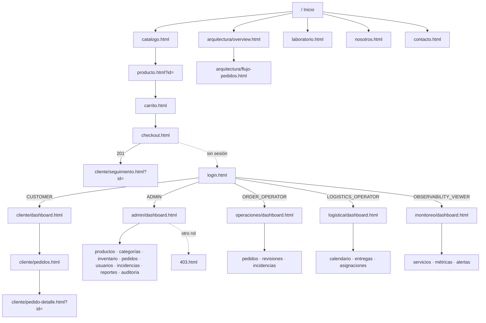

# Sitio web multipágina de HexaOrders (v4)

HexaOrders tiene **39 páginas HTML reales generadas** más el **laboratorio original** (`laboratorio.html`). Cada página tiene su propia URL, se puede abrir directamente, funciona tras recargar, tiene navegación hacia el resto, respeta los permisos del rol (en el navegador **y** en Spring Security), consume la API real y gestiona los estados de carga, error y vacío.

## 1. Cómo está construido

| Pieza | Archivo | Función |
| --- | --- | --- |
| Registro de páginas | `tools/generate_pages.py` | Única fuente: ruta, título, descripción, sección, roles y parámetros de cada página. Genera los HTML y `tools/ui-e2e/pages.json`. |
| Página HTML | `static/**/*.html` | Esqueleto común: `<head>` con CSS, `<header>`, barra lateral (portales), `<main id="view-root">`, pie. Declara `data-route`, `data-section` y `data-roles`. |
| Punto de entrada | `static/js/page.js` | Compatibilidad de URLs antiguas → sesión → layout → vista. |
| Layout | `static/js/layout.js` | Cabecera, menús por rol, barra lateral, breadcrumbs, pie y menú móvil. |
| Enrutador | `static/js/router.js` | Registro de vistas (`route()`), `startPage()`, `link()` (ruta lógica → página real) y redirección de los hashes de la v3. |
| Vistas | `static/js/views/*.js` | `home`, `shop`, `customer`, `admin`, `operations`, `logistics`, `ops`, `architecture-pages`. Cada una registra sus rutas. |
| API | `static/js/api.js` | Cliente HTTP con sesión, CSRF automático (`X-CSRF-TOKEN`) y reintento si el token caduca. |
| Componentes | `static/js/components.js` | Badges, modales, formularios, paginación (`paginated`), búsqueda (`searchBox`), KPIs, gráficos, CSV. |
| Estilos | `static/css/base.css`, `components.css`, `effects.css`, `platform.css`, `site.css` | Tokens en `base.css`; `site.css` contiene el layout multipágina. |

No hay frameworks ni build de Node: se sirve tal cual desde Spring Boot dentro del contenedor `order-api` (ADR 0007 y ADR 0009).

## 2. Páginas y rutas

| Página | Rol | Contenido | API |
| --- | --- | --- | --- |
| `/` (`index.html`) | Público | Hero, propuesta de valor, catálogo destacado, flujo del pedido, portales por rol | `/api/catalog/*`, `/api/orders/statistics` |
| `/catalogo.html` | Público | Búsqueda, categorías, precio máximo, solo disponibles, orden, paginación; filtros en la URL | `/api/catalog/*` |
| `/producto.html?id=` | Público | Detalle, stock, cantidad, carrito, relacionados | `/api/catalog/products/{id}` |
| `/carrito.html` | Público | Cantidades, quitar, subtotal y total calculados por el servidor | `POST /api/shop/quote` |
| `/checkout.html` | CUSTOMER | Datos de entrega, confirmación, riesgo y redirección al seguimiento | `POST /api/shop/orders` |
| `/login.html`, `/registro.html` | Público | Acceso (con `?next=`) y registro de clientes | `/api/auth/*` |
| `/nosotros.html`, `/contacto.html` | Público | Proyecto y formulario de contacto persistido | `POST /api/contact` |
| `/403.html`, `/404.html` | Público | Páginas de error diseñadas | — |
| `/cliente/dashboard.html` | CUSTOMER | KPIs y pedidos en curso | `/api/shop/orders` |
| `/cliente/pedidos.html` | CUSTOMER | Historial paginado | `/api/shop/orders` |
| `/cliente/pedido-detalle.html?id=` | CUSTOMER | Artículos, total, dirección y cancelación | `/api/shop/orders/{id}[/cancel]` |
| `/cliente/seguimiento.html?id=` | CUSTOMER | Tracker, entrega e historial real | `/api/shop/orders/{id}` |
| `/cliente/perfil.html` | Cualquier sesión | Perfil y contraseña | `/api/account/*` |
| `/admin/dashboard.html` | ADMIN | KPIs, pedidos por día, alertas, actividad y mensajes de contacto | `/api/admin/dashboard`, `/api/admin/contact-messages` |
| `/admin/productos.html` | ADMIN | Alta y edición con búsqueda y paginación | `/api/admin/products` |
| `/admin/categorias.html` | ADMIN | Categorías y su contenido | `/api/catalog/categories`, `/api/admin/categories` |
| `/admin/inventario.html` | ADMIN | Existencias, stock bajo, valor del inventario y ajustes | `/api/admin/products/{id}/stock` |
| `/admin/pedidos.html` | ADMIN | Todos los pedidos y transiciones | `/api/operations/orders` |
| `/admin/usuarios.html` | ADMIN | Roles y activación con búsqueda y filtro por rol | `/api/admin/users` |
| `/admin/incidencias.html` | ADMIN | Incidencias | `/api/incidents` |
| `/admin/reportes.html` | ADMIN | Ventas por categoría y CSV | `/api/admin/dashboard` |
| `/admin/auditoria.html` | ADMIN | Auditoría con búsqueda, filtro y paginación | `/api/admin/audit` |
| `/operaciones/dashboard.html` | ORDER_OPERATOR, ADMIN | Cola por estado y pedidos más antiguos | `/api/operations/orders` |
| `/operaciones/pedidos.html` | ORDER_OPERATOR, ADMIN | Bandeja con búsqueda, filtro y transiciones | `/api/operations/orders[/{id}/transitions]` |
| `/operaciones/revisiones.html` | ORDER_OPERATOR, ADMIN | Confirmar o rechazar pedidos en `RISK_REVIEW` | idem |
| `/operaciones/incidencias.html` | ORDER_OPERATOR, ADMIN | Registrar y resolver incidencias | `/api/incidents` |
| `/logistica/dashboard.html` | LOGISTICS_OPERATOR, ADMIN | Entregas de hoy, pendientes, en tránsito | `/api/logistics/*` |
| `/logistica/calendario.html` | LOGISTICS_OPERATOR, ADMIN | Mes, semana y día; programar y reprogramar | `/api/logistics/deliveries` |
| `/logistica/entregas.html` | LOGISTICS_OPERATOR, ADMIN | Listado por periodo y estado con destino | idem |
| `/logistica/asignaciones.html` | LOGISTICS_OPERATOR, ADMIN | Carga semanal por responsable y reasignación | idem |
| `/monitoreo/dashboard.html` | OBSERVABILITY_VIEWER, ADMIN | Salud de PostgreSQL y del motor de riesgo, estado de Prometheus y dashboards | `/api/ops/health`, `/api/ops/monitoring` |
| `/monitoreo/servicios.html` | idem | Targets de Prometheus | `/api/ops/monitoring` |
| `/monitoreo/metricas.html` | idem | 14 indicadores con consultas fijas | idem |
| `/monitoreo/alertas.html` | idem | Reglas de alerta y estado | idem |
| `/arquitectura/overview.html` | Público | Capas y explorador interactivo real | `POST /api/orders` (solicitud real opcional) |
| `/arquitectura/flujo-pedidos.html` | Público | Secuencia del checkout y ciclo de vida por rol | `/api/orders/statistics` |
| `/laboratorio.html` | Público | Laboratorio original (v1–v3) intacto | `/api/orders/**`, Prometheus |

**URLs limpias** (redirigen a la página real): `/catalogo`, `/tienda`, `/carrito`, `/checkout`, `/login`, `/registro`, `/nosotros`, `/contacto`, `/laboratorio`, `/cliente`, `/admin`, `/operaciones`, `/logistica`, `/monitoreo`, `/arquitectura`.

**Compatibilidad con la v3**: `/#/tienda` → `/catalogo.html`, `/#/admin/usuarios` → `/admin/usuarios.html`, `/#/mis-pedidos/{id}` → `/cliente/pedido-detalle.html?id=…`, etc. Los anclajes del laboratorio (`/#panel`, `/#pedidos`…) llevan a `/laboratorio.html#panel`.

## 3. Navegación

- **Menú principal** en todas las páginas y **menú por rol** según la sesión real.
- **Barra lateral** en cada portal con el enlace activo; **breadcrumbs** Inicio → portal → página.
- **Redirección tras el login** al parámetro `next` (solo rutas internas) o al portal del rol.
- **Móvil**: menú desplegable con botón accesible (`aria-expanded`) y barra lateral horizontal.

## 4. Seguridad de las páginas

Spring Security protege los HTML de los portales (`/admin/**`, `/cliente/**`, `/operaciones/**`, `/logistica/**`, `/monitoreo/**`, `/checkout.html`):

- sin sesión → **302** a `/login.html?next=<página>`;
- con otro rol → **403** y la página `403.html`;
- el contenido real procede siempre de la API, que vuelve a comprobar el rol en el controlador y en el caso de uso.

`check_frontend.py` falla si una página protegida del registro no tiene su regla en `SecurityConfiguration` con los mismos roles.

## 5. Matriz de auditoría (v3 → v4)

| Funcionalidad | Estado en v3 | Verificación | Acción en v4 |
| --- | --- | --- | --- |
| Laboratorio (`index.html`) | Existente y probado | `ui-e2e.js` | Movido íntegro a `laboratorio.html`; anclajes redirigen |
| Tienda (`#/tienda`) | Una sola vista en un único HTML | `ui-e2e.js` | `catalogo.html` + paginación, precio, disponibles, filtros en la URL |
| Producto | Existente | Revisión manual | `producto.html` + relacionados y breadcrumbs |
| Carrito y checkout | Existente, sin dirección | `platform_smoke.py` | Dirección de entrega validada en el dominio (V4) |
| Mis pedidos / seguimiento | Una sola vista mezclada | `ui-e2e.js` | Separado en resumen, historial, detalle y seguimiento |
| Administración | Pestañas en una vista | `ui-e2e.js` | 9 páginas; categorías e inventario nuevas; búsqueda y paginación |
| Operaciones | Una vista | `ui-e2e.js` | Resumen, bandeja, revisiones e incidencias |
| Logística | Calendario | `ui-e2e.js` | Resumen, calendario, entregas y asignaciones |
| Salud técnica | Una vista con health | `ui-e2e.js` | Monitoreo con targets, métricas y alertas reales de Prometheus |
| Contacto, nosotros, 403/404 | No existían | — | Nuevas |
| Defectos encontrados | — | Capturas y Playwright | Breadcrumb visible en la portada, `main` centrado en la cuadrícula, desbordamiento móvil de la barra lateral: corregidos |

## 6. Pruebas del frontend

| Prueba | Qué comprueba |
| --- | --- |
| `tools/check_frontend.py` (en `check`) | HTML al día, rutas registradas, recursos y enlaces existentes, sin CSS ni JS en línea, reglas de seguridad por página y tabla de transiciones igual al dominio |
| `node --check` (CI) | Sintaxis de todos los módulos JavaScript |
| `tools/ui-e2e/pages-e2e.js` | Cada página como visitante y con los 5 roles (200 / 302 / 403 / 404), enlaces sin 404, recarga, formularios (contacto, checkout con dirección), mensajes en admin, calendario, monitoreo con Prometheus real, móvil sin desbordamiento, sin errores de JavaScript ni respuestas 5xx |
| `tools/ui-e2e/ui-e2e.js` | Laboratorio original y flujos por rol de la v3 (con las URLs nuevas) |
| `SecurityRulesTest` | Redirecciones al login, 403 por rol, páginas públicas y formulario de contacto |
