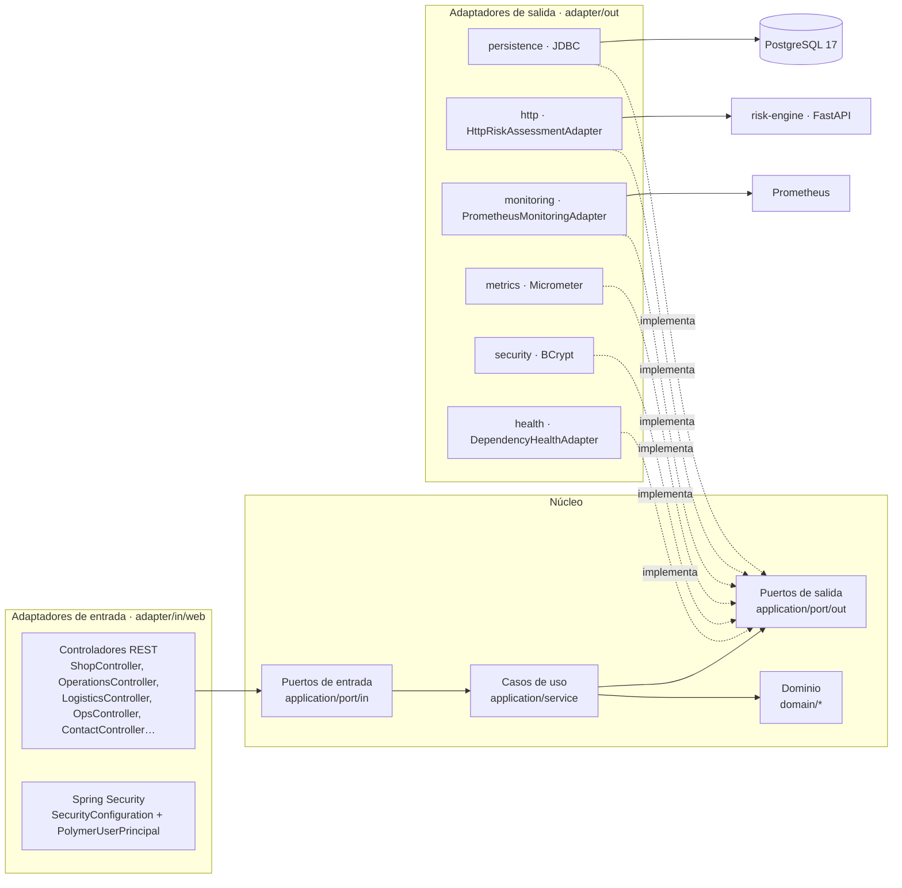
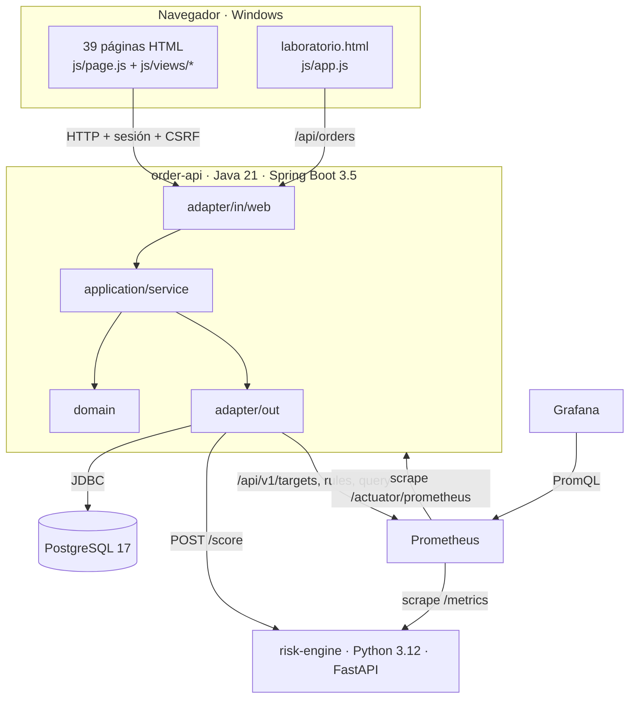
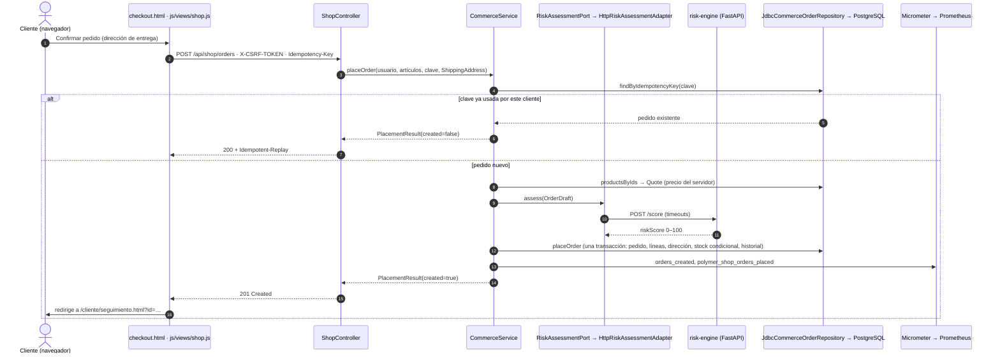
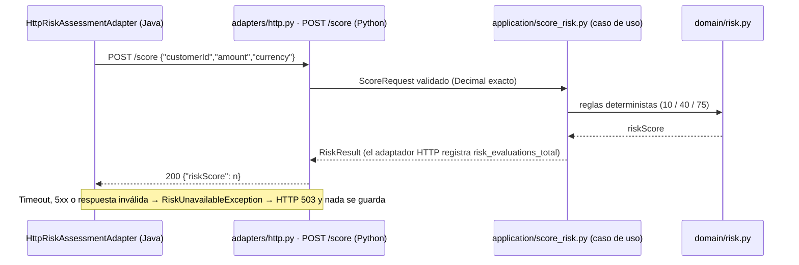
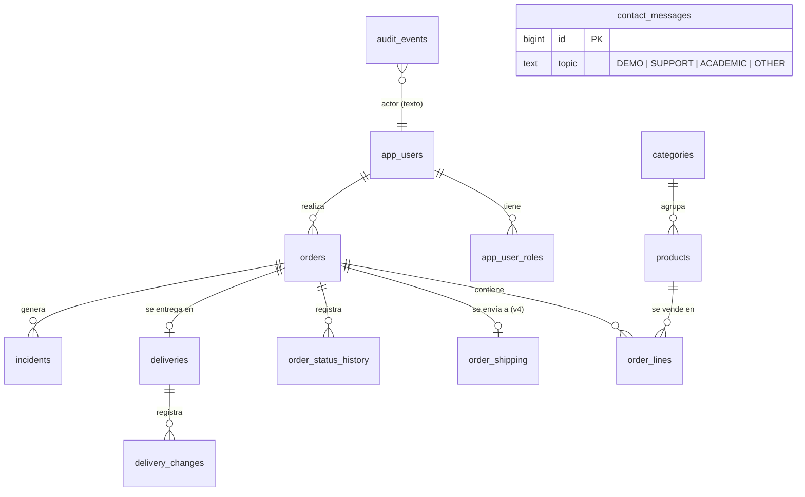
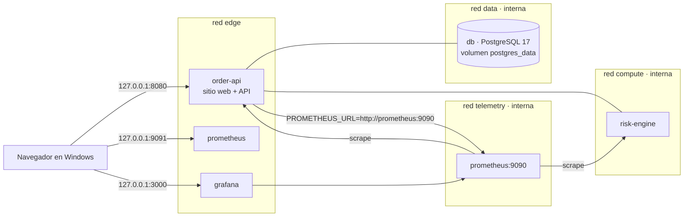
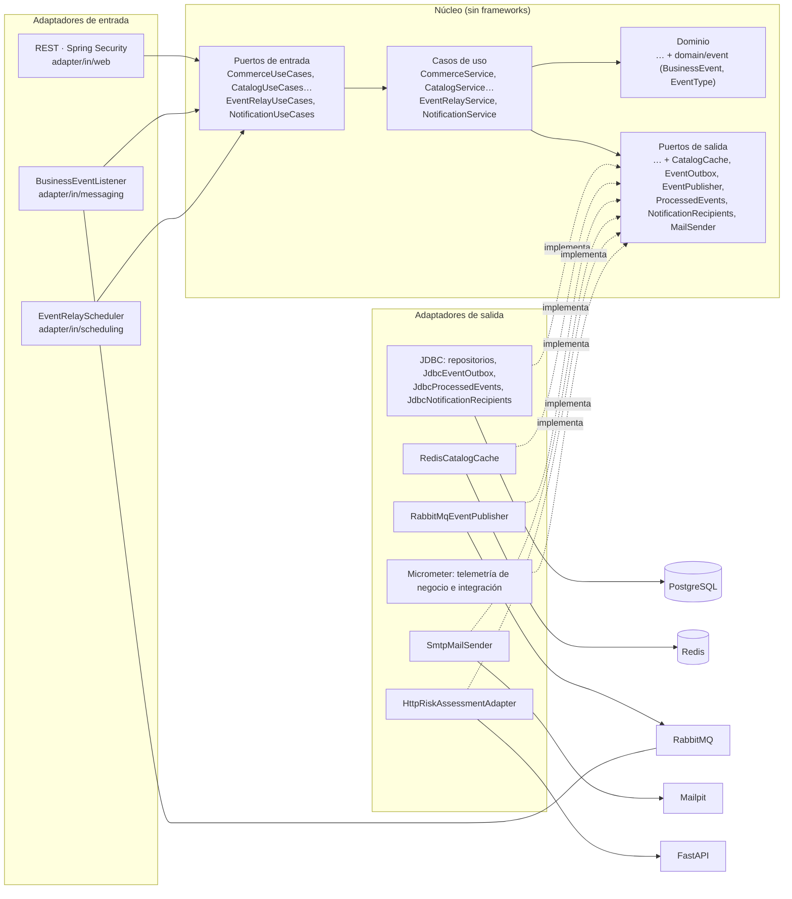
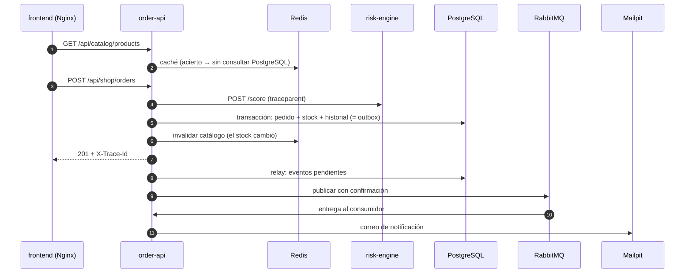
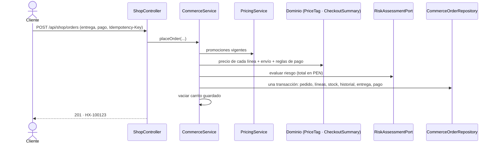

# Arquitectura hexagonal de POLYMER (v4 y v5)

Este documento describe cómo está organizado el código y por qué la arquitectura hexagonal es **verificable**, no decorativa. Las rutas son relativas a `services/order-api/src/main/java/com/polymer/` salvo que se indique otra cosa.

## 1. Regla de dependencias

Las flechas continuas son dependencias de código; las discontinuas, «implementa». **Nada del núcleo importa Spring, JDBC, HTTP, Micrometer ni Jackson.**

### Cómo se comprueba

| Regla | Prueba |
| --- | --- |
| `domain` y `application` no dependen de frameworks | `HexagonalArchitectureTest.CORE_HAS_NO_FRAMEWORK_OR_INFRASTRUCTURE` (ArchUnit) |
| `domain` es el centro: no depende de `application`, `adapter` ni `config` | `DOMAIN_IS_INNERMOST` |
| Los adaptadores de entrada no usan adaptadores de salida | `ADAPTERS_ARE_INDEPENDENT` |
| Los adaptadores de entrada solo usan puertos de entrada | `DRIVING_ADAPTERS_USE_INPUT_PORTS_ONLY` |
| El motor de riesgo (Python) respeta la misma regla | `services/risk-engine/tests/test_architecture.py` (análisis AST) |
| Las páginas HTML no hablan con la base de datos | No hay ningún driver en el navegador; `check_frontend.py` verifica que solo hay llamadas a `/api/**` |

## 2. Componentes

## 3. Dominio (`domain/`)

| Paquete | Contenido | Invariantes destacadas |
| --- | --- | --- |
| raíz | `Order`, `OrderDraft`, `OrderStatus`, `OrderStatistics` (v1) | Importe > 0 con 2 decimales, umbral de riesgo 70 |
| `identity` | `Role`, `UserAccount` | Usuario `[A-Za-z0-9_-]{3,32}`, contraseña 8–72 con letras y dígitos |
| `catalog` | `Category`, `Product`, `ProductDetails` | SKU, precio ≤ 100 000 con 2 decimales, stock ≥ 0 |
| `fulfillment` | `CommerceOrder`, `FulfillmentStatus`, `TransitionPolicy`, `Quote`, `CartItem`, `OrderLine`, `StatusChange`, **`ShippingAddress`** (v4) | Matriz de transiciones por rol, estados finales, devolución de stock, dirección válida |
| `logistics` | `Delivery`, `DeliveryChange` | Ventana ≤ 8 h, nunca en el pasado, conflictos por repartidor |
| `incident` | `Incident`, `IncidentCategory`, `IncidentStatus` | Descripción obligatoria ≤ 1000 |
| `audit` | `AuditEvent` | — |
| `contact` (v4) | `ContactMessage` | Correo válido, tema cerrado, mensaje 10–2000 |
| `monitoring` (v4) | `ServiceTarget`, `AlertRule`, `Indicator`, `MonitoringSnapshot` | Valores sin datos = `null`, nunca 0 inventado |

## 4. Aplicación: puertos y casos de uso

### Casos de uso solicitados y dónde están

El enunciado proponía nombres orientativos. No se duplicaron casos de uso existentes: cada uno corresponde a una operación de un puerto de entrada.

| Caso de uso pedido | Implementación | Puerto de entrada |
| --- | --- | --- |
| RegisterCustomer | `AccountService.register` | `AccountUseCases` |
| AuthenticateUser | `AuthenticationManager` (BCrypt) + `AccountService.recordAuthentication` | `AccountUseCases` |
| ListProducts / GetProduct | `CatalogService.products` / `product` | `CatalogUseCases` |
| AddProduct | `CatalogService.createProduct` | `CatalogUseCases` |
| UpdateInventory | `CatalogService.adjustStock` (auditado, nunca negativo) | `CatalogUseCases` |
| CreateOrder | `CommerceService.placeOrder` (portal) · `OrderService.create` (API v1) | `CommerceUseCases` · `OrderUseCases` |
| GetOrder | `CommerceService.myOrder` · `OperationsService.details` · `OrderService.get` | idem |
| ListCustomerOrders | `CommerceService.myOrders` | `CommerceUseCases` |
| EvaluateOrderRisk | Puerto `RiskAssessmentPort` dentro de `placeOrder`/`create` (riesgo antes de la transacción) | — |
| ChangeOrderStatus | `OperationsService.transition` → `LifecycleTransitions` | `OperationsUseCases` |
| ScheduleDelivery / AssignDelivery | `LogisticsService.schedule` / `reschedule` (reasignación incluida) | `LogisticsUseCases` |
| RegisterIncident | `OperationsService.reportIncident` | `OperationsUseCases` |
| GetOperationalMetrics | `MonitoringService.snapshot` (v4) · `AdministrationService.dashboard` | `MonitoringUseCases` · `AdministrationUseCases` |
| (v4) Enviar mensaje de contacto | `ContactService.send` / `recent` | `ContactUseCases` |

### Puertos de salida

`OrderRepository`, `CommerceOrderRepository`, `CatalogRepository`, `DeliveryRepository`, `IncidentRepository`, `UserRepository`, `ContactMessageRepository` (v4), `AuditLog`, `RiskAssessmentPort`, `OrderTelemetry`, `BusinessTelemetry`, `PasswordHasher`, `SystemHealthPort`, `MonitoringPort` (v4).

### Transacciones

Los servicios no conocen Spring, así que no declaran `@Transactional`. Los puertos ofrecen operaciones atómicas (`placeOrder`, `transition`, `create`/`reschedule` de entregas) y los adaptadores JDBC las ejecutan con `TransactionTemplate` (ADR 0008).

## 5. Secuencia de creación de un pedido (checkout)

## 6. Integración Java ↔ FastAPI

El motor de riesgo **no es inteligencia artificial**: aplica tres tramos deterministas y explicables.

## 7. Modelo de datos

| Migración | Contenido | Tipo |
| --- | --- | --- |
| `V1__create_orders.sql` | Tabla `orders` (API original) | Original |
| `V2__commerce_platform.sql` | Usuarios, roles, catálogo, líneas, historial, entregas, incidencias, auditoría; columnas nuevas en `orders` con relleno | No destructiva |
| `V3__seed_catalog.sql` | 6 categorías y 18 productos | Datos de demostración |
| `V4__web_platform.sql` | `order_shipping`, `contact_messages` | No destructiva (solo crea tablas) |

## 8. Despliegue Docker

Los contenedores se comunican por **nombre de servicio** (`db`, `risk-engine`, `prometheus`), nunca por `localhost`. Solo se publican puertos en `127.0.0.1`. ADR 0009 explica por qué el frontend sigue servido por Spring Boot en lugar de un sexto contenedor Nginx.

## 9. Versión 5: nuevos puertos y adaptadores (Redis, RabbitMQ, SMTP, OpenTelemetry)

La v5 añade infraestructura **sin tocar el dominio ni las reglas existentes**: todo entra por puertos nuevos o por decoradores en `config`. Las cuatro reglas de ArchUnit y la prueba AST de Python siguen en verde.

| Pieza nueva | Capa | Notas |
| --- | --- | --- |
| `BusinessEvent`, `EventType` | dominio | Regla de negocio: qué cambio es «creado», «aprobado», «rechazado»… Sin datos personales. |
| `CatalogCache` | puerto de salida | `NONE` para el modo básico y las pruebas |
| `EventOutbox`, `EventPublisher`, `ProcessedEvents`, `NotificationRecipients`, `MailSender`, `IntegrationTelemetry` | puertos de salida | — |
| `EventRelayUseCases`, `NotificationUseCases` | puertos de entrada | — |
| `EventRelayService`, `NotificationService`, `NotificationComposer` | aplicación | Publicación *at-least-once*; consumidor idempotente |
| `CatalogService`, `CommerceService`, `LifecycleTransitions`, `OperationsService` | aplicación | Constructores **adicionales** con `CatalogCache`; los anteriores siguen existiendo y usan `CatalogCache.NONE` |
| `RedisCatalogCache` | `adapter/out/cache` | Lectura con caché, invalidación por versión y degradación |
| `RabbitMqEventPublisher` | `adapter/out/messaging` | Confirmaciones del broker y `mandatory` |
| `SmtpMailSender` | `adapter/out/mail` | JavaMailSender → Mailpit |
| `JdbcEventOutbox`, `JdbcProcessedEvents`, `JdbcNotificationRecipients` | `adapter/out/persistence` | Outbox sobre las tablas de historial (ADR 0012) |
| `MicrometerIntegrationTelemetry` | `adapter/out/metrics` | — |
| `BusinessEventListener` | `adapter/in/messaging` | AMQP → `NotificationUseCases`; DLQ |
| `EventRelayScheduler` | `adapter/in/scheduling` | Temporizador → `EventRelayUseCases` |
| `TraceIdResponseFilter` | `adapter/in/web` | Cabecera `X-Trace-Id` |
| `EventContract` | `adapter/messaging` | Contrato JSON compartido por los adaptadores de entrada y salida (no depende de ninguno) |
| `IntegrationEnvironment`, `IntegrationConfiguration`, `ObservedPortsConfiguration`, `TracingConfiguration` | `config` | Raíz de composición: activación por despliegue, cableado y observación de puertos |

### Observación de los puertos sin tocar el núcleo

`ObservedPortsConfiguration` registra un `BeanPostProcessor`. Cada bean que implementa un puerto de `application.port.in` o `application.port.out` se envuelve en un proxy JDK, que abre una *Observation* por llamada. Así se obtiene:

- un span por caso de uso y por puerto en Tempo, por ejemplo `commerce-use-cases.place-order`, `commerce-order-repository.place-order` y `risk-assessment-port.assess`;
- un temporizador `polymer_port_calls_seconds{kind,port,method}` en Prometheus.

Los servicios y el dominio no conocen Micrometer.

### Secuencia de un pedido con la infraestructura v5

Más detalle: [`ASYNCHRONOUS_EVENTS.md`](ASYNCHRONOUS_EVENTS.md), [`REDIS_INTEGRATION.md`](REDIS_INTEGRATION.md), [`OBSERVABILITY_STACK.md`](OBSERVABILITY_STACK.md) y [`DOCKER_ARCHITECTURE.md`](DOCKER_ARCHITECTURE.md).

## 10. Versión 6: tienda tecnológica

La v6 añade casos de uso comerciales **sin romper la separación hexagonal**. Detalle completo en [`TECH_STORE.md`](TECH_STORE.md).

| Capa | Piezas nuevas |
| --- | --- |
| Dominio | `CatalogSearch`, `CatalogQuery`, `CatalogPage`, `PriceTag`, `Promotion`, `Spec`, `CommercialStatus`, `Availability`, `CheckoutSummary`, `DeliveryMethod`, `PaymentMethod`, `OrderCheckout` |
| Puertos de entrada | `PromotionUseCases`, `CartUseCases`; amplía `CatalogUseCases` (búsqueda, precios, relacionados) y `CommerceUseCases` (resumen y checkout con entrega y pago) |
| Aplicación | `PricingService`, `PromotionService`, `CartService`; amplía `CatalogService` y `CommerceService` |
| Puertos de salida | `PromotionRepository`, `CartRepository`; amplía `CatalogRepository` y `CommerceOrderRepository` |
| Adaptadores de salida | `JdbcPromotionRepository`, `JdbcCartRepository`; `JdbcCatalogRepository` (JSONB) y `JdbcCommerceOrderRepository` (checkout, número de pedido) |
| Adaptadores de entrada | `CatalogController` (`/search`, `/promotions`, `/related`), `ShopController` (carrito, resumen), `AdminController` (promociones, categorías) |

