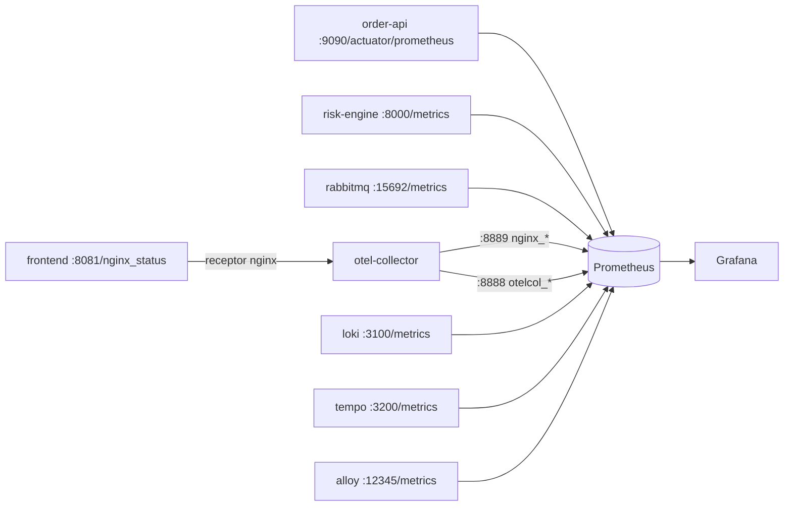
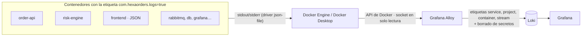
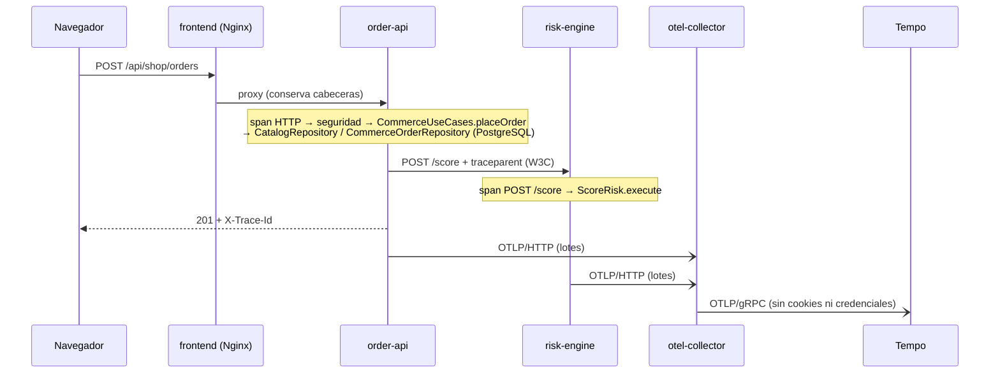

# Stack de observabilidad (v5): métricas, logs y trazas

| Señal | Origen | Transporte | Almacén | Consulta |
| --- | --- | --- | --- | --- |
| Métricas | order-api (Micrometer), risk-engine (`prometheus_client`), RabbitMQ (plugin), collector, Loki, Tempo, Alloy, Nginx (vía collector) | *scrape* de Prometheus cada 10 s | Prometheus (7 días) | Grafana: 8 dashboards |
| Logs | stdout y stderr de **todos** los contenedores del proyecto | Grafana Alloy (API de Docker) → Loki | Loki (7 días) | Grafana → Explore → Loki |
| Trazas | order-api (OpenTelemetry vía Micrometer Tracing), risk-engine (OpenTelemetry Python) | OTLP/HTTP → otel-collector → OTLP/gRPC | Tempo (72 h) | Grafana → Explore → Tempo |

Todo lo anterior a la v5 (7 dashboards, métricas, alertas y jobs) se conserva: ver [`OBSERVABILITY_PRESERVATION.md`](OBSERVABILITY_PRESERVATION.md).

## 1. Flujo de métricas

Los 3 jobs originales usan `static_configs`. Los 6 nuevos usan `dns_sd_configs`: si el servicio no está desplegado (modo básico), el job no tiene targets en lugar de aparecer caído.

**Métricas nuevas de la v5** (las anteriores no cambian):

| Métrica | Origen |
| --- | --- |
| `hexaorders_cache_requests_total{cache,result}`, `hexaorders_cache_invalidations_total` | Caché Redis |
| `hexaorders_outbox_pending`, `hexaorders_events_published_total{type}`, `hexaorders_events_publish_failures_total` | Outbox y publicación |
| `hexaorders_events_consumed_total{type,result}`, `hexaorders_notifications_sent_total{type}` | Consumidor y SMTP |
| `hexaorders_port_calls_seconds_{count,sum,max}{kind,port,method,error}` | Cada caso de uso y puerto de salida (proxy en `ObservedPortsConfiguration`) |
| `nginx_requests_total`, `nginx_connections_current{state}`, `nginx_connections_*_total` | Gateway, convertido por el collector |
| `rabbitmq_*` (p. ej. `rabbitmq_queue_messages_ready{queue}`) | Plugin `rabbitmq_prometheus`, con métricas por cola |
| `otelcol_receiver_accepted_spans`, `otelcol_exporter_sent_spans`, `otelcol_exporter_send_failed_spans` | Collector |
| `loki_distributor_lines_received_total`, `tempo_distributor_spans_received_total` | Ingesta |

Ninguna etiqueta contiene datos personales ni identificadores de alta cardinalidad: no hay ids de pedido, usuarios ni correos.

## 2. Flujo de logs

- **Recolección.** Grafana Alloy descubre los contenedores por la API de Docker y solo toma los de este proyecto, filtrados por etiqueta. Lee sus logs como lo hace `docker logs`. Funciona igual en Docker Desktop para Windows, que expone `/var/run/docker.sock` a los contenedores Linux (ADR 0013).
- **Privacidad.**
  - Antes de enviar cada línea, Alloy sustituye por `<redacted>` el valor que siga a `password`, `secret`, `token`, `authorization`, `cookie` o `jsessionid`.
  - Las aplicaciones no registran secretos ni cuerpos de petición.
  - Nginx registra la ruta sin query string ni cabeceras.
  - `integration_smoke.py` busca en Loki el valor de cada uno de los 4 secretos y exige cero coincidencias.
- **Correlación.** Con las trazas activas, el patrón de log de Spring Boot incluye el trace id. La fuente Loki de Grafana lo convierte en un enlace a la traza en Tempo.
- **Retención.** 7 días, compactada (`retention_enabled`), con un límite de ingesta de 8 MB/s.

## 3. Flujo de trazas distribuidas

- **Instrumentación de Java.**
  - Las observaciones de Spring (HTTP, seguridad, `RestClient` y AMQP de plantilla y listener) se exportan con Micrometer Tracing y el puente OpenTelemetry.
  - Cada caso de uso y cada puerto de salida (repositorios PostgreSQL, motor de riesgo, caché, publicador, SMTP) tiene su span gracias a un proxy en `config`. **El núcleo no se modifica.**
  - Muestreo del 100 %, adecuado para un entorno académico.
- **Instrumentación de Python.** `FastAPIInstrumentor` continúa el contexto W3C que envía Java. El adaptador añade el span `ScoreRisk.execute` con la decisión y el puntaje, nunca el cliente.
- **Mensajería.** El relay del outbox publica en su propia traza, que cubre la publicación y el consumo con el listener AMQP. La traza del checkout termina al confirmar la transacción: el evento se procesa después, de forma asíncrona, y se relaciona por `orderId` y `eventId`.
- **Navegador.** No hay instrumentación JavaScript en el navegador: la traza empieza en el servidor (Nginx → order-api). El `X-Trace-Id` de la respuesta permite abrir esa misma traza.
- **Activación.** Solo si existe `otel-collector` (modo completo). En el modo básico no se exporta nada y no hay ruido en los logs.

## 4. OpenTelemetry Collector

| Etapa | Configuración |
| --- | --- |
| Receptores | `otlp` (gRPC :4317, HTTP :4318) y `nginx` (stub_status de `frontend:8081`, cada 15 s) |
| Procesadores | `memory_limiter` (200 MiB), `attributes/redact` (borra cookies, `Authorization`, `set-cookie`, `user.email`, `enduser.id`) y `batch` (2 s / 512) |
| Exportadores | `otlp/tempo` (reintentos 120 s y cola de 2000) y `prometheus/nginx` (:8889) |
| Salud | Extensión `health_check` (:13133); healthcheck de Compose con `busybox wget` |
| Telemetría propia | Métricas en :8888 (job `otel-collector`) y logs en nivel `warn` |

No recibe las métricas de las aplicaciones: Prometheus ya las recoge directamente y duplicarlas no aporta nada.

## 5. Grafana

| Fuente | uid | Archivo |
| --- | --- | --- |
| Prometheus (original, sin cambios) | `prometheus` | `infra/grafana/provisioning/datasource.yml` |
| Loki (v5) | `loki` | `infra/grafana/provisioning/datasource-logs-traces.yml` |
| Tempo (v5) | `tempo` | ídem |

Dashboard nuevo **HexaOrders — Platform Integrations** (`/d/hexaorders-integrations`, 14 paneles):

- caché, outbox, DLQ, correos, eventos y colas de RabbitMQ;
- Nginx;
- latencia por puerto hexagonal;
- spans del collector;
- ingesta de Loki y Tempo;
- un panel de logs con advertencias y errores, y una guía para seguir un pedido.

## 6. Verificación automática

`integration_smoke.py check`, dentro de `verify` y en el CI:

- los 9 jobs de Prometheus en UP;
- spans exportados por el collector;
- métricas de Nginx y RabbitMQ;
- traza de un checkout en Tempo con order-api y risk-engine;
- logs de 3 servicios en Loki y ningún secreto en los logs;
- salud de las 3 fuentes de Grafana y los 8 dashboards.
