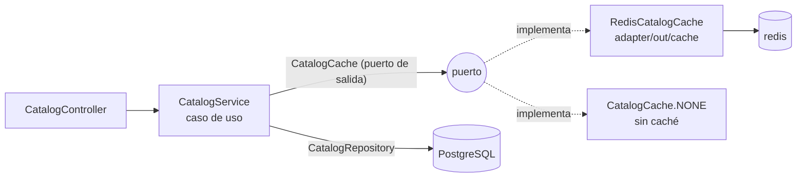

# Integración con Redis (v5)

## 1. Para qué se usa

Redis guarda una **caché de lectura del catálogo público**: categorías, listados de productos por categoría y ficha de un producto. Son los datos más consultados del sitio y no son sensibles.

Redis **no** se usa como fuente de verdad. PostgreSQL sigue siendo la base de datos principal de pedidos, stock y usuarios. **Tampoco** se usa para la idempotencia de los pedidos: esa garantía sigue en PostgreSQL (columna `idempotency_key` única), porque una clave temporal en Redis no sobreviviría a reinicios ni a expiraciones y podría duplicar pedidos.

## 2. Diseño hexagonal

- **Puerto:** `application/port/out/CatalogCache`, con `categories`, `activeProducts`, `product` e `invalidate`. Cada lectura recibe el *loader* que consulta PostgreSQL.
- **Caso de uso:** `CatalogService` usa la caché para las lecturas públicas e invalida tras crear o editar productos o categorías y tras ajustar el stock.
- **Invalidación por stock:** `CommerceService` (al crear un pedido) y `LifecycleTransitions` (al devolver stock por cancelación o rechazo) también invalidan, porque el stock mostrado cambió.
- **Lo que no se cachea:**
  - Las búsquedas de texto libre: tendrían claves ilimitadas.
  - El listado de administración: debe estar siempre al día.
  - El precio y el stock que valida el checkout: se leen siempre de PostgreSQL.
- **Adaptador:** `RedisCatalogCache`, sobre Spring Data Redis y Lettuce, con JSON vía Jackson.
- **Configuración:** `IntegrationConfiguration` elige `RedisCatalogCache` si `redis` existe en el modo completo, o `CatalogCache.NONE` en el básico.

## 3. Claves, expiración e invalidación

| Clave | Contenido | TTL |
| --- | --- | --- |
| `hexaorders:catalog:version` | Número de versión del catálogo | sin TTL |
| `hexaorders:catalog6:v{n}:categories` | Categorías (v6: con subcategorías) | 60 s |
| `hexaorders:catalog6:v{n}:products:{all\|categoría}` | Productos activos con su ficha técnica | 60 s |
| `hexaorders:catalog6:v{n}:product:{id}` | Ficha de un producto | 60 s |

`invalidate()` ejecuta `INCR hexaorders:catalog:version`: todas las claves anteriores dejan de usarse a la vez y caducan solas. No hace falta recorrer claves con `KEYS` ni `SCAN`. Si Redis no responde durante una invalidación, queda **pendiente** y se aplica en cuanto Redis vuelve. Mientras tanto se lee de PostgreSQL.

Redis está configurado con `maxmemory 48mb` y `allkeys-lru`, y guarda una instantánea cada 5 minutos en el volumen `redis_data`, que es prescindible.

## 4. Degradación

| Situación | Comportamiento |
| --- | --- |
| Modo básico (sin contenedor `redis`) | `CatalogCache.NONE`: lectura directa de PostgreSQL, sin intentos de conexión. |
| Redis se detiene en marcha | Timeout de 300 ms → `result="error"` → PostgreSQL responde. Durante 30 s Redis se omite (`result="bypass"`), así ninguna petición espera timeouts. |
| Redis vuelve | Tras el *back-off* se reanuda la caché y se aplica la invalidación pendiente, si la hay. |
| PostgreSQL falla | El error **no** se oculta: se propaga como antes (`503`). |
| Redis caído | No afecta a la salud de order-api (`management.health.redis.enabled=false`). |

## 5. Seguridad

- Red interna `cache` (solo `order-api` y `redis`), sin puerto publicado en el host.
- Solo datos públicos del catálogo; nunca sesiones, usuarios ni pedidos.
- Contenedor `read_only`, usuario 999, `cap_drop: ALL`.

## 6. Métricas

| Métrica | Valores |
| --- | --- |
| `hexaorders_cache_requests_total{cache="catalog",result}` | `hit`, `miss`, `error`, `bypass` |
| `hexaorders_cache_invalidations_total` | Invalidaciones aplicadas |

Panel «Aciertos de caché del catálogo» en `/d/hexaorders-integrations`.

## 7. Pruebas

| Prueba | Qué demuestra |
| --- | --- |
| `IntegrationServicesTest.publicCatalogReadsUseTheCacheButSearchesAndAdminChangesDoNot` | Lectura con caché, búsquedas sin caché, invalidación tras ajustar stock |
| `InfrastructureAdaptersTest.redisCacheServesHitsAndInvalidatesByVersion` | Acierto, fallo, escritura con TTL e invalidación por versión |
| `InfrastructureAdaptersTest.withoutRedisTheCatalogIsServedFromPostgresqlAndRedisIsSkippedForAWhile` | Degradación real contra un Redis inalcanzable (sin colgarse y con *back-off*) |
| `integration_smoke.py check` | Aciertos reales en Prometheus con el stack Docker |
| `integration_smoke.py degraded` / `recovered` | Catálogo sin Redis en menos de 5 s; recuperación automática |

## 8. Cambios de la v6

- El prefijo pasa a `hexaorders:catalog6:`, porque el formato de los productos cambió (marca, modelo, ficha técnica): ninguna entrada guardada por la v5 se lee con la v6.
- La búsqueda de la tienda (`/api/catalog/search`) filtra y pagina sobre el listado **cacheado** de productos activos (556). Los **precios no se cachean**: las promociones se aplican en cada consulta (`PricingService`), así que activar o desactivar una campaña se ve al momento.
- Una categoría leída sin el campo `active` (dato anterior a la v6) se considera visible.
