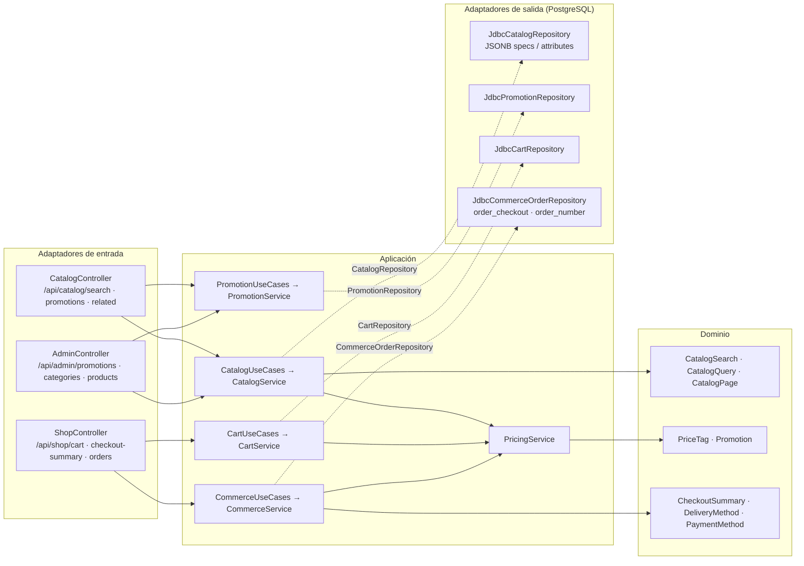

# POLYMER v6 — tienda tecnológica (documentación técnica)

La v6 convierte la interfaz en una **tienda virtual de tecnología**. Este documento es técnico: explica cómo se implementó. La tienda (`http://localhost:8080`) no muestra nada de esto; lo comprueban `tools/check_frontend.py` y `tools/ui-e2e/pages-e2e.js`.

## 1. Qué cambió

| Área | v5 | v6 |
| --- | --- | --- |
| Catálogo | 18 productos, 6 categorías planas | **556 productos activos** (539 nuevos + 17 anteriores reasignados), **20 categorías principales y 170 subcategorías** |
| Ficha de producto | nombre, descripción, precio, stock | marca, modelo, descripción breve y detallada, especificaciones técnicas, filtros técnicos, precio anterior, estado comercial, disponibilidad, fechas |
| Moneda de la tienda | USD | **PEN (soles)**. La API original `/api/orders` sigue en USD |
| Búsqueda | texto en el navegador sobre 200 productos | **búsqueda en el servidor**: nombre, marca, modelo y SKU; filtros; facetas con conteos; orden; paginación |
| Promociones | — | campañas con porcentaje, vigencia y categorías o productos; gestionadas por el administrador |
| Carrito | `localStorage` | **guardado en PostgreSQL** para clientes; el carrito del visitante se fusiona al iniciar sesión |
| Checkout | dirección | **método de entrega** (estándar, express, recojo), **método de pago** (contra entrega, transferencia, en tienda), resumen y **número de pedido** `HX-100001` |
| Interfaz | sitio académico con arquitectura y laboratorio enlazados | tienda comercial; la documentación técnica y el laboratorio son **internos** (ADR 0014) |

Se mantienen los 13 contenedores, los roles y usuarios, los pedidos, la idempotencia, el motor de riesgo, los eventos, los dashboards y las métricas.

## 2. Arquitectura hexagonal (piezas nuevas)



- **Reglas en el dominio**, sin dependencias de frameworks:
  - `PriceTag.of(product, promociones, ahora)` aplica la mejor promoción vigente, **sin acumular descuentos**, y calcula el precio tachado y el porcentaje.
  - `CatalogSearch` busca ignorando acentos y mayúsculas, filtra, ordena, pagina y calcula las facetas. Cada faceta ignora su propio filtro, así que solo ofrece valores que devuelven resultados.
  - `CheckoutSummary` suma el envío y valida que el pago sea compatible con la entrega.
- **`PricingService`** lee una vez las promociones vigentes y precia con esa lista. La tienda, el carrito y el checkout usan el mismo precio, de modo que el cliente siempre paga lo que ve.
- **`CommerceService`**:
  - cobra el precio con promoción más el envío, en PEN;
  - guarda la entrega, el pago y los totales en la **misma transacción** que el pedido;
  - vacía el carrito guardado.
  - La idempotencia (`Idempotency-Key`) y el motor de riesgo no cambian. El motor recibe el importe que se cobra.
- **ArchUnit** sigue verificando que `domain/` y `application/` no importan Spring, JDBC, Jackson, HTTP ni Micrometer.

## 3. Datos y migraciones (no destructivas)

| Migración | Contenido |
| --- | --- |
| `V6__tech_store.sql` | `categories.parent_id/position/active`; columnas nuevas de `products` (marca, modelo, `specs` y `attributes` en JSONB, `compare_at_price`, `commercial_status`); moneda `USD` o `PEN`; `orders.order_number`, que se numera también para los pedidos existentes; `promotions` y `promotion_targets`; `order_lines.list_unit_price/promotion_id`; `order_checkout`; `cart_items`; temas de contacto nuevos |
| `V7__tech_catalog.sql` | **Generada** por `tools/generate_catalog.py` desde `tools/catalog_v6_data.py`: categorías, 539 productos y 9 promociones con `ON CONFLICT DO NOTHING` (idempotente) |

Qué hace con los datos existentes:

- **No borra ninguna fila.**
- Los 18 productos anteriores pasan a subcategorías tecnológicas y a soles (×3,70, terminación ,90).
- La botella térmica, que no es tecnología, deja de venderse, pero se conserva con su historial.
- Las 6 categorías anteriores quedan ocultas.
- Los pedidos anteriores conservan su moneda USD y sus importes.

Lo comprobé en local sobre una base v5 con pedidos (sección 7).

Regenerar el catálogo después de editar los datos:

```powershell
py tools\generate_catalog.py          # escribe V7 (solo antes de publicarla; las migraciones aplicadas no se modifican)
py tools\generate_catalog.py --check  # lo ejecuta .\polymer.cmd check y el CI
```

Los filtros técnicos (`procesador`, `ram`, `almacenamiento`, `gpu`, `pantalla`, `resolucion`, `frecuencia`, `conectividad`, `bateria`, `capacidad`, `potencia`, `formato`) **se derivan de la ficha técnica**, así que siempre corresponden a atributos reales. Las marcas y modelos son reales para que la búsqueda resulte realista. **Los precios, el stock y las promociones son de demostración**, no ofertas del mercado; el pie de la tienda lo indica.

## 4. API nueva

| Método y ruta | Acceso | Uso |
| --- | --- | --- |
| `GET /api/catalog/search` | público | `q`, `category`, `brand`, `min`, `max`, `available`, `offers`, `status`, `sort`, `page`, `size`, `attr.CLAVE`. Devuelve los productos, el total, las páginas, las facetas y las etiquetas |
| `GET /api/catalog/products/{id}/related` | público | Productos de la misma categoría con stock |
| `GET /api/catalog/promotions` | público | Campañas vigentes y cuántos productos descuentan |
| `GET /api/shop/checkout-options` | público | Métodos de entrega y de pago con sus reglas |
| `POST /api/shop/checkout-summary` | público (CSRF) | Totales con promociones y envío |
| `GET/DELETE /api/shop/cart`, `POST /api/shop/cart/items`, `PUT/DELETE /api/shop/cart/items/{id}`, `POST /api/shop/cart/merge` | CUSTOMER | Carrito guardado (409 si se supera el stock) |
| `POST /api/shop/orders` | CUSTOMER | Ahora acepta `deliveryMethod` y `paymentMethod`. Sin ellos se comporta como en la v5 |
| `GET/POST /api/admin/promotions`, `PUT /api/admin/promotions/{id}`, `PUT /api/admin/promotions/{id}/active` | ADMIN | Gestión de campañas |
| `GET /api/admin/categories`, `POST /api/admin/categories` (`parentId`) | ADMIN | Árbol de categorías, incluidas las ocultas |

Compatibilidad:

- Los endpoints anteriores conservan su contrato; las respuestas solo **añaden** campos.
- `GET /api/catalog/products` devuelve ahora el precio con promoción.
- Al editar un producto, los campos que no se envían conservan su valor.

## 5. Interfaz de la tienda

- **Módulos de la tienda:**
  - `layout.js`: cabecera, megamenú y pie;
  - `views/home.js`: portada, ofertas, ayuda, nosotros, contacto y errores;
  - `views/shop.js`: catálogo, ficha, carrito, checkout, pedidos, perfil y acceso;
  - `views/customer.js`;
  - `store-ui.js`: tarjeta, precio e insignias;
  - `cart.js`;
  - `css/store.css`.
- **Sin recursos multimedia nuevos:** la tarjeta usa un degradado y el icono de su categoría, como pide la v6 (sin imágenes, videos ni galerías).
- **Áreas del personal:** se adaptaron la administración (productos con ficha completa, categorías en árbol, promociones, reportes por moneda) y los textos que ve el cliente («Pedido verificado», «En camino»…).
- **Accesibilidad:** filtros con casillas reales y etiquetas, `aria-current` en la paginación, foco visible, móvil sin desbordamiento (390 px).

## 6. Pruebas

| Prueba | Qué comprueba |
| --- | --- |
| `TechStoreDomainTest` (7) | Mejor promoción sin acumular, precio anterior, promociones vencidas o programadas, validaciones, búsqueda por marca, modelo, SKU y acentos, facetas, orden, paginación, relacionados, envío y compatibilidad del pago |
| `TechStoreServicesTest` (5) | Carrito con stock y fusión, checkout en PEN con envío y promoción (el riesgo recibe el total cobrado), carrito vaciado, reglas de dirección y pago, promociones solo para ADMIN, categorías ocultas |
| `tools/store_smoke.py` (38) | Todo lo anterior contra PostgreSQL real, a través de la API |
| `tools/store_smoke.py --quick` | Que el catálogo, las categorías y las promociones persisten tras reiniciar `db` y `order-api` (paso 8 de `verify`) |
| `check_frontend.py` (comprobación 8) | La tienda no contiene términos técnicos ni enlaza la documentación interna |
| `pages-e2e.js` | Recorre todas las páginas con todos los roles; filtros que persisten en la URL; filtro de marca; «Comprar ahora» y checkout; ningún texto técnico visible para visitante y cliente; móvil |
| `ui-e2e.js` | Laboratorio interno como observador; compra con envío express y transferencia; número de pedido |

## 7. Persistencia y actualización desde la v5

- Al arrancar la v6 sobre una base v5, Flyway aplica V6 y V7 **una sola vez** y conserva usuarios, contraseñas y pedidos.
- Detener Docker, reiniciar o reconstruir imágenes no repite ni pierde nada: el catálogo vive en el volumen `polymer_postgres_data`.
- El administrador puede editar productos, precios y promociones; esos cambios **no se pisan**, porque V7 nunca vuelve a ejecutarse e inserta con `ON CONFLICT DO NOTHING`.
- La caché de Redis usa claves nuevas (`polymer:catalog6:…`), así que ninguna entrada de la v5 se mezcla con la v6.
