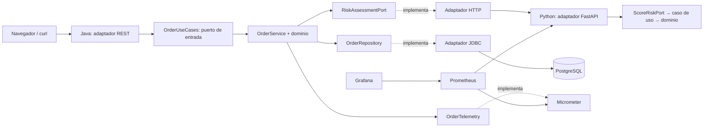

# POLYMER: defensa técnica leyendo docker-compose.yml

La aplicación permite crear y consultar pedidos en USD. Java coordina el caso de uso; Python asigna riesgo mediante reglas explicables; PostgreSQL conserva el pedido. El resultado es `APPROVED` o `REVIEW`. No hay aprendizaje automático, procesamiento asíncrono ni cola en esta versión.

## El único archivo de entrega

`docker-compose.yml` es un entregable autosuficiente: sus cuatro `build.dockerfile_inline` contienen los Dockerfiles **y los fuentes de ambas aplicaciones**, incluidos los tests que se ejecutan al construir las imágenes, además de las imágenes de Prometheus y Grafana con su configuración (reglas de alerta, datasource y dashboard) incorporada. Así todos los servicios propios se ejecutan con `read_only: true`: Compose no puede inyectar `configs.content` en contenedores de solo lectura. No utiliza bind mounts ni necesita clonar este repositorio para arrancar. Se requieren Docker Engine/Compose V2 >= 2.23.1, BuildKit, Internet en la primera construcción y dos secretos suministrados por el operador. Las contraseñas son configuración de cada instalación; no forman parte del archivo a entregar.

Esto utiliza características oficiales de [Compose Build](https://docs.docker.com/reference/compose-file/build/#dockerfile_inline) y heredocs de BuildKit (`COPY <<EOF`). No se usa el campo obsoleto `version:`.

El repositorio mantiene fuentes normales bajo `services/` para poder editarlos y revisarlos. `python tools/generate_delivery.py` vuelve a empaquetarlos en el YAML. `--check` detecta divergencias entre los fuentes y el entregable. No edites a mano el archivo generado: la siguiente generación reemplazaría esos cambios. Los signos `$` dentro de Java, JavaScript y plantillas Prometheus se escapan como `$$` para sobrevivir a la interpolación de Compose.

## Recorrido del YAML durante la exposición

| Sección | Qué explicar | Fuentes correspondientes |
|---|---|---|
| `name` y `x-runtime` | Proyecto aislado por nombre; reinicio y rotación de logs comunes mediante ancla YAML. | `infra/compose.base.yml` |
| `services.db` | PostgreSQL 17, autenticación SCRAM para conexiones TCP, secreto montado y volumen persistente. La base no publica puerto al host. | Java `adapter/out/persistence/`, `resources/db/migration/` |
| `services.risk-engine.build` | Python 3.12 + FastAPI; Dockerfile multietapa con tests obligatorios y runtime sin pytest. | `services/risk-engine/` |
| `services.order-api.build` | Java 21 + Spring Boot + Maven; compila, ejecuta JUnit/ArchUnit y copia únicamente el JAR al runtime. | `services/order-api/` |
| `order-api.environment` | DNS `db` y `risk-engine`, puerto y nombre de base, URL del adaptador HTTP y ruta del secreto. La JVM respeta su límite de memoria. | `config/HexagonalConfiguration.java` |
| `order-api.depends_on` | Espera salud inicial de base y motor de riesgo antes de iniciar Java. No sustituye timeouts ni manejo de errores en ejecución. | `HttpRiskAssessmentAdapter`, excepciones de aplicación |
| `services.prometheus` | Recopila métricas por HTTP cada 10 s; conserva hasta 7 días o 1 GB; monta configuración y reglas en archivos. | `infra/prometheus/` |
| `services.grafana` | Arranca con datasource y dashboard ya configurados; login `admin` con contraseña del secreto. | `infra/grafana/` |
| `ports` | Solo loopback: app 8080, Grafana 3000, Prometheus 9091. El Actuator 9090 de Java queda en redes internas. | No requiere código de negocio |
| `networks` | `data`, `compute` y `telemetry` son internas; `edge` permite acceso a los servicios publicados. Las redes no son un diagrama de dependencias Java. | Separación de conectividad |
| `volumes` | Conserva datos PostgreSQL, TSDB Prometheus y SQLite/configuración Grafana al recrear contenedores. | Persistencia operativa |
| `secrets` | Monta `./secrets/*.txt` (generados en el destino, fuera de Git) como archivos de solo lectura en `/run/secrets`; es la única fuente que Compose admite en servicios `read_only`. | `DB_PASSWORD_FILE` y `GF_SECURITY_ADMIN_PASSWORD__FILE` |
| Imágenes `polymer/prometheus` y `polymer/grafana` | Contenido íntegro de configuración y dashboard dentro de la imagen, sin archivos externos y compatible con `read_only`. | `infra/prometheus/Dockerfile`, `infra/grafana/Dockerfile` |

`healthcheck` decide si un servicio responde; `restart: unless-stopped` actúa cuando el proceso termina. Docker no reinicia automáticamente un proceso que sigue vivo por estar `unhealthy`. Tras una caída de Python, Java devuelve 503 y registra un fallo; la recuperación de Python permite aceptar nuevas solicitudes. Su liveness no depende de otros servicios; la readiness Java incluye DB para señalar si puede consultar pedidos. La salud de Python se observa por su propia sonda y por Prometheus.

## Hexágonos y dirección de dependencias



Las flechas continuas representan recorrido de ejecución. Las discontinuas identifican implementaciones de puertos; en el código, **el adaptador importa el puerto**, no al revés. `domain` no importa `application`. `application` puede importar `domain`, pero no Spring, FastAPI, JDBC, Micrometer ni adaptadores. La composición concreta ocurre en `config/HexagonalConfiguration.java` y `risk_engine/bootstrap.py`.

Java incluye cuatro puertos: uno de entrada (`OrderUseCases`) y tres de salida (`RiskAssessmentPort`, `OrderRepository`, `OrderTelemetry`). Python ofrece `ScoreRiskPort` como puerto de entrada. Su regla es pura y no necesita un puerto de salida artificial, ya que no consulta sistemas externos. Ambos núcleos funcionan con objetos comunes del lenguaje y pueden probarse sin contenedores.

ArchUnit comprueba las dependencias compiladas Java; las pruebas AST comprueban imports Python. La arquitectura no se demuestra solo con nombres de carpetas, interfaces o cinco contenedores: se demuestra con la dirección de dependencias y con casos de uso probados mediante dobles de sus puertos.

## Contrato y ejecución

```http
POST /api/orders
Content-Type: application/json

{"customerId":"demo-001","amount":125.50}
```

1. El adaptador REST construye `OrderDraft`: cliente `[A-Za-z0-9_-]{1,64}`, importe > 0 y <= 1 000 000, máximo dos decimales y moneda USD. No se redondea una entrada inválida.
2. `OrderService` solicita un score mediante `RiskAssessmentPort`.
3. El adaptador HTTP envía `POST http://risk-engine:8000/score` con `{customerId,amount}`. Conexión máxima 2 s y lectura máxima 3 s; no hay reintentos automáticos.
4. Python conserva precisión con `Decimal`. Importe < 500 → score 10; de 500 a < 1000 → 40; >= 1000 → 75. Devuelve `{score,decision}`.
5. Java valida el contrato del proveedor y conserva la autoridad sobre el estado del pedido: score >= 70 → `REVIEW`, de lo contrario `APPROVED`.
6. JDBC ejecuta un único INSERT atómico en autocommit. El esquema impone restricciones e índice de fecha. Flyway crea y valida el esquema al iniciar Java.
7. La API responde `201 Created`, `Location: /api/orders/{uuid}` y el pedido con `id`, `customerId`, `amount`, `currency`, `riskScore`, `status`, `createdAt` UTC. GET por UUID devuelve 404 si no existe; listado devuelve los 50 más recientes; `GET /api/orders/statistics` cuenta todos los pedidos por estado con una consulta agregada (`OrderUseCases.statistics()` → `OrderRepository.statistics()`), sin pasar por el motor de riesgo.

Una falla o respuesta inválida de Python produce 503 **antes de insertar**. Una falla de base produce 503. No hay transacción abierta durante la llamada HTTP. La API no implementa idempotencia: un cliente que repita una creación después de perder una respuesta puede crear otro pedido. Es una mejora futura concreta, junto con autenticación, autorización, TLS y backups externos si se publica para uso real. Para la demostración se accede por loopback o túnel SSH.

## Observabilidad que se puede demostrar

| Métrica | Significado |
|---|---|
| `up{job="order-api"}` / `up{job="risk-engine"}` | Éxito de cada scrape, 0 o 1. |
| `orders_created_total{status}` | Pedidos persistidos desde el inicio del proceso Java. |
| `orders_risk_failures_total` | Fallos al consultar/validar el motor de riesgo. |
| `http_server_requests_seconds_bucket` | Histograma Micrometer para p95 REST. |
| `risk_evaluations_total{decision}` | Evaluaciones Python completadas por decisión. |
| `risk_evaluation_duration_seconds_bucket` | Histograma de duración de la regla Python. |

Los contadores no equivalen a un inventario histórico de la tabla: se reinician con el proceso; `rate`/`increase` contemplan esos reinicios. Las gráficas de tasas y p95 necesitan tráfico y varias muestras; genera pedidos durante al menos 30 segundos para la demo. No se usan etiquetas por cliente o UUID, evitando alta cardinalidad.

Las reglas `PolymerServiceDown` y `RiskRequestsFailing` aparecen en la página Alerts de Prometheus. Este proyecto no incluye Alertmanager ni envíos de correo. El stack observa aplicaciones y Prometheus; no se incluye exporter de métricas internas de PostgreSQL ni del host.

## Persistencia y límites de operación

`docker compose down` conserva volúmenes. `down -v` elimina todos sus datos. Las contraseñas iniciales de PostgreSQL y Grafana quedan almacenadas en sus volúmenes: modificar los archivos de `secrets/` no constituye un procedimiento de rotación. Conserva los valores originales o rota mediante los mecanismos propios de cada producto.

Los secretos de Compose local son montajes de archivos y no una bóveda cifrada. PostgreSQL usa el rol de inicialización de la imagen para simplificar la práctica; una evolución de producción debe separar el rol de migración y el rol de aplicación. Los límites de memoria/CPU se aplican con `mem_limit`/`cpus` sin depender de Swarm. Los tags están fijados a versiones, pero pueden ser mutables en los registros: fijar digests y actualizar dependencias con revisión es una mejora posterior.

Kubernetes es una alternativa adicional, documentada en `k8s/README.md`. No es un prerrequisito del despliegue con Compose ni transforma una VM única en alta disponibilidad.
