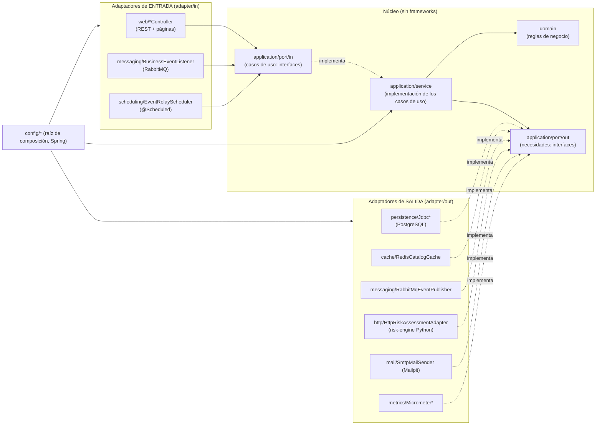
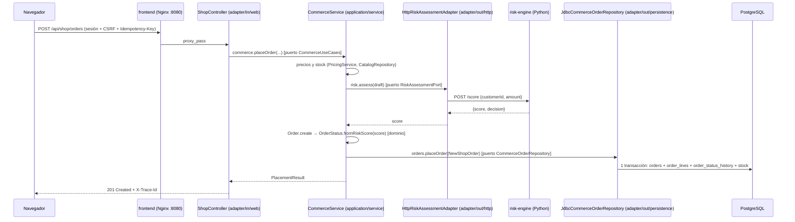

# Arquitectura hexagonal de POLYMER (puertos y adaptadores)

Este documento explica la arquitectura con **el código real**. Todas las rutas son relativas a
`services/order-api/src/main/java/com/polymer/`, salvo que se indique otra.

## 1. Las capas y la regla de dependencias



**Regla:** las dependencias de código apuntan **hacia dentro**. El dominio no conoce a nadie; la
aplicación solo conoce el dominio y sus propios puertos; los adaptadores conocen los puertos; solo
`config/` conoce todo para conectar las piezas.

La regla no es una convención: la comprueban **8 reglas ArchUnit** en
`services/order-api/src/test/java/com/polymer/architecture/HexagonalArchitectureTest.java`, que se
ejecutan en cada build de la imagen (`mvn test` dentro del Dockerfile) y en el CI.

| Regla ArchUnit | Qué garantiza |
| --- | --- |
| `CORE_HAS_NO_FRAMEWORK_OR_INFRASTRUCTURE` | `domain` y `application` no usan Spring, JDBC, Jackson, Micrometer, Hikari, adaptadores ni `config` |
| `DOMAIN_IS_INNERMOST` | `domain` no depende de `application`, `adapter` ni `config` |
| `ADAPTERS_ARE_INDEPENDENT` | un adaptador de entrada no usa adaptadores de salida |
| `DRIVING_ADAPTERS_USE_INPUT_PORTS_ONLY` | los controladores solo hablan con puertos de **entrada** |
| `PORTS_ARE_CONTRACTS` | todo lo que hay en `application/port` es una interfaz o un registro de datos |
| `PORTS_DO_NOT_DEPEND_ON_IMPLEMENTATIONS` | los puertos no conocen servicios, adaptadores ni `config` |
| `OUTPUT_ADAPTERS_IMPLEMENT_OUTPUT_PORTS` | cada adaptador de salida implementa un puerto de salida |
| `USE_CASES_IMPLEMENT_INPUT_PORTS` | cada servicio de casos de uso implementa un puerto de entrada |

Comprobado en este trabajo: añadir temporalmente un campo `JdbcTemplate` a `domain/OrderStatus.java`
hace fallar `CORE_HAS_NO_FRAMEWORK_OR_INFRASTRUCTURE` con
`Field <com.polymer.domain.OrderStatus.DEMO> has type <org.springframework.jdbc.core.JdbcTemplate>`.

## 2. Conceptos, con su clase real

| Concepto | Qué es | En POLYMER |
| --- | --- | --- |
| **Dominio** | Reglas de negocio puras, sin tecnología | `domain/OrderStatus.java` (umbral de revisión), `domain/Order.java`, `domain/fulfillment/TransitionPolicy.java` (ciclo de vida por rol), `domain/catalog/PriceTag.java` (promociones), `domain/identity/PasswordPolicy.java` |
| **Caso de uso** | Orquesta una operación del negocio: valida, consulta puertos, aplica el dominio | `application/service/CommerceService.java` (`placeOrder`), `CatalogService`, `OperationsService`, `LogisticsService`, `AccountService`… |
| **Puerto de entrada** | Interfaz con lo que el sistema **ofrece** | `application/port/in/CommerceUseCases.java`, `CatalogUseCases.java`, `OrderUseCases.java`, v7: `SignInUseCases.java`, `PaymentUseCases.java`, `StoreUseCases.java`… (16 interfaces y 12 registros de datos) |
| **Puerto de salida** | Interfaz con lo que el núcleo **necesita** del exterior | `application/port/out/RiskAssessmentPort.java`, `CommerceOrderRepository.java`, `CatalogCache.java`, `EventPublisher.java`, `EventOutbox.java`, `MailSender.java`, v7: `CardGateway.java`, `WalletGateway.java`, `PaymentWindow.java`, `DeviceTokens.java`… (33 interfaces y 2 registros) |
| **Adaptador de entrada** | Traduce un estímulo externo (HTTP, mensaje, temporizador) a una llamada a un puerto de entrada | `adapter/in/web/ShopController.java`, `adapter/in/messaging/BusinessEventListener.java`, `adapter/in/scheduling/EventRelayScheduler.java` |
| **Adaptador de salida** | Implementa un puerto de salida con una tecnología concreta | `adapter/out/persistence/JdbcCommerceOrderRepository.java`, `adapter/out/cache/RedisCatalogCache.java`, `adapter/out/messaging/RabbitMqEventPublisher.java`, `adapter/out/http/HttpRiskAssessmentAdapter.java`, `adapter/out/fixed/FixedRiskAssessmentAdapter.java` |
| **Inversión de dependencias** | El núcleo define la interfaz y la tecnología la implementa; el núcleo nunca importa la tecnología | `CommerceService` recibe un `RiskAssessmentPort` en su constructor y no sabe si detrás hay HTTP o un puntaje fijo |
| **Raíz de composición** | El único lugar que crea las implementaciones concretas | `config/HexagonalConfiguration.java`, `config/PlatformConfiguration.java`, `config/IntegrationConfiguration.java` |

## 3. Responsabilidades de Spring Boot

Spring Boot está **solo en el borde**:

- **Adaptadores de entrada:** `@RestController` (`adapter/in/web`), `@RabbitListener`
  (`BusinessEventListener.onEvent`), `@Scheduled` (`EventRelayScheduler`), Spring Security
  (`config/SecurityConfiguration.java`: permisos por rol de cada ruta).
- **Adaptadores de salida:** `JdbcTemplate`, `StringRedisTemplate`, `RabbitTemplate`, `JavaMailSender`,
  `RestClient`, Micrometer.
- **Raíz de composición:** `@Configuration` + `@Bean` crean los servicios con `new` y les pasan los
  adaptadores. Los servicios de aplicación **no tienen anotaciones de Spring** (ni `@Service` ni
  `@Autowired`): se pueden probar con `new` y dobles de prueba.
- **Transversal:** Flyway (migraciones), Actuator (salud y métricas en el puerto interno 9090),
  Micrometer Tracing → OpenTelemetry. `config/ObservedPortsConfiguration.java` envuelve los puertos para
  generar trazas sin tocar los casos de uso.

## 4. Recorrido completo de un pedido (código real)



1. **Adaptador de entrada** — `adapter/in/web/ShopController.java`:

   ```java
   @PostMapping("/orders")
   public ResponseEntity<CommerceOrder> place(@RequestHeader("Idempotency-Key") String idempotencyKey, @RequestBody CartRequest cart) {
       PlacementResult result = cart.deliveryMethod() == null && cart.paymentMethod() == null
               ? commerce.placeOrder(CurrentUser.require(), cart.toItems(), idempotencyKey, cart.toShipping())
               ...
   ```

   Solo traduce HTTP → objetos del dominio (`CartItem`, `ShippingAddress`) y llama al **puerto**
   `CommerceUseCases` (campo `commerce`). No sabe nada de SQL ni de Python.

2. **Caso de uso** — `application/service/CommerceService.java`, método privado `place(...)`:

   ```java
   // 1) Risk first (Python), exactly like the original use case; no transaction is open yet.
   OrderDraft draft = new OrderDraft(customer.username(), summary.total(), CURRENCY);
   int score;
   try {
       score = risk.assess(draft);
       ...
   } catch (RiskUnavailableException error) { ... throw error; }
   Order order = Order.create(draft, score, UUID.randomUUID(), now);
   FulfillmentStatus status = FulfillmentStatus.fromRiskDecision(order.status());
   ...
   // 2) One transaction: order + lines + history + conditional stock decrement.
   placed = orders.placeOrder(new NewShopOrder(order, customer.userId(), status, quote.lines(), history, idempotencyKey, shipping, summary));
   cache.invalidate(); // stock decreased in PostgreSQL: cached listings would show stale stock
   ```

   Usa **solo interfaces**: `risk` (`RiskAssessmentPort`), `orders` (`CommerceOrderRepository`),
   `cache` (`CatalogCache`), `telemetry`, `audit`.

3. **Dominio** — `domain/OrderStatus.java`:

   ```java
   public static OrderStatus fromRiskScore(int score) {
       if (score < 0 || score > 100) throw new IllegalArgumentException("El puntaje debe estar entre 0 y 100");
       return score >= 70 ? REVIEW : APPROVED;
   }
   ```

   La decisión es del dominio Java aunque el motor Python también devuelva una `decision`
   (`HttpRiskAssessmentAdapter` la ignora a propósito: «The Java domain owns the decision»).

4. **Puerto y adaptadores de salida** — `application/port/out/RiskAssessmentPort.java`:

   ```java
   public interface RiskAssessmentPort {
       /** Returns 0..100 or throws RiskUnavailableException. */
       int assess(OrderDraft draft);
   }
   ```

   Implementaciones: `adapter/out/http/HttpRiskAssessmentAdapter.java` (real, `RestClient`, timeout de
   conexión 2 s y de lectura 3 s) y `adapter/out/fixed/FixedRiskAssessmentAdapter.java` (demostración).

5. **Raíz de composición** — `config/HexagonalConfiguration.java` elige el adaptador:

   ```java
   @Bean
   @ConditionalOnProperty(name = "polymer.risk.adapter", havingValue = "http", matchIfMissing = true)
   RiskAssessmentPort riskAssessmentPort(RestClient.Builder builder, @Value("${RISK_BASE_URL:http://risk-engine:8000}") String baseUrl) { ... }

   @Bean
   @ConditionalOnProperty(name = "polymer.risk.adapter", havingValue = "fixed")
   RiskAssessmentPort fixedRiskAssessmentPort(@Value("${polymer.risk.fixed-score:10}") int score) { ... }
   ```

## 5. Cómo se comunica el dominio con PostgreSQL

El dominio **no** se comunica con PostgreSQL. El caso de uso pide persistencia a un puerto
(`CommerceOrderRepository.placeOrder(NewShopOrder)`) y el adaptador
`adapter/out/persistence/JdbcCommerceOrderRepository.java` lo implementa con `JdbcTemplate` y SQL
explícito (ADR 0008: JDBC sin ORM), en **una transacción**: `orders`, `order_lines`,
`order_status_history`, `order_shipping`, `order_checkout` y el descuento condicional de stock.
El esquema lo crean las migraciones Flyway `services/order-api/src/main/resources/db/migration/V1…V10`.

## 6. Cómo se integra Redis sin acoplarlo al dominio

- Puerto: `application/port/out/CatalogCache.java` con `categories(loader)`, `activeProducts(categoryId, loader)`,
  `product(id, loader)` e `invalidate()`. El propio puerto define `CatalogCache.NONE` (sin caché).
- Caso de uso: `CatalogService.categories()` → `cache.categories(catalog::categories)`: pasa como
  *loader* la consulta a PostgreSQL; no sabe si hay Redis.
- Adaptador: `adapter/out/cache/RedisCatalogCache.java` (*read-through*): clave
  `polymer:catalog6:v<versión>:<nombre>`, TTL `polymer.cache.catalog-ttl` (60 s), invalidación
  incrementando `polymer:catalog:version`, y degradación: ante un error de Redis consulta PostgreSQL y
  omite Redis 30 s (`polymer.cache.backoff`).
- Composición: `config/IntegrationConfiguration.java` crea `RedisCatalogCache` si
  `polymer.integrations.redis.enabled=true` (modo `full`) y `CatalogCache.NONE` si no (modo `basic` y
  pruebas). **Es una sustitución de adaptador que ya existía**: el mismo `CatalogService` funciona con
  ambos.

## 7. Cómo se integra RabbitMQ

- **Escritura:** el caso de uso no publica nada. Escribe el historial de estados
  (`order_status_history`, `delivery_changes`) en la misma transacción que el cambio de negocio; esas
  tablas son el **outbox** (ADR 0012). Adaptador del puerto `EventOutbox`:
  `adapter/out/persistence/JdbcEventOutbox.java`.
- **Publicación:** `adapter/in/scheduling/EventRelayScheduler` (adaptador de entrada: un temporizador)
  llama cada 2 s a `EventRelayUseCases.relayPending()` → `application/service/EventRelayService`, que usa
  el puerto `EventPublisher` → `adapter/out/messaging/RabbitMqEventPublisher` (mensaje persistente,
  *publisher confirms*, `mandatory`). Solo con el *ack* se marca el evento en `outbox_published`.
- **Consumo:** `adapter/in/messaging/BusinessEventListener.onEvent` (adaptador de entrada,
  `@RabbitListener`) → puerto `NotificationUseCases` → `application/service/NotificationService`
  (idempotente con `processed_events`) → puerto `MailSender` → `adapter/out/mail/SmtpMailSender` (Mailpit).

## 8. Cómo se consume el servicio de evaluación de riesgo

`HttpRiskAssessmentAdapter.assess` hace `POST /score` con `{customerId, amount}` y valida la respuesta
(`score` entero 0–100 y `decision` APPROVED/REVIEW). Cualquier error de red, de formato o de rango se
convierte en `RiskUnavailableException`, que `adapter/in/web/ApiExceptionHandler` traduce a **HTTP 503**.
No hay reintentos ni puntaje por defecto: un pedido nunca se aprueba sin evaluación
(ver `DEMOSTRACION_MICROSERVICIOS.md`).

El motor Python tiene su propio hexágono (`services/risk-engine/risk_engine/`): `domain/risk.py`
(reglas, solo biblioteca estándar), `application/score_risk.py` y `application/ports.py`, y
`adapters/http.py` (FastAPI). Lo comprueba `services/risk-engine/tests/test_architecture.py`.

## v7 · Tres casos que muestran la hexagonal con funcionalidades nuevas

1. **Un puerto, dos adaptadores según la infraestructura**: `PaymentWindow` (ventana de 60 s de Yape/Plin) se
   implementa con `RedisPaymentWindow` (clave con TTL) en el perfil completo y con `ClockPaymentWindow` en el modo
   básico. `StoreAndPaymentConfiguration` elige; `PaymentService` no cambia. La regla «60 segundos» vive en el
   dominio (`PaymentPolicy.WALLET_TTL`), no en Redis.
2. **Adaptador de entrada nuevo sin tocar el núcleo de pedidos**: «Continuar con Google» es un adaptador de
   entrada (`GoogleSignInHandlers`, Spring Security OAuth2) que traduce el token a `ExternalIdentity` y llama a
   `SignInUseCases`. La decisión de pedir el código, vincular o crear la cuenta es del núcleo (`SignInService`).
3. **Pasarelas sustituibles**: `CardGateway` y `WalletGateway` tienen adaptadores de **prueba**
   (`SandboxCardGateway`, `SandboxWalletGateway`). Pasar a Niubiz, Izipay o Culqi es escribir otro adaptador del
   mismo puerto; `PaymentService`, la interfaz y las pruebas del dominio no cambian.

Detalle y configuración: [`GUIA_GOOGLE_Y_PAGOS.md`](GUIA_GOOGLE_Y_PAGOS.md).

