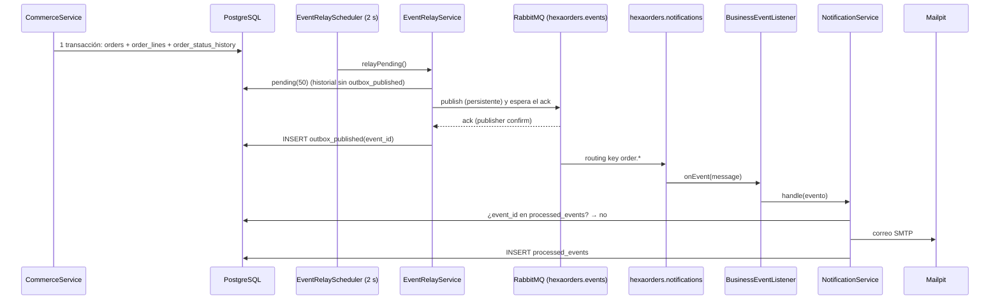

# Demostración de RabbitMQ: eventos, outbox transaccional y persistencia

Rutas Java relativas a `services/order-api/src/main/java/com/polymer/`.

## 1. Qué está implementado (verificado en el código)

| Garantía | Implementación |
| --- | --- |
| **Exchange durable** | `config/IntegrationConfiguration.Messaging.eventTopology()`: `new TopicExchange("hexaorders.events", true, false)` |
| **Colas durables** | `QueueBuilder.durable("hexaorders.notifications")` y `QueueBuilder.durable("hexaorders.notifications.dlq")` |
| **Dead Letter Queue** | La cola de notificaciones declara `deadLetterExchange("hexaorders.events.dlx")`; la DLQ se enlaza a ese exchange |
| **Mensajes persistentes** | `adapter/out/messaging/RabbitMqEventPublisher.publish`: `MessageDeliveryMode.PERSISTENT` |
| **Publisher confirms** | `application.yml`: `publisher-confirm-type: correlated`; el publicador espera el `ack` (`confirm-timeout-ms`, 5 s) |
| **Mensajes no enrutables** | `publisher-returns: true` + `template.mandatory: true`: un mensaje sin cola es un error |
| **Acknowledgments del consumidor** | `listener.simple.acknowledge-mode: auto`: el `ack` se envía cuando el método termina sin excepción |
| **Reintentos** | `listener.simple.retry`: 4 intentos, 1 s inicial, ×2, máximo 10 s; después `default-requeue-rejected: false` → DLQ |
| **Outbox transaccional** | `adapter/out/persistence/JdbcEventOutbox`: el outbox son las tablas de historial escritas en la misma transacción que el pedido (`order_status_history`, `delivery_changes`); `outbox_published` registra lo confirmado (ADR 0012) |
| **Publicación** | `adapter/in/scheduling/EventRelayScheduler` (cada 2 s) → `application/service/EventRelayService.relayPending()` |
| **Consumidor idempotente** | `adapter/in/messaging/BusinessEventListener.onEvent` → `application/service/NotificationService`: descarta un `eventId` ya presente en `processed_events` |
| **Recuperación** | Si RabbitMQ cae, `relayPending` se detiene en el primer fallo y reintenta los mismos eventos en la siguiente ejecución |

> Los nombres `hexaorders.*` del exchange, las colas y el usuario de RabbitMQ se conservan a propósito:
> están guardados en el volumen de RabbitMQ de las instalaciones existentes (`docs/MIGRACION_POLYMER.md`).

### Garantía de entrega real

**Al menos una vez** (*at-least-once*). Un evento se marca como publicado solo después del `ack` del
broker. Si el proceso cae entre el `ack` y la escritura en `outbox_published`, el evento se publica otra
vez y el consumidor lo descarta gracias a `processed_events`. **No es «exactamente una vez»**: es entrega
al menos una vez con **consumidor idempotente**.

Límite real del consumidor (`NotificationService.handle`): comprueba `processed_events`, envía el correo y
**después** registra el evento. Si el proceso cayera justo entre el envío SMTP y el `INSERT`, RabbitMQ
reentregaría el mensaje y el cliente podría recibir **un correo duplicado**. No se pierde ningún evento; el
efecto posible es un duplicado, coherente con la garantía «al menos una vez».

## 2. Recorrido de un pedido



## 3. Demostración automatizada

```powershell
.\polymer.cmd demo -Scenario rabbitmq
```

Comprueba, para un cliente **ficticio** nuevo (`demo_xxxx`, correo `@example.test`):

1. El pedido se crea (`POST /api/shop/orders`).
2. PostgreSQL contiene el pedido y su historial (consultas de solo lectura).
3. El evento `order-status-<id del historial>` aparece en `outbox_published`.
4. El evento aparece en `processed_events` (lo procesó el consumidor).
5. Mailpit recibió el correo para ese cliente.
6. Con la API de gestión de RabbitMQ: exchange `topic` durable, cola durable con consumidor y DLQ
   configurada (la contraseña se lee de `secrets\rabbitmq_password.txt` y no se muestra).

### Consultas de solo lectura que muestra

```sql
SELECT order_number, channel, amount, currency, risk_score, status AS decision, fulfillment_status, created_at
FROM orders WHERE id = '<id>';
SELECT id AS history_id, from_status, to_status, actor, changed_at
FROM order_status_history WHERE order_id = '<id>' ORDER BY id;
SELECT event_id, published_at FROM outbox_published WHERE event_id = 'order-status-<history_id>';
SELECT event_id, consumer, processed_at FROM processed_events WHERE event_id = 'order-status-<history_id>';
```

Para ejecutarlas a mano:

```powershell
docker compose exec db psql -U orders -d orders -c "SELECT event_id, published_at FROM outbox_published ORDER BY published_at DESC LIMIT 5;"
```

### Interfaces

- RabbitMQ: http://127.0.0.1:15672 → *Queues* → `hexaorders.notifications` (usuario `hexaorders`,
  contraseña en `secrets\rabbitmq_password.txt`). Gráfico de mensajes publicados y confirmados.
- Mailpit: http://127.0.0.1:8025 → el correo del pedido.
- Grafana: **POLYMER — Platform Integrations** → «Eventos pendientes en el outbox», «Eventos publicados y
  fallos de publicación / min», «Eventos consumidos por resultado / min», «Mensajes en la DLQ».

## 4. Prueba de fallo: RabbitMQ detenido

```powershell
.\polymer.cmd demo -Scenario rabbitmq-caida
```

1. `docker compose stop rabbitmq`.
2. Se registra un pedido: **201**, PostgreSQL lo guarda (el pedido no depende del broker).
3. El evento **no** está en `outbox_published` y `polymer_outbox_pending` > 0.
4. `docker compose up -d --wait rabbitmq`.
5. El relay publica el evento pendiente (aparece en `outbox_published`) y llega el correo a Mailpit.
6. El pedido sigue en PostgreSQL: **no se pierde nada**.

El CI también lo comprueba en cada ejecución (`tools/integration_smoke.py`, fases `degraded` y
`recovered`: «Sin RabbitMQ el pedido se crea y se evalúa igualmente», «Los eventos esperan en el outbox»,
«El outbox se vació al volver RabbitMQ», «Llegaron los correos del pedido creado durante la caída»).

**No se manipulan colas**: el escenario no purga ni borra colas ni mensajes.

## 5. Posibles errores

| Síntoma | Causa | Solución |
| --- | --- | --- |
| El evento no llega a `outbox_published` | RabbitMQ detenido o arrancando | `.\polymer.cmd health`; espera a que `rabbitmq` esté *healthy* |
| No llega el correo | Mailpit detenido | `.\polymer.cmd restart -Services mailpit` |
| La API de gestión responde 401 | `secrets\rabbitmq_password.txt` no coincide con el volumen | `.\polymer.cmd change-password -Service rabbitmq` o restaura el archivo original |
| Mensajes en la DLQ | El consumidor falló 4 veces (por ejemplo, SMTP caído largo tiempo) | Revisa `docker compose logs order-api`; los mensajes quedan en la DLQ para análisis |
