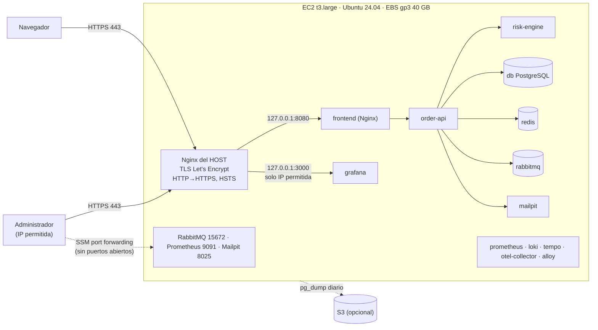

# Despliegue de POLYMER en AWS con HTTPS

> **Estado:** diseño y archivos preparados y probados localmente (sintaxis y comportamiento del Nginx del
> host). **No se ha creado ningún recurso de AWS** ni se ha desplegado nada: requiere tu aprobación, tu
> cuenta y, para HTTPS con Let's Encrypt, un dominio. Ningún comando de esta guía se ejecuta solo.

## 1. Arquitectura elegida: una instancia EC2 con Docker Compose



**Por qué EC2 + Compose y no ECS/EKS:** es exactamente el entorno que ya se verifica en el CI
(13 contenedores, healthchecks, volúmenes) y en Windows; el coste es predecible y no hay que reescribir
nada. Kubernetes (manifiestos en `k8s/`) y ECS quedan como evolución, no como requisito.

**Qué se publica a Internet:** solo los puertos **80 y 443 del Nginx del host**. Todos los contenedores
publican sus puertos en `127.0.0.1` (ya es así en `docker-compose.yml`); PostgreSQL, Redis y AMQP ni
siquiera tienen puerto en el host.

## 2. Dimensionamiento

| Recurso | Estimación | Fundamento |
| --- | --- | --- |
| **RAM** | 8 GiB | Límites de los 13 contenedores = 4,5 GB (`mem_limit`: order-api 768m, db 512m, rabbitmq 512m, risk-engine/prometheus/grafana/loki/tempo 384m c/u, otel-collector/alloy 256m, redis/mailpit 96m, frontend 64m) + sistema, Docker, Nginx y la **compilación** de las imágenes (Maven) |
| **CPU** | 2 vCPU (ráfaga) | Carga de demostración; la compilación inicial es lo más pesado |
| **Disco** | 40 GB gp3 | Imágenes (~4–5 GB), caché de Docker, volúmenes (PostgreSQL, Prometheus 7 d, Loki, Tempo) y copias locales |
| **Instancia** | `t3.large` (2 vCPU, 8 GiB, x86_64) | `t3.medium` (4 GiB) no alcanza para los 13 contenedores con margen; x86_64 evita dudas de compatibilidad de imágenes |
| **Región** | `us-east-1` (más barata) o `sa-east-1` (São Paulo, menor latencia desde Perú, más cara) | Elige según presupuesto |

## 3. Costo mensual estimado (us-east-1, bajo demanda, 730 h)

| Concepto | Precio de referencia | Mes |
| --- | --- | --- |
| EC2 `t3.large` Linux | ≈ 0,0832 USD/h | ≈ 60,7 USD |
| EBS gp3 40 GB | ≈ 0,08 USD/GB-mes | ≈ 3,2 USD |
| IPv4 pública (IP elástica) | 0,005 USD/h | ≈ 3,65 USD |
| Snapshots EBS (~10 GB incrementales) | ≈ 0,05 USD/GB-mes | ≈ 0,5 USD |
| S3 para copias (< 5 GB) | | < 0,2 USD |
| Route 53: zona alojada (opcional) | 0,50 USD/zona | 0,5 USD |
| Dominio `.com` (opcional) | ≈ 13–15 USD/año | ≈ 1,2 USD |
| **Total aproximado** | | **≈ 70 USD/mes** |

Precios de referencia obtenidos de fuentes públicas en noviembre de 2026: **confírmalos en la
[calculadora oficial de AWS](https://calculator.aws/)** antes de aprobar el gasto. Detener la instancia
cuando no se usa elimina el cargo de cómputo (EBS e IP siguen cobrándose). Un *Savings Plan* reduce el
cómputo si el uso es continuo.

## 4. Certificados y dominio

**Con dominio (recomendado):** HTTPS válido con **Let's Encrypt** (gratis, renovación automática con
`certbot`). Registros DNS (los nombres son ejemplos; no se inventa ningún dominio real):

| Tipo | Nombre | Valor |
| --- | --- | --- |
| A | `tienda.tudominio.com` | IP elástica de la instancia |
| A | `grafana.tudominio.com` | la misma IP elástica |
| CAA (opcional) | `tudominio.com` | `0 issue "letsencrypt.org"` |

**Sin dominio:** Let's Encrypt necesita un nombre de dominio que controles. Opciones:

| Opción | HTTPS válido | Limitaciones |
| --- | --- | --- |
| Comprar un dominio barato | Sí | ≈ 13–15 USD/año |
| Subdominio de DNS dinámico gratuito (p. ej. DuckDNS) + Let's Encrypt | Sí | Dependes de un tercero; nombre poco profesional |
| **Amazon CloudFront** delante de la instancia (`https://dXXXX.cloudfront.net`) | Sí, con el certificado de AWS | Hay que desactivar la caché para la API y las páginas, reenviar cookies y cabeceras (`Host`, `X-Forwarded-Proto`) y proteger el origen; añade complejidad |
| Nombre público de EC2 (`ec2-…amazonaws.com`) | No de forma fiable | Let's Encrypt no emite certificados para esos nombres de forma práctica |
| Certificado autofirmado | **No** (el navegador avisa) | Solo para pruebas |

## 5. Seguridad

| Requisito | Cómo se cumple |
| --- | --- |
| HTTPS válido | Let's Encrypt en el Nginx del host (`infra/aws/nginx-host-polymer.conf`) |
| HTTP → HTTPS | `return 301 https://$host$request_uri` (probado: 301) |
| Servicios internos no expuestos | Contenedores solo en `127.0.0.1`; *security group* solo con 80/443 |
| Grafana con autenticación | Inicio de sesión de Grafana (`GF_AUTH_ANONYMOUS_ENABLED=false`, sin registro) + lista de IP permitidas en Nginx (probado: 403 desde otra IP) + cookie `Secure` (`infra/aws/compose.aws.yml`) |
| RabbitMQ Management protegido | No se publica; acceso con **SSM port forwarding** (o túnel SSH); además pide usuario y contraseña |
| PostgreSQL y Redis sin puerto público | No tienen puerto ni en el host (redes internas `data` y `cache`) |
| Prometheus, Loki, Tempo | No se publican; Prometheus por SSM; Loki y Tempo se consultan **desde Grafana** |
| API del laboratorio `POST /api/orders` (pública desde la v1) | Bloqueada en el Nginx del host salvo la IP de administración (probado: 403) |
| Credenciales fuera del repositorio | `secrets/` excluido de Git y del ZIP; se generan **en la instancia** (independientes de las locales) |
| Cookie de sesión segura | `SERVER_SERVLET_SESSION_COOKIE_SECURE=true` (`compose.aws.yml`) |
| URLs canónicas con https | El gateway conserva `X-Forwarded-Proto` del Nginx del host (`infra/frontend/nginx.conf`; probado) |
| Correo | Mailpit es un **capturador** de correo: en AWS no envía correos reales. Enviar correo real requeriría Amazon SES (no configurado) |

### Secretos en AWS

- Se generan en la instancia: `pwsh tools/polymer.ps1 secrets` (aleatorios) o `-Memorable`. **Nunca se
  copian los de tu equipo**: producción y local son independientes.
- Copia de recuperación cifrada en **SSM Parameter Store** (`SecureString`, parámetros estándar sin coste):

  ```bash
  aws ssm put-parameter --name /polymer/prod/db_password --type SecureString --value file://secrets/db_password.txt
  ```

  (Repite para `grafana_password`, `rabbitmq_password` y `demo_password`. `file://` evita que el valor
  aparezca en la línea de comandos.) Restaurar:

  ```bash
  aws ssm get-parameter --name /polymer/prod/db_password --with-decryption --query Parameter.Value --output text > secrets/db_password.txt
  ```

- **Secrets Manager** (≈ 0,40 USD/secreto/mes) aporta rotación automática, pero la rotación de
  PostgreSQL/Grafana/RabbitMQ debe hacerse con `change-password`, que actualiza el servicio **y** el
  archivo. Para este proyecto basta Parameter Store.
- **«Continuar con Google» en producción (v8):** crea en Google Cloud un cliente OAuth **distinto** del local
  (tipo *Aplicación web*), con origen `https://TU_DOMINIO` y URI de retorno
  `https://TU_DOMINIO/login/oauth2/code/google`; publica la app (o añade usuarios de prueba). En la instancia:
  copia su JSON a `secrets/google-oauth.json` por un canal privado (por ejemplo `aws ssm put-parameter --type
  SecureString --value file://google-oauth.json` y `get-parameter … > secrets/google-oauth.json`; nunca por Git),
  y en `.env`: `POLYMER_PUBLIC_URL=https://TU_DOMINIO`. Si el proxy no conservara el host,
  `POLYMER_GOOGLE_REDIRECT_URI=https://TU_DOMINIO/login/oauth2/code/google`. `pwsh tools/polymer.ps1 google -AssumeYes`
  comprueba que la URI de producción está registrada en el JSON y que el botón redirige a Google; `order-api`
  también avisa en su log si falta.
- Recuerda: el archivo de `secrets/` y la contraseña **guardada dentro del volumen** del servicio deben
  coincidir. Para cambiarla: `pwsh tools/polymer.ps1 change-password -Service db|grafana|rabbitmq`.

## 6. Pasos (cuando lo apruebes)

### 6.1 En la consola de AWS (genera costos)

1. **EC2 → Launch instance:** Ubuntu Server 24.04 LTS (x86_64), `t3.large`, disco gp3 40 GB cifrado.
2. **Rol IAM** de la instancia: `AmazonSSMManagedInstanceCore` (acceso sin SSH) y, si usarás S3, permiso
   `s3:PutObject` sobre el bucket de copias.
3. **Security group:** entrada TCP 80 y 443 desde `0.0.0.0/0` (y `::/0`). **Sin puerto 22** (usa Session
   Manager) o, si prefieres SSH, 22 solo desde tu IP.
4. **IP elástica** asociada a la instancia y registros DNS de la sección 4.

### 6.2 Dentro de la instancia (Session Manager)

```bash
git clone https://github.com/TU_USUARIO/TU_REPOSITORIO.git polymer && cd polymer
```

```bash
sudo bash infra/aws/bootstrap-ubuntu.sh
```

(Docker Engine + Compose, Nginx, certbot, PowerShell, actualizaciones automáticas. Vuelve a entrar.)

```bash
cp .env.example .env && nano .env
```

(Pon `POLYMER_DOMAIN`, `POLYMER_GRAFANA_DOMAIN` y `LETSENCRYPT_EMAIL`. Añade
`COMPOSE_FILE=docker-compose.yml:infra/aws/compose.aws.yml` para que `docker compose` use el override.)

```bash
pwsh tools/polymer.ps1 secrets
```

```bash
docker compose --profile full up -d --build --wait
```

(La primera vez compila las imágenes con sus pruebas: varios minutos.)

### 6.3 Certificado y Nginx del host

1. Certificado de Let's Encrypt. Como la plantilla de Nginx usa los archivos del certificado, se obtiene
   primero en modo `standalone`; los ganchos detienen Nginx unos segundos y lo vuelven a arrancar, y
   quedan guardados para las **renovaciones automáticas**:

   ```bash
   sudo certbot certonly --standalone -d tienda.tudominio.com -d grafana.tudominio.com --email TU_CORREO@ejemplo.com --agree-tos --no-eff-email --pre-hook "systemctl stop nginx" --post-hook "systemctl start nginx"
   ```

2. Copia la plantilla, sustituye `TIENDA.EJEMPLO.COM`, `GRAFANA.EJEMPLO.COM` (el certificado se guarda en
   la carpeta del **primer** dominio) y la IP de administración `203.0.113.10/32`:

   ```bash
   sudo cp infra/aws/nginx-host-polymer.conf /etc/nginx/sites-available/polymer.conf && sudo nano /etc/nginx/sites-available/polymer.conf
   ```

3. Activa el sitio, comprueba y recarga:

   ```bash
   sudo ln -sf /etc/nginx/sites-available/polymer.conf /etc/nginx/sites-enabled/polymer.conf && sudo nginx -t && sudo systemctl reload nginx
   ```

4. Renovación: el paquete `certbot` instala un temporizador de systemd que usa los mismos ganchos.
   Compruébalo con `sudo certbot renew --dry-run`.

### 6.4 Comprobaciones

```bash
docker compose ps
```

```bash
curl -I http://tienda.tudominio.com
```

(Debe responder `301` hacia `https://`.)

```bash
curl -s https://tienda.tudominio.com/sitemap.xml | head
```

(Las URL deben empezar por `https://tienda.tudominio.com`.)

Desde tu equipo, interfaces internas sin abrir puertos (requiere AWS CLI y el plugin de Session Manager):

```powershell
aws ssm start-session --target i-XXXXXXXX --document-name AWS-StartPortForwardingSession --parameters "portNumber=15672,localPortNumber=15672"
```

(RabbitMQ en http://127.0.0.1:15672; igual con 9091 para Prometheus y 8025 para Mailpit.)

## 7. Operación

| Tema | Procedimiento |
| --- | --- |
| **Reinicio automático** | `restart: unless-stopped` en los 13 servicios + `systemctl enable docker`: vuelven solos tras reiniciar la instancia |
| **Healthchecks** | Los mismos de Compose; `docker compose ps` muestra `healthy` |
| **Logs y métricas** | Grafana (`https://grafana.tudominio.com`): Loki para logs, Tempo para trazas, Prometheus para métricas y los 8 dashboards |
| **Copias** | `bash infra/aws/backup.sh` (pg_dump + SHA-256 + S3 opcional). Cron diario: `15 3 * * * cd /home/ubuntu/polymer && bash infra/aws/backup.sh >> /var/log/polymer-backup.log 2>&1` |
| **Copias verificables** | `bash infra/aws/backup-verify.sh /var/backups/polymer/polymer-orders-<fecha>.dump`: restaura en una base **temporal** `polymer_restore_check`, compara recuentos con la real y la elimina. Nunca toca `orders` |
| **Snapshots** | *Data Lifecycle Manager* con snapshots diarios del volumen EBS (retención 7) |
| **Actualizar** | 1) `bash infra/aws/backup.sh`; 2) `git fetch --tags && git checkout vX.Y.Z`; 3) `docker compose --profile full up -d --build --wait`; 4) comprobaciones de 6.4. Los volúmenes se conservan |
| **Rollback** | Sin migración nueva de base de datos: `git checkout <versión anterior>` y `docker compose --profile full up -d --build --wait`. **Con** migración Flyway nueva: Flyway no admite volver atrás (un código antiguo rechaza una base migrada); restaura la copia previa en una base nueva y conmuta, o restaura el snapshot EBS anterior a la actualización |
| **Nunca** | `docker compose down -v`, `stop -RemoveData`, abrir 5432/6379/5672 en el *security group* |

## 8. Lo que no se ha verificado

- No se ha creado la instancia ni se ha ejecutado esta guía en AWS (falta tu aprobación, cuenta y dominio).
- Los precios son de referencia; confírmalos en la calculadora de AWS.
- Verificado localmente: la plantilla del Nginx del host (`nginx -t` con Nginx 1.24, la versión de
  Ubuntu 24.04) y su comportamiento con certificados de prueba (301, proxy TLS con `X-Forwarded-Proto: https`,
  403 en `/api/orders` y Grafana desde una IP no permitida, HSTS); el gateway conserva `https`; la
  sintaxis de los scripts `bash`.
