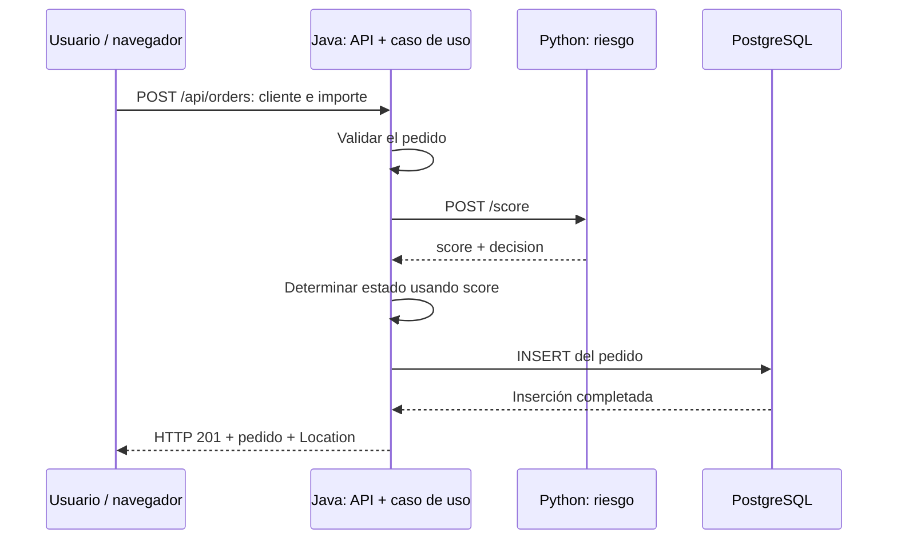

# Guía para enseñar y defender POLYMER

Preparada el 21 de octubre de 2026 a partir del código del proyecto. Pensada para alguien con conocimientos básicos de programación que todavía no domina Docker ni arquitectura hexagonal.

## 1. Qué debes conseguir al explicárselo

El objetivo es que pueda seguir un pedido desde el formulario hasta la base de datos, identificar dónde vive cada regla y demostrarlo. No necesita memorizar todo el YAML ni cada dependencia de Maven.

Enseña en este orden: **problema → recorrido de un pedido → responsabilidades → arquitectura → contenedores → monitoreo → demostración**. Al terminar cada bloque, pídele que lo explique con sus palabras y que señale un archivo o una evidencia. Saber repetir una definición no basta para defender el proyecto.

## 2. Explicación inicial, en 30 segundos

«POLYMER es un sistema que registra pedidos y calcula su nivel de riesgo. El usuario introduce un cliente y un importe. Java recibe la solicitud, pide a Python que calcule el riesgo, determina si el pedido se aprueba o requiere revisión y lo guarda en PostgreSQL. Docker Compose permite levantar todos los servicios juntos. Prometheus recoge métricas y Grafana las representa. La arquitectura hexagonal mantiene las reglas de negocio independientes de esas tecnologías».

El riesgo es una **regla de demostración basada en el importe**. No es inteligencia artificial ni una probabilidad de fraude obtenida de datos reales. `REVIEW` significa revisión, no rechazo del pedido. No se realizan pagos, despachos ni comprobaciones de identidad.

## 3. Vocabulario que necesita dominar

| Concepto | Explicación sencilla | Ejemplo del proyecto |
|---|---|---|
| Servicio | Programa con una responsabilidad y proceso propios. | Java atiende pedidos; Python calcula riesgo. |
| API | Operaciones que un programa ofrece a otro. | Crear o consultar un pedido por HTTP. |
| Endpoint | Ruta concreta de una API. | `POST /api/orders`. |
| HTTP | Protocolo con el que se envían solicitudes y respuestas. | Java llama a Python por HTTP. |
| JSON | Formato de los datos intercambiados. | `{"customerId":"demo-001","amount":125.50}`. |
| Dominio | Conceptos y reglas del negocio. | Pedido, importe válido y decisión por score. |
| Caso de uso | Secuencia que ejecuta una operación del negocio. | Evaluar riesgo y registrar pedido. |
| Puerto hexagonal | Contrato de software que ofrece o necesita el núcleo. | Interfaz `OrderRepository`. |
| Adaptador | Código que conecta un contrato con una tecnología. | `JdbcOrderRepository` usa PostgreSQL. |
| Imagen Docker | Paquete con aplicación y dependencias para ejecutarla. | Imagen construida de `order-api`. |
| Contenedor | Ejecución de una imagen. | El proceso Java en funcionamiento. |
| Dockerfile | Instrucciones para construir una imagen. | Compilar Java y copiar el JAR al runtime. |
| Compose | Definición de cómo arrancar y conectar varios contenedores. | `docker-compose.yml`. |
| Volumen | Almacenamiento independiente de la vida del contenedor. | `postgres_data`. |
| Métrica | Medición numérica a lo largo del tiempo. | Pedidos creados o duración de una solicitud. |
| Log | Registro textual de eventos del proceso. | Salida de `docker compose logs`. |

**Un puerto hexagonal y un puerto TCP son cosas distintas.** `OrderRepository` es un contrato de código; `8080` es un número utilizado para comunicar procesos por red.

## 4. Los cinco servicios y sus responsabilidades

| Servicio en Compose | Qué hace | Qué necesita conocer el alumno |
|---|---|---|
| `order-api` | Expone la interfaz web y API, coordina el caso de uso y guarda pedidos. | Java 21, Spring Boot, API en 8080 y gestión en 9090. |
| `risk-engine` | Responde evaluaciones de riesgo. | Python, FastAPI, puerto interno 8000. No accede a PostgreSQL. |
| `db` | Conserva los pedidos. | PostgreSQL, puerto interno 5432, base y usuario `orders`. |
| `prometheus` | Consulta métricas de Java, Python y de sí mismo cada 10 segundos. | No crea pedidos ni toma decisiones del negocio. |
| `grafana` | Presenta las métricas mediante un dashboard. | Consulta Prometheus; no consulta la tabla de pedidos. |

La interfaz web está dentro de Java: no existe un sexto contenedor frontend. La base de datos no tiene interfaz gráfica incluida. Para esta práctica, Grafana usa su almacenamiento interno para configuración; PostgreSQL almacena los pedidos.

## 5. Dibujar el recorrido antes de abrir el código



Este diagrama representa ejecución. La arquitectura también impone una dirección de dependencias del código: los adaptadores importan los contratos del núcleo; el núcleo no importa los adaptadores.

## 6. Seguir un ejemplo exacto

Pedido de entrada:

```json
{"customerId":"demo-001","amount":125.50}
```

1. El navegador envía `POST /api/orders` a Java. También puede hacerse con PowerShell; el formulario no es obligatorio para utilizar la API.
2. `OrderController` transforma el JSON y construye `OrderDraft`. Si no se envía moneda, usa USD.
3. El dominio valida: cliente con 1–64 letras, números, guiones o guiones bajos; importe mayor que cero y hasta un millón; máximo dos decimales; moneda USD.
4. `OrderService` pide una evaluación a `RiskAssessmentPort`.
5. El adaptador HTTP implementa ese puerto y envía `{customerId, amount}` a `http://risk-engine:8000/score`.
6. FastAPI recibe la solicitud. Su adaptador convierte los datos a objetos del dominio; el caso de uso Python ejecuta la regla y devuelve score 10 y decisión `APPROVED`.
7. El adaptador Java valida la respuesta y entrega el score al caso de uso. Java conserva la autoridad sobre el estado final: desde 70, `REVIEW`; por debajo, `APPROVED`.
8. Java genera un UUID y una fecha UTC. `OrderRepository` permite guardar el pedido; su adaptador JDBC ejecuta un INSERT en PostgreSQL.
9. Tras guardar, se incrementa la métrica de pedidos creados y se responde `201 Created`, con el pedido y su cabecera `Location`.
10. El navegador muestra el resultado y vuelve a consultar los últimos pedidos con `GET /api/orders`.

La comunicación Java–Python es **síncrona**: Java espera la respuesta antes de guardar. No hay cola ni worker que procese después. La llamada tiene timeout de conexión de 2 s y lectura de 3 s, sin reintentos automáticos. Esos límites son de fases de la llamada, no un plazo global exacto de cinco segundos para toda la operación.

## 7. Reglas y resultados que debe poder predecir

| Importe USD | Score Python | Estado final Java |
|---|---:|---|
| Mayor que 0 y menor que 500 | 10 | `APPROVED` |
| Desde 500 y menor que 1000 | 40 | `APPROVED` |
| Desde 1000 y hasta 1 000 000 | 75 | `REVIEW` |

Ejemplos: 125.50 → 10/aprobado; 500 → 40/aprobado; 999.99 → 40/aprobado; 1000 → 75/revisión. El umbral Java es 70 aunque la regla actual Python produzca solamente 10, 40 o 75.

Java usa `BigDecimal`, Python `Decimal` y PostgreSQL `NUMERIC(12,2)`. La validación evita redondear silenciosamente entradas con más de dos decimales. El score 75 es un puntaje de la regla, **no demuestra una probabilidad de fraude del 75 %**.

La respuesta contiene: `id` (UUID), `customerId`, `amount`, `currency`, `riskScore`, `status` y `createdAt`. El listado devuelve hasta 50 pedidos, ordenados del más reciente al más antiguo. `GET /api/orders/statistics` devuelve los totales de todos los pedidos persistidos (`total`, `approved`, `review`), que el panel de la interfaz muestra.

| Respuesta HTTP de la API Java | Significado |
|---|---|
| `201` | Pedido creado y persistido. |
| `200` | Consulta correcta. |
| `400` | JSON, tipos, importe, cliente, moneda o UUID inválidos. |
| `404` | UUID válido que no corresponde a un pedido existente. |
| `503` | No se pudo completar por falla de riesgo o persistencia. |

La API interna Python usa 422 para datos de evaluación inválidos. No confundas sus respuestas con las de la API pública Java.

## 8. Mostrar dónde está la arquitectura hexagonal

Usa esta analogía: el negocio pide «guarda este pedido» mediante un contrato. Un adaptador sabe cómo hacerlo usando SQL. El caso de uso no necesita conocer la sentencia SQL ni la conexión.

| Capa Java | Archivos principales | Qué explicar |
|---|---|---|
| Dominio | `domain/OrderDraft.java`, `Order.java`, `OrderStatus.java` | Datos, validaciones y regla de estado. |
| Aplicación | `application/service/OrderService.java` | Coordina riesgo, creación, persistencia y telemetría. |
| Puerto de entrada | `application/port/in/OrderUseCases.java` | Ofrece crear, buscar y listar pedidos. |
| Puertos de salida | `RiskAssessmentPort`, `OrderRepository`, `OrderTelemetry` | Contratos que necesita el caso de uso. |
| Adaptador de entrada | `adapter/in/web/OrderController.java` | Traduce HTTP al caso de uso. |
| Adaptadores de salida | `HttpRiskAssessmentAdapter`, `JdbcOrderRepository`, `MicrometerOrderTelemetry` | Implementan HTTP, persistencia y métricas. |
| Composición | `config/HexagonalConfiguration.java` | Selecciona e inyecta las implementaciones concretas. |

Todos esos caminos Java parten de `services/order-api/src/main/java/com/polymer/`.

En Python, parte de `services/risk-engine/risk_engine/`: `adapters/http.py` recibe HTTP; `application/ports.py` define `ScoreRiskPort`; `application/score_risk.py` contiene el caso de uso; `domain/risk.py` conserva la regla; `bootstrap.py` conecta los componentes. Python no necesita un puerto de salida artificial: su cálculo no llama a otra infraestructura.

Pídele abrir `OrderService.java` y señalar `riskAssessment.assess(draft)` y `repository.save(order)`. Después debe observar que no hay imports de Spring, SQL o adaptadores. Las interfaces pertenecen al núcleo; las implementaciones concretas viven fuera. Eso explica la inversión de dependencias.

La hexagonalidad está comprobada con reglas ArchUnit en Java y análisis AST de imports Python. Los tests de negocio usan dobles de los puertos. No todos los tests son unitarios: también hay pruebas de adaptadores HTTP y arquitectura.

Cambiar PostgreSQL por otro almacenamiento exigiría otro adaptador, consultas y migraciones compatibles; el objetivo es conservar el caso de uso y el dominio. No prometas una sustitución de base totalmente gratuita.

## 9. Qué debe saber leer del YAML

`docker-compose.yml` es el archivo ejecutable y autosuficiente. Para enseñar su estructura sin recorrer todo el código embebido, puedes abrir `infra/compose.base.yml`, pero **esa plantilla tiene marcadores y no es el archivo que se despliega**.

| Clave | Explicación para la defensa |
|---|---|
| `name` | Nombre del proyecto Compose. |
| `x-runtime`, `&runtime`, `<<: *runtime` | Extensión y ancla para reutilizar configuración común. |
| `services` | Los cinco programas o componentes que se levantan. |
| `image` | Imagen utilizada o nombre asignado al resultado del build. |
| `build.dockerfile_inline` | Instrucciones y fuentes para construir Java y Python desde el YAML. |
| `environment` | Nombres DNS, puertos, rutas de secretos y opciones de ejecución. |
| `depends_on` + `service_healthy` | Espera la salud inicial de las dependencias declaradas. |
| `healthcheck` | Orden que verifica si el servicio responde. No demuestra todo el negocio. |
| `ports` | Relaciona puerto del host y del contenedor. |
| `networks` | Conecta los servicios que necesitan comunicarse. |
| `volumes` | Conserva datos aunque se recree un contenedor. |
| `secrets` | Concede a servicios archivos con contraseñas suministradas por el operador. |
| Imágenes de monitoreo inline | Prometheus y Grafana se construyen con su configuración dentro, compatibles con `read_only`. |
| `restart` | Política al terminar el proceso; no reinicia por sí sola un proceso vivo que está unhealthy. |
| `mem_limit`, `cpus` | Límites de recursos por servicio. |
| `read_only`, `cap_drop`, `security_opt` | Reducen permisos de las aplicaciones y herramientas de monitoreo. |

En `127.0.0.1:9091:9090`: `127.0.0.1` limita el acceso al propio host, `9091` es el puerto del host y `9090` el de Prometheus dentro del contenedor.

Java encuentra Python por `risk-engine:8000` y la base por `db:5432`: Docker resuelve esos nombres. `localhost` dentro de Java representa su propio contenedor, no Python. Los puertos internos no necesitan publicarse al host para que los servicios conectados se comuniquen.

El archivo generado es grande porque incluye código, tests y configuración para cumplir la entrega de un solo YAML. Los fuentes separados facilitan el estudio y la edición. Si se editan, `python tools/generate_delivery.py` actualiza el entregable. Java y Python locales no son necesarios para desplegar: se usan dentro de sus builds Docker. El generador solo se necesita al editar y reempaquetar el repositorio.

## 10. Preparar una demostración antes de enseñarla

El registro de validación documenta 32 pruebas Java y 59 Python aprobadas, además de validación Compose y Kubernetes. Desde el 1 de noviembre de 2026, GitHub Actions ejecuta en cada push la integración completa de los cinco contenedores (smoke HTTP y HTTP 503 incluidos) y comprueba los scripts en Windows. Aun así, **ensaya la demostración en la máquina donde vas a presentarla**.

En una máquina con Docker Desktop iniciado (contenedores Linux, Compose >= 2.23.1 y BuildKit), abre PowerShell o CMD en la carpeta del proyecto:

```powershell
Set-Location 'C:\Users\frank\Downloads\PROYECTO DOCKER'
.\polymer.cmd start
```

`polymer.cmd start` muestra cada etapa en pantalla; explica cada una: generar las contraseñas si faltan, validar la configuración, construir las imágenes ejecutando los tests, arrancar esperando a que los servicios estén sanos y mostrar el estado y las direcciones. Si quieres enseñar los comandos de Docker uno a uno, son estos:

```powershell
.\tools\init-env.ps1
docker compose version
docker compose config --quiet
docker compose build --pull
docker compose up -d --wait --wait-timeout 240
docker compose ps
```

Antes de la sesión puedes ejecutar `.\polymer.cmd verify` para repetir en tu equipo la misma prueba integral que pasa en GitHub (requiere tener detenido el entorno con `.\polymer.cmd stop`). El primer build descarga imágenes y dependencias: hazlo antes de la sesión para no depender del tiempo de descarga durante la explicación.

El script crea `secrets\db_password.txt` y `secrets\grafana_password.txt` si no existen (reutiliza las contraseñas de un `.env` anterior). Compose los monta como archivos de solo lectura; no hace falta cargar nada en cada terminal nueva. Si una política de PowerShell impide ejecutarlo, revisa esa restricción antes de la sesión; no cambies políticas de todo el equipo sin necesidad. `secrets/` debe conservarse privado y está excluido de Git. No lo proyectes ni lo incluyas en capturas.

Accesos: aplicación `http://127.0.0.1:8080`; Grafana `http://127.0.0.1:3000/d/polymer`; targets Prometheus `http://127.0.0.1:9091/targets`; alertas `http://127.0.0.1:9091/alerts`. Grafana utiliza `admin` y la contraseña generada para esa instalación.

## 11. Demostración guiada con evidencias

### A. Crear un pedido aprobado y consultarlo

```powershell
$body = @{ customerId = 'demo-001'; amount = 125.50 } | ConvertTo-Json
$pedido = Invoke-RestMethod http://127.0.0.1:8080/api/orders -Method Post -ContentType 'application/json' -Body $body
$pedido
Invoke-RestMethod "http://127.0.0.1:8080/api/orders/$($pedido.id)"
```

Resultado esperado: score 10, estado `APPROVED`, un UUID y la misma identidad al consultar. Pregunta: «¿Quién calculó el score, quién decidió el estado y quién lo guardó?».

### B. Crear un pedido en revisión

```powershell
$body = @{ customerId = 'demo-002'; amount = 1500 } | ConvertTo-Json
Invoke-RestMethod http://127.0.0.1:8080/api/orders -Method Post -ContentType 'application/json' -Body $body
```

Resultado esperado: score 75 y `REVIEW`. Predice el resultado antes de ejecutar. Haz una tercera prueba con importe 500 para comprobar el límite de la regla.

### C. Mostrar la persistencia real

```powershell
docker compose exec -T db psql -U orders -d orders -c "SELECT customer_id, amount, risk_score, status, created_at FROM orders ORDER BY created_at DESC LIMIT 5;"
```

La consulta SQL ofrece una evidencia directa de lo guardado. Flyway crea el esquema al iniciar Java; no se requiere crear la tabla manualmente. PostgreSQL también aplica restricciones de importe, moneda, score y coherencia de estado.

### D. Enviar un dato inválido

```powershell
$invalido = @{ customerId = 'demo-001'; amount = 0 } | ConvertTo-Json
try {
    Invoke-RestMethod http://127.0.0.1:8080/api/orders -Method Post -ContentType 'application/json' -Body $invalido
} catch {
    $_.Exception.Message
}
```

Resultado esperado: HTTP 400. Debe explicar qué regla lo impide y dónde está. Hazlo por la API: las validaciones del formulario pueden bloquear antes el envío y ocultar el comportamiento del backend.

### E. Detener Python y comprobar el manejo del fallo

```powershell
$antes = docker compose exec -T db psql -U orders -d orders -tAc "SELECT count(*) FROM orders;"
docker compose stop risk-engine
$body = @{ customerId = 'fallo-demo'; amount = 125.50 } | ConvertTo-Json
try {
    Invoke-RestMethod http://127.0.0.1:8080/api/orders -Method Post -ContentType 'application/json' -Body $body
} catch {
    $_.Exception.Message
}
$despues = docker compose exec -T db psql -U orders -d orders -tAc "SELECT count(*) FROM orders;"
"Filas antes: $antes / después: $despues"
Invoke-RestMethod http://127.0.0.1:8080/api/orders
docker compose start risk-engine
docker compose up -d --wait --wait-timeout 120
```

En una demo sin otras escrituras concurrentes, el número de filas debe permanecer igual tras el intento que devuelve 503. La consulta de pedidos existentes puede seguir funcionando: no necesita calcular riesgo. Restablece Python antes de continuar.

Si deseas observar la alerta de servicio caído, mantén Python detenido hasta que Prometheus complete varios scrapes y transcurran los 30 segundos de condición sostenida de la regla. Su aparición no es instantánea. Las alertas se muestran en Prometheus; no se envía correo ni mensajería.

### F. Mostrar conservación de datos

```powershell
.\polymer.cmd stop
.\polymer.cmd start
Invoke-RestMethod http://127.0.0.1:8080/api/orders
```

Resultado esperado: los pedidos siguen presentes en el volumen. No añadas `-RemoveData` (equivale a `docker compose down -v`): elimina los datos. Reiniciar o recrear un contenedor no equivale a eliminar su volumen. Conserva las contraseñas de `secrets/`: cambiarlas no rota automáticamente una base ya inicializada.

### G. Ver métricas y diferenciarlas de los datos del negocio

En Prometheus comprueba los tres targets UP. En la pantalla de consultas prueba:

```promql
up{job=~"order-api|risk-engine"}
```

```promql
sum by (status) (orders_created_total)
```

```promql
orders_risk_failures_total
```

Luego muestra el dashboard Grafana. Genera solicitudes durante al menos 30 segundos: tasas e histogramas necesitan tráfico y varias muestras. El p95 es una estimación de la duración por debajo de la cual quedan aproximadamente el 95 % de las observaciones. Con pocas solicitudes puede ser poco informativo.

Los contadores se reinician al reiniciar el proceso: no equivalen al total histórico de filas. `up=1` indica que Prometheus pudo recopilar métricas; Java puede seguir UP aunque una creación falle por caída de Python. Las sondas readiness Java incluyen DB, mientras que Python se observa mediante sus propias sondas y target.

## 12. Qué evidencias debes reunir

| Evidencia que debes sacar | Qué permite explicar |
|---|---|
| Captura de `docker compose ps` con los cinco servicios | Procesos y salud observada durante el ensayo. |
| Respuesta de un pedido de 125.50 y otro de 1500 | Integración de reglas, API y estados. |
| SELECT de PostgreSQL | Datos persistidos y columnas reales. |
| Respuesta 400 y validación de `OrderDraft` | Reglas del dominio, más allá del formulario. |
| Respuesta 503 y conteos antes/después | Fallo controlado sin inserción después de una falla de riesgo. |
| `OrderService`, interfaces y adaptadores | Separación hexagonal y dirección de dependencias. |
| Reportes de tests, si se ejecutaron | Reglas y arquitectura comprobadas, con alcance explícito. |
| Targets Prometheus y dashboard Grafana | Observabilidad configurada y datos del ensayo. |
| Consulta después de `down` y nuevo `up` | Persistencia mediante volumen. |
| Manifiestos de `k8s/` | Adaptación adicional; no afirmar despliegue si no se realizó. |

No uses capturas de contraseñas. Si una comprobación no se ejecutó o falló, anótalo y conserva el diagnóstico; no presentes el resultado esperado como resultado observado.

## 13. Orden para abrir archivos durante la enseñanza

1. `README.md`: propósito, accesos y arranque.
2. La interfaz web (`services/order-api/src/main/resources/static/`): `index.html`, `js/orders.js` (formulario que inicia el recorrido) y `js/architecture.js` (explorador con las clases reales). Sección **Arquitectura → Ejecutar solicitud real** para recorrer las capas con un pedido real.
3. Java `adapter/in/web/OrderController.java`: entrada HTTP.
4. Java `domain/OrderDraft.java` y `OrderStatus.java`: validación y decisión.
5. Java `application/service/OrderService.java`: secuencia completa.
6. Java `application/port/in/` y `application/port/out/`: contratos.
7. Java `adapter/out/http/HttpRiskAssessmentAdapter.java`: llamada a Python.
8. Python `risk_engine/domain/risk.py`: regla de score.
9. Java `adapter/out/persistence/JdbcOrderRepository.java` y migración `V1__create_orders.sql`: persistencia.
10. Java `config/HexagonalConfiguration.java` y Python `bootstrap.py`: conexión de implementaciones.
11. `infra/compose.base.yml` y después `docker-compose.yml`: empaquetado y operación.
12. `infra/prometheus/` e `infra/grafana/`: observabilidad.
13. Pruebas de arquitectura de ambos servicios: evidencia de la regla de dependencias.

El árbol completo está en `docs/estructura.txt`. Los caminos Java abreviados de esta lista parten de `services/order-api/src/main/java/com/polymer/`; la migración parte de `src/main/resources/db/migration/` de ese servicio.

## 14. Preguntas para ensayar la defensa

**¿Qué problema resuelve el patrón hexagonal?** Aísla las reglas y casos de uso de HTTP, almacenamiento y frameworks mediante contratos y adaptadores.

**¿Dónde se demuestra en este proyecto?** En el núcleo sin imports de infraestructura, en los puertos, en los adaptadores externos y en sus pruebas de dependencias.

**¿Por qué hay Java y Python?** Para demostrar integración entre dos servicios y cumplir el alcance académico; no es una exigencia del patrón hexagonal. Java coordina pedidos y Python mantiene la regla de riesgo.

**¿Por qué no acceder a PostgreSQL desde Python?** El motor de riesgo actual es un cálculo independiente. Java conserva la responsabilidad sobre los pedidos; el cálculo no necesita consultar ni escribir esa base.

**¿Por qué Python devuelve decision si Java decide el estado?** Es parte de la respuesta del servicio de riesgo. El adaptador Java valida su formato y entrega el score; el dominio Java aplica su política de estado. El consumidor no delega la autoridad sobre su pedido.

**¿Qué pasa si Python está caído?** La creación falla con 503 antes de insertar. Se registra una falla de riesgo. Las consultas existentes pueden continuar si DB está disponible.

**¿Por qué no hay una transacción alrededor de toda la operación?** La llamada HTTP ocurre antes de la persistencia. El único INSERT es atómico en autocommit; así no se mantiene una transacción de base abierta mientras se espera una red.

**¿Se garantizan pedidos sin duplicados si se repite el POST?** No. Se genera un UUID para cada creación y no hay clave de idempotencia. Si el cliente pierde la respuesta y reintenta, puede crear otro pedido.

**¿Qué diferencia hay entre Docker y Compose?** Docker construye/ejecuta contenedores; Compose define su conjunto, configuración, redes y volúmenes.

**¿Por qué basta un YAML si normalmente se requieren fuentes?** Este YAML particular contiene Dockerfiles y fuentes embebidos, además de configuraciones. Eso es una decisión de empaquetado para la entrega, no una propiedad automática de todo Compose. Se necesitan Docker, red durante el build inicial y secretos del operador.

**¿Qué diferencia hay entre Prometheus y Grafana?** Prometheus recopila y almacena métricas; Grafana consulta esas métricas para mostrarlas. Los logs se consultan con Docker; no hay Loki configurado.

**¿Qué pasa si cae Grafana o Prometheus?** Se pierde esa capacidad de observación mientras están caídos; no participan en el recorrido de creación de pedidos.

**¿Por qué usar Flyway?** Para versionar y aplicar el esquema de base al iniciar Java, sin pasos SQL manuales separados.

**¿Qué aporta Kubernetes?** Manifiestos equivalentes con Services, Deployments, StatefulSet, PVC, ConfigMap, Secret y sondas. Es otra opción de despliegue, no una dependencia de Compose ni una garantía automática de alta disponibilidad.

**¿Qué tendría que cambiar para producción?** Autenticación, autorización, TLS, backups externos, idempotencia, separación de roles de DB y una estrategia de disponibilidad y actualización. La práctica usa una regla demostrativa y un host único en su despliegue Compose.

## 15. Errores conceptuales que debes corregir

- «Es hexagonal porque tiene varios contenedores». La hexagonalidad se refiere a las dependencias del código.
- «Hexagonal significa seis capas o servicios». El dibujo no impone esa cantidad.
- «Los puertos hexagonales son 8080 y 5432». Son contratos de código, distintos de los puertos TCP.
- «Python es un worker asíncrono o una IA». Es una API de reglas deterministas invocada de forma síncrona.
- «Score 75 significa 75 % de fraude». No hay modelo calibrado que respalde esa interpretación.
- «Grafana guarda pedidos o muestra logs por defecto». Aquí muestra métricas de Prometheus.
- «Un healthcheck prueba que todo funciona». La salud observada depende de qué comprueba la sonda.
- «Kubernetes ya está desplegado y da alta disponibilidad». Hay una adaptación básica; una réplica de DB no ofrece esa garantía.
- «Cambiar DB no requiere trabajo». Se mantiene el núcleo, pero hay que desarrollar y validar la nueva integración.
- «Los 91 tests prueban el arranque integral». Su alcance es distinto de ejecutar y probar los contenedores juntos.

## 16. Sesión sugerida de una hora

| Minutos | Actividad | Comprobación del aprendizaje |
|---|---|---|
| 0–5 | Propósito y pantalla de la aplicación. | Explica qué hace y qué no hace el sistema. |
| 5–15 | Dibuja el recorrido con un pedido de 125.50. | Identifica quién recibe, calcula, decide y guarda. |
| 15–30 | Abre dominio, caso de uso, puertos y adaptadores. | Señala una regla y un contrato; explica la dependencia. |
| 30–40 | Recorre Compose y ejecuta el arranque previamente ensayado. | Explica imagen, contenedor, puerto, red y volumen. |
| 40–50 | Pedidos aprobado/revisión, validación y caída de Python. | Predice estados y distingue 400 de 503. |
| 50–55 | Muestra DB, Prometheus y Grafana. | Distingue datos de negocio, métricas y logs. |
| 55–60 | El alumno hace una explicación de 3 minutos y responde preguntas. | Explica el recorrido sin leer y reconoce límites. |

Prueba final: dale un importe de 750 y pídele que prediga score/estado, localice la regla, cree el pedido, lo encuentre en DB y explique qué pasaría al detener Python. Si puede hacerlo y justificar cada paso, entiende el funcionamiento básico.

## 17. Qué material debes entregarle

La guía presente; `README.md`; `docs/presentacion.md` para el discurso; `docs/arquitectura.md` para detalle; `docs/estructura.txt`; `docs/validacion.md`; el YAML y los fuentes. Para publicación o nube utiliza `docs/github.md` y `docs/despliegue-cloud.md`. Los ejemplos empresariales y sus fuentes se conservan en `docs/fuentes.md`; al explicarlos, mantén la fecha y el alcance documentados.

Antes de una presentación debe tener guardados: un diagrama explicado con sus palabras, una ficha de los cinco servicios, tres pedidos de prueba con resultados esperados, las capturas del ensayo y respuestas a las preguntas de defensa. El guion ayuda a ordenar la exposición; la comprensión se comprueba siguiendo el pedido y justificando las decisiones.
